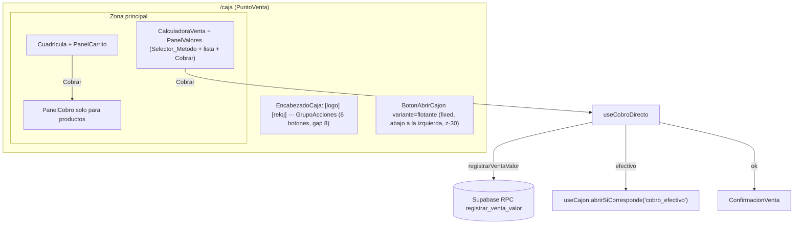

# Design Document: Ajustes de la Caja (botones en el encabezado, cajón flotante y cobro directo)

## Overview

Cuatro ajustes de UI sobre la spec `barra-acciones-caja`, sin cambios de base de datos:

1. Los 6 Botones_Accion vuelven al Encabezado_Caja como Grupo_Acciones, a la derecha, con separación de 8 px. Se quita la fila aparte y `altoDisponible` deja de restarla.
2. "Gastos" pasa a "Gastos/Pedidos" y "Retiro a caja mayor" a "Retiros", también en los títulos de `PanelGastos` y `DialogoRetiro`.
3. "Abrir cajón" pasa a un botón flotante en la esquina inferior izquierda (`BotonAbrirCajon variante="flotante"`).
4. La Calculadora registra la Venta_Por_Valor de una al tocar "Cobrar", con el método escogido arriba de la Lista_Valores. Se elimina la vista `cobrando-valor`.

| Capa | Archivo | Cambio |
|---|---|---|
| Dominio puro | `src/lib/caja/layout.ts` | `ENCABEZADO` reemplaza a `BARRA`; quitar `MEDIDAS.barraAcciones`; campos `encabezado`, `anchoBotonAccion`, `textoEnAcciones`, `cajonFlotante` |
| Dominio puro | `src/lib/caja/cobro.ts` | `metodoPorDefecto`, `metodoVigente`, `datosCobroDirecto`, `firmaCobroDirecto` |
| Hook | `src/hooks/caja/useClaveIdempotente.ts`, `src/hooks/caja/useCobroDirecto.ts` (nuevo) | Clave por firma bajo demanda; registro directo con manejo de errores |
| UI | `BarraAccionesCaja.tsx` → grupo del encabezado, `EncabezadoCaja.tsx`, `BotonAbrirCajon.tsx`, `PanelValores.tsx`, `PuntoVenta.tsx`, `PanelGastos.tsx`, `DialogoRetiro.tsx`, `CuadriculaProductos.tsx`, `CalculadoraVenta.tsx`, `PanelCobro.tsx` | Encabezado, nombres, flotante, selector de método y cobro directo |

## Architecture



### Vistas de `PuntoVenta`

```ts
type Vista =
  | 'vendiendo' | 'cobrando' | 'cerrando' | 'ventas' | 'gastos' | 'retiro'
  | 'autoconsumo'
  | 'calculadora'; // se elimina 'cobrando-valor'
```

`accionActiva` deja de mapear `cobrando-valor`. Se quitan `volverACalculadora`, `alRegistradaValor`, `pedidoValor` y el efecto que volvía de `cobrando-valor` a `calculadora`.

### Reparto del Encabezado_Caja

| Ancho de ventana | Sin turno | Con turno |
|---|---|---|
| 320–479 | Logo + reloj | Solo Grupo_Acciones (íconos) |
| 480–767 | Logo + reloj | Hora (sin día) + Grupo_Acciones (íconos) |
| 768–1279 | Logo + reloj | Logo + reloj + Grupo_Acciones (íconos) |
| ≥ 1280 | Logo + reloj | Logo + reloj + Grupo_Acciones (ícono + texto) |

El Grupo_Acciones es una `nav` con `grid grid-cols-6` y `columnGap: ENCABEZADO.gap` (8 px), alineada a la derecha. Cada botón mide `anchoBotonAccion` de ancho y 48 px de alto. En pantallas muy anchas el botón se limita a 200 px y el grupo queda pegado a la derecha.

## Components and Interfaces

### 1. `src/lib/caja/layout.ts`

```ts
export const MEDIDAS = {
  encabezado: 96,
  barraMovil: 64,
  padding: 16,
  gap: 12,
  tarjetaMin: 120,
  tarjetaMax: 200,
  quiebre: 768,
}; // sin barraAcciones

/** Grupo_Acciones dentro del Encabezado_Caja. */
export const ENCABEZADO = {
  botones: 6,
  altoBoton: 48,
  toqueMin: 44,
  /** Separación entre botones vecinos (Req 1.3). */
  gap: 8,
  margen: { movil: 8, escritorio: 16 },
  /** Ancho máximo de cada botón en pantallas grandes. */
  anchoBotonMax: 200,
  /** Ancho reservado a la izquierda del grupo y separación con él. */
  izquierda: { acciones: 0, reloj: 96, completo: 360 },
  gapIzquierda: 8,
  /** Umbrales de ancho de ventana. */
  conReloj: 480,
  conLogo: 768,
  conTexto: 1280,
};

/** Boton_Cajon_Flotante. */
export const CAJON_FLOTANTE = { tamano: 56, margen: 16 };

export type ParteEncabezado = 'acciones' | 'reloj' | 'completo';

export type LayoutCaja = {
  modo: 'movil' | 'escritorio';
  altoVentana: number;
  columnas: number;
  anchoTarjeta: number;
  anchoCarrito: number;
  /** Alto − encabezado (− barraMovil en móvil). */
  altoDisponible: number;
  altoCarritoExpandido: number;
  /** Qué se muestra a la izquierda del Grupo_Acciones con turno abierto. */
  encabezado: ParteEncabezado;
  /** min(anchoBotonMax, (ancho − 2×margen − izquierda − gapIzq − 5×gap) / 6); gapIzq = 0 si izquierda = 0. */
  anchoBotonAccion: number;
  /** ancho ≥ 1280. */
  textoEnAcciones: boolean;
  /** Posición del Boton_Cajon_Flotante y espacio a reservar al final de las zonas con scroll. */
  cajonFlotante: { left: number; bottom: number; tamano: number; reserva: number };
};
```

- `encabezado`: `'acciones'` si ancho < 480, `'reloj'` si < 768, `'completo'` desde 768.
- `cajonFlotante`: `left = 16`, `bottom = 16 + (móvil ? MEDIDAS.barraMovil : 0)`, `tamano = 56`, `reserva = 56 + 2 × 16 = 88`.
- Comprobación de que cabe: con 320 px, `(320 − 16 − 0 − 0 − 40) / 6 = 44`; con 480 px, `(480 − 16 − 96 − 8 − 40) / 6 = 53,3`; con 768 px, `(768 − 32 − 360 − 8 − 40) / 6 = 54,7`. Entre umbrales el ancho crece, así que nunca baja de 44.

### 2. Grupo_Acciones (`src/components/caja/BarraAccionesCaja.tsx`)

Se conserva el archivo, el tipo `AccionCaja`, los íconos y los tonos. Cambios:

- `ACCIONES`: `{ accion: 'gastos', texto: 'Gastos/Pedidos' }` y `{ accion: 'retiro', texto: 'Retiros' }`.
- Ya no es una fila: `nav aria-label="Acciones de caja"` con `grid grid-cols-6 items-center`, `columnGap: ENCABEZADO.gap`, `width: 6 × anchoBotonAccion + 5 × gap`, sin borde inferior ni alto propio.
- Cada botón: `width: layout.anchoBotonAccion`, `height: ENCABEZADO.altoBoton`, `min-w-[44px]`, `aria-label` y `title` con el texto; texto visible con `layout.textoEnAcciones`.

### 3. `EncabezadoCaja`

```ts
interface EncabezadoCajaProps {
  layout?: LayoutCaja; // ausente en carga o error: solo logo + reloj
  acciones?: { activo: AccionCaja | null; onAccion: (a: AccionCaja) => void }; // solo con turno
}
```

- `header` en `flex items-center justify-between`, alto `MEDIDAS.encabezado`, `paddingLeft/Right` = margen del modo.
- Izquierda: sin `acciones` siempre logo + reloj; con `acciones` según `layout.encabezado` (`'completo'` logo + reloj, `'reloj'` solo `Reloj` con la hora, `'acciones'` nada). La izquierda tiene `min-w-0 overflow-hidden` para que el logo ceda espacio.
- Derecha: `BarraAccionesCaja` cuando hay `acciones` y `layout`.
- Se quita `BotonAbrirCajon` del encabezado.
- `Reloj` recibe `soloHora?: boolean` para ocultar el día.

### 4. `BotonAbrirCajon variante="flotante"`

Se agrega la variante `'flotante'` y se quita `'cabecera'` si queda sin uso. Misma lógica, ondas, monedas y estados. Clases: `fixed z-30 flex h-14 w-14 items-center justify-center rounded-full`; `style={{ left, bottom }}` desde `layout.cajonFlotante` (props `posicion?: { left: number; bottom: number }`). Sin texto visible; `aria-label` y `title` "Abrir cajón" y el `sr-only` de estado se conservan.

**Capas:** botón flotante `z-30`; Barra_Inferior_Movil y fondo del panel expandido `z-40`, panel expandido `z-50`; Ventana_Modal `z-40`/`z-50`. Así el botón queda debajo de todas.

`PuntoVenta` lo pinta una vez dentro de `contenedor(...)` en todos los estados que tienen `layout`: error de carga, sin turno, con turno y resumen de cierre.

**Reserva inferior (Req 4.6):** `CuadriculaProductos`, `CalculadoraVenta` y `PanelCobro` reciben `reservaInferior?: number` y la aplican como `paddingBottom` de su contenedor con scroll, para que el último elemento y el botón de confirmar del cobro se puedan desplazar por encima del botón flotante. `PuntoVenta` pasa `layout.cajonFlotante.reserva`.

### 5. Lógica pura del cobro directo (`src/lib/caja/cobro.ts`)

Se agrega aquí porque ya contiene `datosPago`, `RECIBIDO_MAX` y `firmaPedido`, y así se prueba sin React.

```ts
type MetodoCobro = { id: string; esEfectivo: boolean; activo: boolean };

/** Primer método activo de efectivo; si no hay, el primer activo; null si no hay activos (Req 5.2). */
export function metodoPorDefecto(metodos: MetodoCobro[]): string | null;

/** El id si sigue activo; si no, metodoPorDefecto (Req 5.4). */
export function metodoVigente(metodos: MetodoCobro[], id: string | null): string | null;

export type CobroDirecto =
  | { ok: true; recibido: number | null; total: number; cambio: 0 }
  | { ok: false; motivo: 'VACIO' | 'EFECTIVO_MAXIMO' };

/**
 * Datos para registrarVentaValor (Req 6.3-6.5).
 * Efectivo: recibido = total (cambio 0); si total > RECIBIDO_MAX → EFECTIVO_MAXIMO.
 * Otro método: recibido = null (el servidor guarda recibido = total).
 */
export function datosCobroDirecto(valores: number[], esEfectivo: boolean): CobroDirecto;

/** firmaPedido({ tipo: 'valor', valores }) + '|' + metodoId (Req 6.6). */
export function firmaCobroDirecto(valores: number[], metodoId: string): string;
```

### 6. Clave bajo demanda (`src/hooks/caja/useClaveIdempotente.ts`)

Al tocar "Cobrar" la lista puede cambiar en ese mismo momento (se agrega el Valor_Digitado), así que la clave no puede salir del render anterior. Se exporta `nuevoUuid` y se agrega:

```ts
/** Devuelve la clave de `firma`; la conserva mientras se pida con la misma firma. */
export function useClavePorFirma(): { claveDe: (firma: string) => string; renovar: () => void };
```

Implementado con un `useRef<{ firma: string; clave: string } | null>`. `useClaveIdempotente` no cambia.

### 7. `useCobroDirecto` (`src/hooks/caja/useCobroDirecto.ts`, nuevo)

```ts
type ErrorCobroDirecto = null | { tipo: 'sin_conexion' } | { tipo: 'mensaje'; texto: string };

export function useCobroDirecto(opciones: {
  turnoId: string;
  onRegistrada: (venta: VentaRegistrada) => void;
  onTurnoCerrado: () => void;
  abrirCajon: () => Promise<unknown>;
}): {
  registrando: boolean;
  error: ErrorCobroDirecto;
  limpiarError: () => void;
  cobrar: (valores: number[], metodo: { id: string; esEfectivo: boolean }) => Promise<void>;
};
```

`cobrar`:

1. Si ya está registrando, sale (ref `enProceso`).
2. `datosCobroDirecto(valores, metodo.esEfectivo)`; con `EFECTIVO_MAXIMO` deja `error` con el texto del Req 6.5 y sale.
3. `clave = claveDe(firmaCobroDirecto(valores, metodo.id))`.
4. `registrarVentaValor({ clave, turnoId, metodoPagoId, valores, recibido })`.
5. Éxito: si `venta.esEfectivo`, `void abrirCajon().catch(() => undefined)`; `renovar()`; `onRegistrada(venta)`.
6. Errores: `SIN_CONEXION` → `{ tipo: 'sin_conexion' }`; `TURNO_CERRADO` → `onTurnoCerrado()`; `METODO_INVALIDO` → "Ese método de pago ya no está disponible. Escoja otro."; `RECIBIDO_INVALIDO` → mismo texto del Req 6.5; otro → "La venta no se guardó. Intente de nuevo.".

### 8. `PanelValores`

Props nuevas (se quita `soloLectura`):

```ts
metodos: MetodoPagoParam[];          // solo activos
metodoId: string | null;
onMetodo: (id: string) => void;
registrando: boolean;
error: ErrorCobroDirecto;
onReintentar: () => void;
```

- Selector_Metodo entre el encabezado "Valores" y la lista: `div role="group" aria-label="Método de pago"` con botones `min-h-[44px]` en `flex flex-wrap gap-2`; el escogido con `border-lz-sage bg-lz-sage text-lz-surface` y `aria-pressed`.
- Durante `registrando`: "Cobrar" deshabilitado con "Guardando…"; "Quitar", "Borrar todo" y el selector deshabilitados.
- Encima de "Cobrar": `AvisoSinConexion` con `onReintentar` si `error.tipo === 'sin_conexion'`; si no, un `p role="alert"` con `text-lz-danger`.
- En móvil contraído el selector no cabe en la barra de 64 px: la barra muestra el nombre del método escogido junto al total; el selector está en el panel expandido.

### 9. `CalculadoraVenta`

Mientras `registrando` (prop nueva), las teclas no cambian el estado. "Cobrar" con Enter no existe en la Calculadora (Enter agrega), así que no hay otro camino de cobro.

### 10. `PuntoVenta`

- Estado `metodoValorId` con `metodoVigente(parametros.metodosPago, ...)` al abrir la Calculadora y cuando cambian los métodos.
- `cobrarValor`: si `registrando`, sale; `valoresParaCobrar(calculadoraRef.current)` (avisa con `textoAvisoCalculadora` si no se puede); `fijarCalculadora(r.estado)`; `cobro.cobrar(r.estado.valores.map(v => v.valor), metodo)`.
- `onRegistrada`: `despacharCalculadora({ tipo: 'vaciar' })`, `setMetodoValorId(metodoPorDefecto(...))`, `setConfirmacion({ total, cambio: 0 })`.
- `despacharCalculadora` ignora acciones mientras `registrando` (Req 6.7).
- `EncabezadoCaja` recibe `layout` y, con turno, `acciones`; se quita el render de `BarraAccionesCaja` como fila.
- `BotonAbrirCajon variante="flotante"` en todos los estados con `layout`.

### 11. Títulos

- `PanelGastos`: `h2` "Gastos/Pedidos del turno".
- `DialogoRetiro`: `h2` "Retiros" y debajo `p className="text-sm text-lz-charcoal-muted"` "El dinero sale del cajón hacia la caja mayor".

## Data Models

Sin cambios en la base de datos. `EntradaVentaValor` y `registrarVentaValor` se usan tal cual (`recibido: number | null`). `LayoutCaja` cambia según la sección 1.

## Correctness Properties

*A property is a characteristic or behavior that should hold true across all valid executions of a system-essentially, a formal statement about what the system should do. Properties serve as the bridge between human-readable specifications and machine-verifiable correctness guarantees.*

### Property 1: El Grupo_Acciones cabe en el encabezado

*For any* ancho entre 320 y 3840 y alto entre 480 y 2160, `calcularLayout` devuelve `anchoBotonAccion ≥ 44` y `≤ 200`, `6 × anchoBotonAccion + 5 × 8 + 2 × margen + izquierda + gapIzquierda ≤ ancho`, `encabezado` igual a `'acciones'` si ancho < 480, `'reloj'` si ancho < 768 y `'completo'` si no, y `textoEnAcciones` verdadero si y solo si ancho ≥ 1280.

**Validates: Requirements 1.3, 1.9, 1.10, 2.2, 2.3, 2.4**

### Property 2: Medidas verticales y botón flotante

*For any* ancho entre 320 y 3840 y alto entre 480 y 2160, `altoDisponible = alto − 96 − (modo móvil ? 64 : 0)`, `cajonFlotante.left = 16`, `cajonFlotante.bottom = 16 + (modo móvil ? 64 : 0)`, `cajonFlotante.tamano ≥ 56` y `cajonFlotante.reserva = tamano + 32`.

**Validates: Requirements 1.5, 4.1, 4.2, 4.6**

### Property 3: Método por defecto y vigente

*For any* lista de métodos de pago, `metodoPorDefecto` devuelve un método activo de efectivo si existe alguno (el primero en el orden), si no el primer método activo, y `null` si no hay activos; y *for any* id, `metodoVigente` devuelve ese id cuando corresponde a un método activo y `metodoPorDefecto` en otro caso.

**Validates: Requirements 5.2, 5.4**

### Property 4: Datos del cobro directo

*For any* lista no vacía de valores enteros entre 1 y 10.000.000 y cualquier tipo de método, `datosCobroDirecto` devuelve `total` igual a la suma y `cambio = 0`; con efectivo y total ≤ 10.000.000, `recibido = total`; con efectivo y total > 10.000.000, `ok = false` con `EFECTIVO_MAXIMO`; con otro método, `recibido = null`. Con la lista vacía devuelve `VACIO`.

**Validates: Requirements 6.3, 6.4, 6.5**

### Property 5: Firma del cobro directo

*For any* dos pares (valores, metodoId), `firmaCobroDirecto` da el mismo texto si y solo si los valores (en orden) y el metodoId son iguales.

**Validates: Requirements 6.6**

## Error Handling

| Caso | Respuesta |
|---|---|
| Efectivo con total > 10.000.000 | Aviso del Req 6.5 en `PanelValores`, sin llamar al servidor |
| `SIN_CONEXION` | `AvisoSinConexion` con "Reintentar"; el reintento llama `cobrarValor` y, como la lista y el método no cambiaron, `claveDe` devuelve la misma clave |
| `TURNO_CERRADO` | `alTurnoCerrado` (toast y vuelta a la apertura); la Lista_Valores vive en `PuntoVenta` y se conserva |
| `METODO_INVALIDO` | Mensaje del Req 6.12; la persona escoge otro método (la firma cambia y se genera otra clave) |
| `RECIBIDO_INVALIDO` | Mismo mensaje que el Req 6.5 |
| Otro error | "La venta no se guardó. Intente de nuevo." |
| Cajón no abre | El aviso lo maneja `useCajon`; la venta ya quedó registrada |

Cualquier cambio en la Lista_Valores o el método limpia el error (`limpiarError`).

## Testing Strategy

- **Propiedades** (Vitest + fast-check, mínimo 100 corridas, etiqueta `Feature: ajustes-caja-encabezado, Property N: ...`):
  - Properties 1 y 2 en `src/lib/caja/layout.test.ts` (nuevo).
  - Properties 3, 4 y 5 en `src/lib/caja/cobro.test.ts` (nuevo).
- **Ejemplos** (`// @vitest-environment jsdom`):
  - `src/components/caja/BarraAccionesCaja.test.tsx`: orden y textos "Gastos/Pedidos" y "Retiros", `aria-pressed` solo en el activo, sin texto visible con `textoEnAcciones = false`.
  - `src/hooks/caja/useCobroDirecto.test.tsx` con `registrarVentaValor` y `abrirCajon` simulados: efectivo envía `recibido = total` y abre el cajón; `SIN_CONEXION` y el reintento usan la misma clave; `TURNO_CERRADO` llama `onTurnoCerrado`; `METODO_INVALIDO` deja el mensaje.
- **Verificación final:** `npx tsc --noEmit`, `npx next lint`, `npm run build`, `npm run test`.
