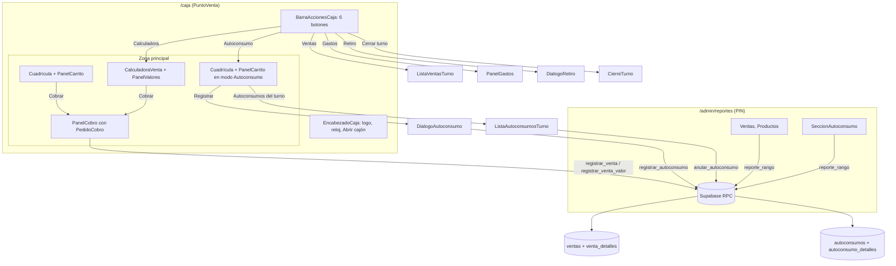

# Design Document: Barra de acciones, Autoconsumo y Calculadora

## Overview

Se saca la fila de botones del encabezado de la Caja a una Barra_Acciones propia con 6 botones iguales, y se agregan dos acciones:

- **Calculadora (venta por valor):** teclado grande, valor digitado encima, lista de valores con total y cobro con el mismo `PanelCobro`. Se registra como una Venta con `tipo = 'valor'` y una línea sin producto por valor. Como es una fila más de `ventas`, entra sola en efectivo esperado, resumen, cierre, Caja mayor y Reportes.
- **Autoconsumo:** se escogen productos del catálogo de la Caja, quién los consumió y una nota. Se guarda en tablas nuevas (`autoconsumos`, `autoconsumo_detalles`) ligadas al Turno, sin tocar dinero ni stock. Se lista y anula en el turno y tiene su pestaña en Reportes.

Todo se escribe por RPC `SECURITY DEFINER` en plpgsql con clave de idempotencia y bloqueo `FOR UPDATE` del Turno, como en `supabase/migration-ventas.sql` y `supabase/migration-caja-mayor.sql`.

| Capa | Archivo | Cambio |
|---|---|---|
| SQL | `supabase/migration-barra-acciones.sql` (nuevo) | `ventas.tipo`, `venta_detalles.producto_id` nulo + `orden`, tablas de autoconsumo, RPC nuevas y reemplazadas |
| API | `src/lib/api/ventas.ts`, `autoconsumo.ts` (nuevo), `reportes.ts`, `errores.ts` | `registrarVentaValor`, tipo de venta, autoconsumos |
| Dominio puro | `src/lib/caja/layout.ts`, `calculadora.ts` (nuevo), `cobro.ts`, `autoconsumo.ts` (nuevo) | Medidas de la barra, teclado y lista de valores, pedido de cobro, validación de autoconsumo |
| UI Caja | `EncabezadoCaja`, `BarraAccionesCaja` (nuevo), `CalculadoraVenta` (nuevo), `PanelValores` (nuevo), `PanelCobro`, `PanelCarrito`, `DialogoAutoconsumo` (nuevo), `ListaAutoconsumosTurno` (nuevo), `ListaVentasTurno`, `PuntoVenta` | Barra, calculadora, autoconsumo |
| Reportes | `src/lib/reportes/agregar.ts`, `tablas.ts`, `exportar.ts`, `NavegacionSecciones`, `ModuloReportes`, `SeccionAutoconsumo` (nuevo), `SeccionVentas` | Tipo de venta, fila "Venta por valor", pestaña Autoconsumo |

### Decisión principal: cómo guardar la venta por valor

Se compararon tres formas:

| Opción | Ventaja | Problema |
|---|---|---|
| A. `venta_detalles.producto_id` nulo + `ventas.tipo` | Una sola tabla de ventas; todo lo que suma `ventas.total` (esperado, cierre, Caja mayor, `por_metodo`, Resumen) funciona sin cambios. `anular_venta` sirve igual. | Hay que relajar `NOT NULL` y proteger la coherencia con CHECK y trigger |
| B. Producto especial "Venta por valor" en `productos` | Sin cambios de esquema en `venta_detalles` | Ensucia el inventario y el catálogo, el precio es variable y `registrar_venta` valida precio vigente |
| C. Tabla aparte `ventas_valor` | Aísla el cambio | Duplica cierre, esperado, Caja mayor, anulación y reportes |

**Se escoge A.** Detalles:

- `ventas.tipo VARCHAR(10) NOT NULL DEFAULT 'productos' CHECK (tipo IN ('productos','valor'))`. Las filas existentes quedan en `'productos'` por el `DEFAULT` del `ADD COLUMN`.
- `venta_detalles.producto_id` acepta nulo. Una Linea_Valor tiene `producto_id NULL`, `nombre_producto = 'Venta por valor'`, `cantidad = 1`, `precio_unitario` = valor y `orden` 1..200. `subtotal` sigue siendo la columna generada.
- `UNIQUE (venta_id, producto_id)` no estorba: en Postgres los nulos son distintos, así que caben varias Lineas_Valor en la misma venta.
- Un trigger `BEFORE INSERT` en `venta_detalles` comprueba que el tipo de la venta coincide con la línea (no se pueden mezclar).
- `registrar_venta` no cambia: inserta con el `DEFAULT 'productos'` y sus líneas siempre tienen producto. Se agrega la RPC `registrar_venta_valor`.

## Architecture



### Vistas de `PuntoVenta`

```ts
type Vista =
  | 'vendiendo' | 'cobrando' | 'cerrando' | 'ventas' | 'gastos' | 'retiro'
  | 'autoconsumo'       // cuadrícula + Seleccion_Autoconsumo
  | 'calculadora'       // teclado + PanelValores
  | 'cobrando-valor';   // PanelCobro con la Lista_Valores + PanelValores sin edición
```

| Vista | Zona izquierda | Panel derecho (escritorio) / barra inferior (móvil) | Botón resaltado |
|---|---|---|---|
| `vendiendo` | Búsqueda + cuadrícula (agrega al Pedido_Productos) | `PanelCarrito` Pedido | — |
| `cobrando` | `PanelCobro` (productos) | `PanelCarrito` Pedido | — |
| `ventas`, `gastos`, `retiro`, `cerrando` | Igual que `vendiendo`, con la ventana encima | `PanelCarrito` Pedido | Ventas, Gastos, Retiro (Cerrar turno conserva tono peligro) |
| `autoconsumo` | Aviso + búsqueda + cuadrícula (agrega a la Seleccion_Autoconsumo) | `PanelCarrito` con título "Autoconsumo" y botón "Registrar" | Autoconsumo |
| `calculadora` | `CalculadoraVenta` | `PanelValores` | Calculadora |
| `cobrando-valor` | `PanelCobro` (valor) | `PanelValores` solo lectura | Calculadora |

Transiciones nuevas:

- Tocar el Boton_Accion de la vista activa vuelve a `vendiendo` (`cobrando-valor` cuenta como vista de Calculadora).
- `calculadora` → `cobrando-valor` con "Cobrar"; `cobrando-valor` → `calculadora` con "Volver" o al registrar la venta.
- `TURNO_CERRADO` en cualquier vista: flujo actual `alTurnoCerrado` (vuelve a la apertura). El Pedido_Productos, la Lista_Valores y la Seleccion_Autoconsumo viven en `PuntoVenta`, así que se conservan.
- Si la Lista_Valores queda vacía en `cobrando-valor`, se vuelve a `calculadora` (igual que hoy con el carrito vacío en `cobrando`).

## Components and Interfaces

### 1. Migración `supabase/migration-barra-acciones.sql`

Se ejecuta después de `migration-ventas.sql` y `migration-caja-mayor.sql`. Idempotente: `ADD COLUMN IF NOT EXISTS`, `CREATE TABLE IF NOT EXISTS`, `DROP … IF EXISTS` antes de crear restricciones, triggers y políticas, y `CREATE OR REPLACE` de funciones con la misma firma.

#### 1.1 Ventas por valor

```sql
ALTER TABLE ventas ADD COLUMN IF NOT EXISTS tipo VARCHAR(10) NOT NULL DEFAULT 'productos';
ALTER TABLE ventas DROP CONSTRAINT IF EXISTS ventas_tipo_valido;
ALTER TABLE ventas ADD CONSTRAINT ventas_tipo_valido CHECK (tipo IN ('productos', 'valor'));

ALTER TABLE venta_detalles ALTER COLUMN producto_id DROP NOT NULL;
ALTER TABLE venta_detalles ADD COLUMN IF NOT EXISTS orden SMALLINT;
ALTER TABLE venta_detalles DROP CONSTRAINT IF EXISTS venta_detalles_linea_coherente;
ALTER TABLE venta_detalles ADD CONSTRAINT venta_detalles_linea_coherente CHECK (
    (producto_id IS NOT NULL AND orden IS NULL)
    OR (producto_id IS NULL
        AND nombre_producto = 'Venta por valor'
        AND cantidad = 1
        AND precio_unitario BETWEEN 1 AND 10000000
        AND orden BETWEEN 1 AND 200)
);
CREATE UNIQUE INDEX IF NOT EXISTS venta_detalles_orden_unico
    ON venta_detalles (venta_id, orden) WHERE orden IS NOT NULL;
```

- **Trigger `validar_linea_venta`** (`BEFORE INSERT ON venta_detalles`): lee `ventas.tipo` de `NEW.venta_id`; si `tipo = 'valor'` y `NEW.producto_id IS NOT NULL`, o `tipo = 'productos'` y `NEW.producto_id IS NULL`, lanza `DATOS_INVALIDOS`.
- **`proteger_ventas`** se reemplaza para incluir `tipo` en la tupla de columnas que no cambian al anular. El resto de la función queda igual.
- `proteger_venta_detalles` no cambia (ya rechaza todo `UPDATE` y `DELETE`).

#### 1.2 Autoconsumo

```sql
CREATE TABLE IF NOT EXISTS autoconsumos (
    id UUID DEFAULT uuid_generate_v4() PRIMARY KEY,
    clave UUID NOT NULL UNIQUE,
    turno_id UUID NOT NULL REFERENCES turnos(id) ON DELETE RESTRICT,
    consumido_por VARCHAR(60) NOT NULL CHECK (length(trim(consumido_por)) BETWEEN 1 AND 60),
    nota VARCHAR(120) CHECK (nota IS NULL OR length(trim(nota)) BETWEEN 1 AND 120),
    valor_referencia INTEGER NOT NULL CHECK (valor_referencia BETWEEN 0 AND 99999999),
    creado_en TIMESTAMPTZ NOT NULL DEFAULT NOW(),
    anulado_en TIMESTAMPTZ
);
CREATE INDEX IF NOT EXISTS autoconsumos_turno ON autoconsumos (turno_id);
CREATE INDEX IF NOT EXISTS autoconsumos_creado_en ON autoconsumos (creado_en);

CREATE TABLE IF NOT EXISTS autoconsumo_detalles (
    id UUID DEFAULT uuid_generate_v4() PRIMARY KEY,
    autoconsumo_id UUID NOT NULL REFERENCES autoconsumos(id) ON DELETE RESTRICT,
    producto_id UUID NOT NULL REFERENCES productos(id) ON DELETE RESTRICT,
    nombre_producto VARCHAR(255) NOT NULL,              -- copia al registrar
    cantidad INTEGER NOT NULL CHECK (cantidad BETWEEN 1 AND 999),
    precio_referencia INTEGER NOT NULL CHECK (precio_referencia BETWEEN 0 AND 99999999),
    subtotal INTEGER GENERATED ALWAYS AS (cantidad * precio_referencia) STORED,
    UNIQUE (autoconsumo_id, producto_id)
);
```

- RLS activado en ambas con una sola política `FOR SELECT TO anon, authenticated USING (TRUE)`.
- **`proteger_autoconsumos`** (`BEFORE UPDATE OR DELETE`): borrar → `MOVIMIENTO_INMUTABLE`; solo se permite pasar `anulado_en` de nulo a no nulo sin cambiar otra columna, y solo si el Turno sigue abierto (si no, `TURNO_CERRADO`).
- **`proteger_autoconsumo_detalles`** (`BEFORE UPDATE OR DELETE`): siempre `MOVIMIENTO_INMUTABLE`.

#### 1.3 Funciones

| RPC | Firma | Respuesta |
|---|---|---|
| `registrar_venta_valor` (nueva) | `(p_clave UUID, p_turno UUID, p_metodo UUID, p_valores jsonb, p_recibido INTEGER)` | Igual que `registrar_venta`: `{venta_id, total, efectivo_recibido, cambio, es_efectivo, creado_en}` |
| `detalle_venta` (reemplazada, misma firma) | `(p_venta UUID)` | Agrega `tipo` a `venta`; `detalles` con `producto_id` nulo en Lineas_Valor, ordenados por `orden NULLS LAST, nombre_producto, producto_id` |
| `registrar_autoconsumo` (nueva) | `(p_clave UUID, p_turno UUID, p_persona TEXT, p_nota TEXT, p_lineas jsonb)` | `{id, turno_id, consumido_por, nota, valor_referencia, creado_en, anulado_en, lineas:[{producto_id, nombre_producto, cantidad, precio_referencia, subtotal}]}` |
| `anular_autoconsumo` (nueva) | `(p_autoconsumo UUID)` | `void` |
| `reporte_rango` (reemplazada, misma firma) | `(p_desde DATE, p_hasta DATE)` | Lo de hoy + `tipo` en cada venta + `autoconsumos` |

Pasos de `registrar_venta_valor` (mismo orden que `registrar_venta`):

1. `p_clave` nulo → `DATOS_INVALIDOS`. Reintento: si existe una venta con esa clave, devolverla.
2. Bloquear el Turno (`FOR UPDATE`); cerrado o inexistente → `TURNO_CERRADO`. Volver a buscar la clave (reintento simultáneo).
3. Método activo → si no, `METODO_INVALIDO`.
4. `p_valores` debe ser un arreglo jsonb de 1 a 200 números enteros entre 1 y 10.000.000; si no, `DATOS_INVALIDOS`. Total = suma; si supera 99.999.999, `DATOS_INVALIDOS`.
5. Efectivo: `p_recibido` entre total y 10.000.000 o `RECIBIDO_INVALIDO`. No efectivo: recibido = total.
6. `INSERT INTO ventas (…, tipo) VALUES (…, 'valor')` y `INSERT INTO venta_detalles (venta_id, producto_id, nombre_producto, cantidad, precio_unitario, orden) SELECT v.id, NULL, 'Venta por valor', 1, x.valor, x.n FROM jsonb_array_elements(p_valores) WITH ORDINALITY x(valor, n)`.
7. Devolver la misma forma que `registrar_venta`.

Pasos de `registrar_autoconsumo`:

1. `p_clave` nulo → `DATOS_INVALIDOS`. Reintento por `clave` en `autoconsumos`: devolver el original.
2. Bloquear el Turno; cerrado o inexistente → `TURNO_CERRADO`; volver a buscar la clave.
3. Validar persona (1..60 tras `trim`) y nota (nula, vacía tras `trim` = nula, o 1..120); si no, `DATOS_INVALIDOS`.
4. `p_lineas` = arreglo de 1 a 200 objetos `{producto_id: uuid, cantidad: entero 1..999}` sin productos repetidos; si no, `DATOS_INVALIDOS`.
5. Cada producto es vendible (activo, no `materia_prima`, `visible_caja`, con `precio_venta`); si no, `PRODUCTO_NO_DISPONIBLE`. No se compara precio con el cliente: el precio solo es referencia.
6. `valor_referencia` = Σ cantidad × `precio_venta`; si supera 99.999.999, `DATOS_INVALIDOS`.
7. Insertar cabecera y detalles en la misma transacción. No toca `ventas`, `gastos`, `caja_mayor_*` ni `inventarios`.

`anular_autoconsumo`: busca el Autoconsumo (no existe → `AUTOCONSUMO_NO_EXISTE`); bloquea el Turno y luego la fila; si ya está anulado termina; si el Turno está cerrado → `TURNO_CERRADO`; `UPDATE autoconsumos SET anulado_en = NOW()`.

`reporte_rango`: se copia la versión de `migration-caja-mayor.sql` y se agrega:

- `'tipo', v.tipo` en cada venta.
- Productos: sin cambios en la consulta. `GROUP BY d.producto_id` junta todas las Lineas_Valor en un grupo con `producto_id` nulo, nombre "Venta por valor", `cantidad` = número de valores y `valor` = suma.
- `'autoconsumos'`: Autoconsumos con `creado_en` en el rango y `anulado_en IS NULL`, ordenados por `creado_en, id`, cada uno con `id, creado_en, turno_id, consumido_por, nota, valor_referencia, lineas:[{producto_id, nombre_producto, cantidad, precio_referencia, subtotal}]`.

Funciones que **no cambian** porque solo leen `ventas`: `efectivo_esperado_turno`, `resumen_turno`, `cerrar_turno` (las Ventas_Por_Valor no efectivo pasan a su Parte de la Caja mayor), `anular_venta`, `registrar_venta`.

Permisos: `REVOKE ALL … FROM PUBLIC` + `GRANT EXECUTE … TO anon, authenticated` para `registrar_venta_valor`, `detalle_venta`, `registrar_autoconsumo`, `anular_autoconsumo` y `reporte_rango`. Las funciones de trigger no reciben `GRANT`.

### 2. API del cliente

`src/lib/api/errores.ts`: `CodigoError` y `CODIGOS_SQL` agregan `'AUTOCONSUMO_NO_EXISTE'`.

```ts
// src/lib/api/ventas.ts
export type TipoVenta = 'productos' | 'valor';
export type EntradaVentaValor = {
  clave: string; turnoId: string; metodoPagoId: string;
  valores: number[];              // en el orden de la Lista_Valores
  recibido: number | null;        // null si el método no es efectivo
};
export async function registrarVentaValor(e: EntradaVentaValor): Promise<VentaRegistrada>
// VentaTurno y VentaDetallada agregan tipo: TipoVenta ('productos' si falta)
// ventasDelTurno agrega 'tipo' al select
// DetalleLinea.productoId pasa a string | null

// src/lib/api/autoconsumo.ts (nuevo)
export type LineaAutoconsumo = { productoId: string; nombre: string; cantidad: number; precio: number; subtotal: number };
export type Autoconsumo = {
  id: string; turnoId: string; consumidoPor: string; nota: string | null;
  valorReferencia: number; creadoEn: string; anuladoEn: string | null; lineas: LineaAutoconsumo[];
};
export type EntradaAutoconsumo = {
  clave: string; turnoId: string; persona: string; nota: string | null;
  lineas: { productoId: string; cantidad: number }[];
};
export async function registrarAutoconsumo(e: EntradaAutoconsumo): Promise<Autoconsumo>
/** Lectura directa (RLS de solo lectura) con autoconsumo_detalles embebidos, más reciente primero. */
export async function autoconsumosDelTurno(turnoId: string): Promise<Autoconsumo[]>
export async function anularAutoconsumo(id: string): Promise<void>
```

`src/lib/api/reportes.ts`: mapea `tipo` de ventas (`'productos'` si falta), `producto_id` nulo en productos y la lista `autoconsumos`.

### 3. Dominio puro

#### 3.1 `src/lib/caja/layout.ts`

```ts
export const MEDIDAS = {
  encabezado: 96,
  barraAcciones: 64,       // nuevo: fila de 6 botones de 48 px + 8 px arriba y abajo
  barraMovil: 64,
  padding: 16,
  gap: 12,
  tarjetaMin: 120,
  tarjetaMax: 200,
  quiebre: 768,
};

export const BARRA = {
  botones: 6,
  altoBoton: 48,
  margen: { movil: 8, escritorio: 16 },   // padding horizontal de la barra
  gap: { movil: 4, escritorio: 8 },
  toqueMin: 44,
};

export type LayoutCaja = {
  // … campos actuales
  /** Alto − encabezado − barra de acciones (− barra inferior en móvil). */
  altoDisponible: number;
  /** Ancho de cada Boton_Accion = (ancho − 2·margen − 5·gap) / 6. */
  anchoBotonAccion: number;
  /** Escritorio: ícono y texto. Móvil: solo ícono. */
  textoEnAcciones: boolean;
};
```

Con 320 px en móvil: (320 − 16 − 20) / 6 ≈ 47,3 px ≥ 44. Con 768 px en escritorio: (768 − 32 − 40) / 6 = 116 px, suficiente para ícono y "Retiro a caja mayor" en 2 líneas de `text-xs`/`text-sm`. La barra es una cuadrícula `grid-cols-6`; `anchoBotonAccion` se usa para pruebas y para decidir el tamaño de letra.

#### 3.2 `src/lib/caja/calculadora.ts` (nuevo)

```ts
export const VALOR_MAX = 10_000_000;
export const VALORES_MAX = 200;
export const TOTAL_MAX = 99_999_999;

export type TeclaCalculadora = '0'|'1'|'2'|'3'|'4'|'5'|'6'|'7'|'8'|'9'|'000'|'retroceso'|'borrar';
export type ValorLista = { id: number; valor: number };     // id local para quitar uno
export type EstadoCalculadora = { digitado: number; valores: ValorLista[]; siguienteId: number };
export type AvisoCalculadora = 'VALOR_MAXIMO' | 'VALORES_MAXIMOS' | 'TOTAL_MAXIMO' | 'VACIO';

export type AccionCalculadora =
  | { tipo: 'tecla'; tecla: TeclaCalculadora }
  | { tipo: 'agregar' }
  | { tipo: 'quitar'; id: number }
  | { tipo: 'vaciar' };

export const CALCULADORA_INICIAL: EstadoCalculadora;

/** Aplica una tecla al valor digitado; devuelve el mismo valor si se pasaría de VALOR_MAX. */
export function teclear(digitado: number, tecla: TeclaCalculadora): { digitado: number; aviso?: 'VALOR_MAXIMO' }

/** Reducer puro de la Calculadora; ante un aviso deja el estado igual. */
export function reducirCalculadora(e: EstadoCalculadora, a: AccionCalculadora):
  { estado: EstadoCalculadora; aviso?: AvisoCalculadora }

export const totalValores = (v: ValorLista[]) => number;

/** Valores para cobrar: la lista más el digitado pendiente si es > 0 (decisión 4). */
export function valoresParaCobrar(e: EstadoCalculadora):
  { ok: true; estado: EstadoCalculadora; valores: number[] } | { ok: false; aviso: AvisoCalculadora }
```

#### 3.3 `src/lib/caja/cobro.ts` (se amplía)

```ts
export type PedidoCobro =
  | { tipo: 'productos'; carrito: Carrito }
  | { tipo: 'valor'; valores: number[] };

export function totalPedido(p: PedidoCobro): number      // totalCarrito o suma de valores
export function pedidoVacio(p: PedidoCobro): boolean
/** Firma para la clave de idempotencia: incluye el tipo y, en valor, el orden de los valores. */
export function firmaPedido(p: PedidoCobro): string
```

#### 3.4 `src/lib/caja/autoconsumo.ts` (nuevo)

La Seleccion_Autoconsumo es un `Carrito` y usa `reducirCarrito` y `conciliarCarrito` de `carrito.ts` (mismas reglas de cantidad).

```ts
export const NOTA_MAX = 120;
export type ErroresAutoconsumo = { lineas?: 'VACIO'; persona?: 'VACIO' | 'LARGO'; nota?: 'LARGO' };
export function validarAutoconsumo(e: { seleccion: Carrito; persona: string; nota: string }):
  { ok: true; persona: string; nota: string | null } | { ok: false; errores: ErroresAutoconsumo }
export const valorReferencia = (c: Carrito) => number;           // = totalCarrito
/** "2 × Pan blandito, 1 × Gaseosa" en el orden recibido. */
export function textoProductos(lineas: { nombre: string; cantidad: number }[]): string
export function firmaAutoconsumo(turnoId: string, seleccion: Carrito, persona: string, nota: string): string
```

### 4. UI Caja

- **`BarraAccionesCaja`** (nuevo, `src/components/caja/BarraAccionesCaja.tsx`): props `{ layout: LayoutCaja; activo: AccionCaja | null; onAccion: (a: AccionCaja) => void }` con `type AccionCaja = 'ventas' | 'gastos' | 'retiro' | 'autoconsumo' | 'calculadora' | 'cerrar'`. Contenedor `nav aria-label="Acciones de caja"` con `grid grid-cols-6`, alto `MEDIDAS.barraAcciones`, `bg-lz-linen border-b border-lz-border`, margen y gap de `BARRA`. Cada botón `h-12 w-full min-w-[44px]` con los mismos `TONOS` que hoy (`normal`, `activo`, `peligro`), `aria-label` y `title` con el texto completo, `aria-pressed` si está activo. Con `layout.textoEnAcciones` muestra ícono + texto (`line-clamp-2 leading-tight`, `text-xs` hasta `lg` y `text-sm` desde `lg`); si no, solo ícono. Íconos nuevos: Autoconsumo (taza/bolsa) y Calculadora.
- **`EncabezadoCaja`**: se quitan `nav`, `BotonEncabezado`, los íconos que pasan a la barra y las props `vistaActiva`, `onVentas`, `onGastos`, `onCerrarTurno`, `onRetiro`. Quedan `turno` (sin uso visible), `onAdministracion` (compatibilidad), logo + reloj a la izquierda y `BotonAbrirCajon` al centro de la cuadrícula `md:grid-cols-[minmax(0,1fr)_auto_minmax(0,1fr)]`.
- **`CalculadoraVenta`** (nuevo): props `{ estado: EstadoCalculadora; despachar: (a) => ResultadoCalculadora; onCobrar: () => void }`. Arriba, el visor con el Valor_Digitado (`formatCurrency`, `text-5xl` en escritorio, `text-4xl` en móvil, `aria-live="polite"`). Debajo, teclado `grid-cols-3` (7 8 9 / 4 5 6 / 1 2 3 / 000 0 ⌫), fila "Borrar" (C) y botón grande "Agregar" (`+`). Teclas `min-h-[56px]` en escritorio y `min-h-[48px]` en móvil, con la clase `TARJETA` de `PanelCobro`. Teclado físico: dígitos, Retroceso, Supr, Enter = agregar, ignorado si el foco está en un campo (misma regla que `PanelCobro`). Los avisos (`VALOR_MAXIMO`, `VALORES_MAXIMOS`, `TOTAL_MAXIMO`) se muestran con `showToast('…', 'warning')`. La sección hace scroll interno si no cabe (`overflow-y-auto`), la pantalla no.
- **`PanelValores`** (nuevo): mismo esquema que `PanelCarrito` (lateral de `layout.anchoCarrito` en escritorio; barra inferior de `MEDIDAS.barraMovil` expandible hasta `altoCarritoExpandido` en móvil). Título "Valores", lista numerada con botón "Quitar" (≥ 44 px) por valor, "Borrar todo" con confirmación, Total_Valores y botón "Cobrar" habilitado si hay valores o Valor_Digitado > 0. Prop `soloLectura` para `cobrando-valor` (sin quitar, borrar ni cobrar).
- **`PanelCobro`**: la prop `carrito` se reemplaza por `pedido: PedidoCobro`. `total = totalPedido(pedido)`, firma de la clave con `firmaPedido`. Al confirmar llama `registrarVenta` (productos) o `registrarVentaValor` (valor). `PRECIOS_ACTUALIZADOS` y `PRODUCTO_NO_DISPONIBLE` solo aplican a productos. El resto (métodos, billetes, monedas, teclado, "Paga exacto", cajón, sin conexión, `TURNO_CERRADO`) no cambia.
- **`PanelCarrito`**: props opcionales `titulo` (por defecto "Pedido"), `textoAccion` ("Cobrar"), `textoVacio` ("Toca un producto para agregarlo al pedido.") y `nota` (texto bajo el total). En Autoconsumo: "Autoconsumo", "Registrar", "Toca los productos consumidos." y "Valor a precio de venta (no se cobra)".
- **`DialogoAutoconsumo`** (nuevo): modal con resumen (`textoProductos`, Valor_Referencia), `SelectorPersona` con etiqueta "¿Quién lo consumió?", nota opcional (≤ 120), Cancelar y "Registrar autoconsumo". Valida con `validarAutoconsumo`; clave con `useClaveIdempotente(firmaAutoconsumo(...))`; maneja `SIN_CONEXION` (`AvisoSinConexion` con la misma clave), `TURNO_CERRADO` (`onTurnoCerrado`), `PRODUCTO_NO_DISPONIBLE` (`onProductosCambiaron`), `DATOS_INVALIDOS` ("Revise los datos e intente de nuevo."). Al terminar: `onRegistrado` y toast "Autoconsumo registrado".
- **`ListaAutoconsumosTurno`** (nuevo): modal con el mismo patrón que `ListaVentasTurno`: total del turno (sin anulados), lista con `hora12`, persona, productos, nota, valor y etiqueta "Anulado" con `hora12(anuladoEn)`; botón "Anular" con confirmación ("¿Anular este autoconsumo?"). Recarga tras anular; `TURNO_CERRADO` → `onTurnoCerrado`; `AUTOCONSUMO_NO_EXISTE` → recarga la lista.
- **`ListaVentasTurno`**: muestra "Venta por valor" bajo el total cuando `tipo = 'valor'`; las líneas del detalle usan `key` por índice (el `productoId` puede ser nulo).
- **`PuntoVenta`**:
  - Renderiza `BarraAccionesCaja` entre `EncabezadoCaja` y la zona principal solo con turno.
  - Estado nuevo: `calculadora` (`useState` + ref como el carrito, con `reducirCalculadora`), `seleccionAutoconsumo` (`Carrito` con `reducirCarrito`), diálogos `dialogoAutoconsumo` y `listaAutoconsumos`.
  - En `autoconsumo`, `CuadriculaProductos` recibe las cantidades de la Seleccion_Autoconsumo y `onAgregar` suma a ella; encima de la búsqueda va el aviso con el botón "Autoconsumos del turno".
  - `PRODUCTO_NO_DISPONIBLE` en autoconsumo: recarga el catálogo y concilia la Seleccion_Autoconsumo con `conciliarCarrito` (el mismo mecanismo `conciliarPendiente`, extendido a las dos listas).
  - `alRegistrada` para valor: vacía la Calculadora, vuelve a `calculadora` y muestra `ConfirmacionVenta`.

### 5. Reportes

- **`agregar.ts`**:
  - `VentaReporte.tipo: 'productos' | 'valor'`; `VentaConMetodo.tipoTexto` ("Productos" o "Venta por valor").
  - `ProductoVendido.productoId: string | null`; el orden actual se mantiene (los nulos se comparan como texto vacío para el desempate).
  - `DatosReporte.autoconsumos: AutoconsumoReporte[]` y `Reporte.autoconsumo: { registros: FilaAutoconsumo[]; porProducto: {productoId, nombre, cantidad, valor}[]; porPersona: {persona, registros, valor}[]; total: number }`. Registros más reciente primero con `productosTexto`; por producto y por persona con valor desc y nombre asc. El nombre por producto es el del registro más reciente.
  - `vacio` no cambia (ventas y gastos) para no afectar las secciones actuales.
- **`tablas.ts`**:
  - `Seccion` agrega `'autoconsumo'`.
  - Ventas: columna "Tipo" en "Ventas registradas" (después de "Total"), en "Ventas anuladas" y en el CSV (después de "Estado").
  - Autoconsumo: tablas "Autoconsumo" (Fecha y hora, Consumió, Productos, Nota, Valor a precio de venta), "Por producto" (Producto, Cantidad, Valor a precio de venta) y "Por persona" (Persona, Registros, Valor a precio de venta).
  - `seccionVacia(r: Reporte, s: Seccion): boolean`: para `'autoconsumo'` es `r.autoconsumo.registros.length === 0`; para las demás, `r.vacio` (con la excepción actual de `'turnos'`, que nunca se considera vacía en pantalla).
- **`exportar.ts`**: `TITULO_SECCION.autoconsumo = 'Autoconsumo'`.
- **`NavegacionSecciones`**: `'autoconsumo'` con etiqueta "Autoconsumo", entre "Métodos de pago" y "Caja mayor".
- **`ModuloReportes`**: `esSeccionReporte('autoconsumo') = true`; `ContenidoReporte` y `BotonesExportar` usan `seccionVacia`.
- **`SeccionAutoconsumo`** (nuevo): aclaración "Valores a precio de venta, no es dinero recibido" y las tres tablas con `TablaReporte`.
- **`SeccionVentas`**: el detalle usa `key` por índice y muestra las Lineas_Valor tal como llegan ("Venta por valor", cantidad 1, precio = valor).

## Data Models

| Entidad | Campos clave | Notas |
|---|---|---|
| `ventas` (+) | `tipo` `'productos'` \| `'valor'` | `DEFAULT 'productos'`; no cambia al anular |
| `venta_detalles` (±) | `producto_id` nulo, `orden` | Nulo solo en Lineas_Valor (CHECK + trigger) |
| `autoconsumos` | `clave`, `turno_id`, `consumido_por`, `nota`, `valor_referencia`, `creado_en`, `anulado_en` | Solo cambia `anulado_en`, una vez, con el Turno abierto |
| `autoconsumo_detalles` | `autoconsumo_id`, `producto_id`, `nombre_producto`, `cantidad`, `precio_referencia`, `subtotal` | Inmutable |

Invariantes:

- Para toda venta: `ventas.total = Σ venta_detalles.subtotal`.
- Venta `tipo = 'valor'` ⇔ todas sus líneas tienen `producto_id` nulo; sus `orden` son 1..n sin repetir.
- Para todo Autoconsumo: `valor_referencia = Σ autoconsumo_detalles.subtotal`.
- Los Autoconsumos no aparecen en ninguna suma de dinero (`efectivo_esperado_turno`, `resumen_turno`, `cerrar_turno`, `reporte_rango.ventas/gastos/turnos`).

## Correctness Properties

*A property is a characteristic or behavior that should hold true across all valid executions of a system-essentially, a formal statement about what the system should do. Properties serve as the bridge between human-readable specifications and machine-verifiable correctness guarantees.*

Reflexión: las medidas de la barra (1.3, 1.7, 1.8, 1.9) salen de `calcularLayout` y quedan en una sola propiedad. El teclado (3.4–3.7) queda en una propiedad de rango y otra de ida y vuelta con retroceso. Los límites del reducer (4.1–4.3, 4.6) se juntan, y quitar (4.5) queda como inversa de agregar. El cobro con valor pendiente (5.2, 5.3) es una propiedad; total y firma del pedido (5.1, 5.4) otra. Las sumas de Reportes con ventas por valor (6.7, 11.1, 11.4) son una sola invariante. El orden y los totales de autoconsumo (12.2, 12.3) se juntan, igual que las tablas y el vacío de la sección (12.5, 12.6). Lo que vive solo en SQL (Req 6.1–6.6, 6.8, 7, 9.3–9.8, 10.3–10.7) no tiene pruebas automáticas en el repositorio y se revisa a mano.

### Property 1: Medidas de la barra de acciones

*For any* ancho y alto de ventana (dentro o fuera de `LIMITES`), `calcularLayout` devuelve `anchoBotonAccion ≥ 44`, `6 · anchoBotonAccion + 5 · gap + 2 · margen` igual al ancho acotado (con margen y gap del modo), `textoEnAcciones` verdadero si y solo si el modo es escritorio, y `altoDisponible = alto acotado − encabezado − barraAcciones − (barraMovil en móvil)`.

**Validates: Requirements 1.3, 1.7, 1.8, 1.9**

### Property 2: Teclado de la Calculadora

*For any* secuencia de teclas aplicada con `teclear` desde 0, el valor digitado siempre queda entre 0 y 10.000.000; cada dígito o `000` aceptado deja `digitado · 10^k + d` (k = 1 o 3), una tecla que lo pasaría de 10.000.000 deja el valor igual con aviso `VALOR_MAXIMO`, y `borrar` deja 0.

**Validates: Requirements 3.4, 3.5, 3.7**

### Property 3: Retroceso deshace un dígito

*For any* valor digitado `x` y dígito `d` tales que `teclear(x, d)` es aceptado, aplicar después `retroceso` devuelve `x`; y para todo `x`, `retroceso` devuelve `floor(x / 10)`.

**Validates: Requirements 3.6**

### Property 4: Agregar valores respeta los límites

*For any* estado de la Calculadora y secuencia de acciones (`tecla`, `agregar`, `quitar`, `vaciar`), la lista tiene a lo sumo 200 valores, cada valor está entre 1 y 10.000.000 y el total no pasa de 99.999.999; un `agregar` aceptado deja la lista anterior más el valor digitado al final y el digitado en 0; un `agregar` con digitado 0 o que rompería un límite deja el estado igual (con aviso si rompe un límite); y `vaciar` deja la lista vacía y el digitado en 0.

**Validates: Requirements 4.1, 4.2, 4.3, 4.6**

### Property 5: Quitar es inverso de agregar

*For any* estado de la Calculadora y valor que se pueda agregar, agregarlo y luego quitarlo por su `id` deja la misma lista de valores en el mismo orden; y quitar cualquier `id` existente baja `totalValores` exactamente en ese valor.

**Validates: Requirements 4.5**

### Property 6: Cobrar con valor pendiente

*For any* estado de la Calculadora, `valoresParaCobrar` devuelve la lista seguida del digitado cuando el digitado es mayor que 0 y cabe en los límites, devuelve la lista tal cual cuando el digitado es 0 y la lista no está vacía, y falla con `VACIO` cuando la lista está vacía y el digitado es 0.

**Validates: Requirements 5.2, 5.3**

### Property 7: Total y firma del pedido de cobro

*For any* lista de valores y carrito, `totalPedido({tipo:'valor', valores})` es la suma de los valores y `totalPedido({tipo:'productos', carrito})` es `totalCarrito(carrito)`; `firmaPedido` es igual para pedidos iguales, cambia si cambia un valor o el orden de los valores, y nunca coincide entre un pedido de valor y uno de productos.

**Validates: Requirements 5.1, 5.4**

### Property 8: Validación del autoconsumo

*For any* selección, persona y nota, `validarAutoconsumo` acepta si y solo si la selección no está vacía, la persona sin espacios al inicio y al final tiene de 1 a 60 caracteres y la nota recortada tiene a lo sumo 120; cuando acepta, devuelve la persona recortada y la nota recortada o `null` si queda vacía.

**Validates: Requirements 9.2**

### Property 9: Texto de productos y valor de referencia

*For any* selección de autoconsumo, `valorReferencia` es Σ cantidad × precio, y `textoProductos` contiene para cada línea, en el mismo orden, la cantidad seguida de " × " y el nombre, separadas por ", ".

**Validates: Requirements 8.4, 9.1**

### Property 10: Ventas por valor cuadran en Reportes

*For any* `DatosReporte` con ventas de tipo `productos` y `valor` (incluidas anuladas) y su lista de productos agregados coherente (con una fila de `productoId` nulo para las Lineas_Valor), `construirReporte` cumple que la suma de `productos.valor`, la suma de `porDia.total` y la suma de `porMetodo.total` son iguales a `resumen.totalVendido`, y que la fila de `productoId` nulo aparece una sola vez.

**Validates: Requirements 6.7, 11.1, 11.4**

### Property 11: Columna Tipo en Ventas

*For any* `Reporte`, las tablas de Ventas en pantalla ("Ventas registradas", "Ventas anuladas") y en CSV tienen la columna "Tipo", cada fila tiene tantas celdas como columnas y su celda Tipo es "Venta por valor" si y solo si la venta es de tipo `valor` (y "Productos" en otro caso).

**Validates: Requirements 11.2**

### Property 12: Agregación de autoconsumos

*For any* lista de autoconsumos no anulados, `construirReporte` devuelve los registros ordenados por `creadoEn` descendente (a igual fecha por `id`) sin perder ni repetir ninguno, y cumple Σ `porProducto.valor` = Σ `porPersona.valor` = Σ `valorReferencia` = `autoconsumo.total`, Σ `porPersona.registros` = número de registros y, para cada producto, su cantidad es la suma de sus cantidades en todos los registros.

**Validates: Requirements 12.2, 12.3**

### Property 13: Tablas y vacío de la sección Autoconsumo

*For any* `Reporte`, `tablasDeSeccion(r, 'autoconsumo', 'pantalla')` y `tablasDeSeccion(r, 'autoconsumo', 'csv')` tienen los mismos títulos, columnas y número de filas, con cada fila del largo de sus columnas; y `seccionVacia(r, 'autoconsumo')` es verdadero si y solo si no hay registros de autoconsumo, sin importar ventas y gastos.

**Validates: Requirements 12.5, 12.6**

### Property 14: Autoconsumos fuera del dinero

*For any* `DatosReporte` y lista de autoconsumos, agregar esos autoconsumos a los datos no cambia `resumen`, `porDia`, `ventas`, `anuladas`, `productos`, `gastos`, `gastosPorCategoria`, `porMetodo`, `turnos` ni `vacio` del reporte.

**Validates: Requirements 12.7**

## Error Handling

| Código | Origen | Mensaje en la UI |
|---|---|---|
| `TURNO_CERRADO` | `registrar_venta_valor`, `registrar_autoconsumo`, `anular_autoconsumo` | Flujo actual `onTurnoCerrado` ("El turno fue cerrado"); se conservan Lista_Valores y Seleccion_Autoconsumo |
| `METODO_INVALIDO` | `registrar_venta_valor` | "Ese método de pago ya no está disponible. Escoja otro." |
| `RECIBIDO_INVALIDO` | `registrar_venta_valor` | "El valor recibido no es válido. Revíselo." |
| `PRODUCTO_NO_DISPONIBLE` | `registrar_autoconsumo` | "Algún producto ya no está disponible. Revise el autoconsumo." + recarga y conciliación |
| `AUTOCONSUMO_NO_EXISTE` | `anular_autoconsumo` | "Ese autoconsumo ya no existe." + recarga la lista |
| `DATOS_INVALIDOS` | todas | "Revise los datos e intente de nuevo." |
| `SIN_CONEXION` | cliente | `AvisoSinConexion` con reintento y la misma clave |
| Avisos locales de la Calculadora | `reducirCalculadora` | "El valor máximo es $ 10.000.000", "Máximo 200 valores", "El total no puede pasar de $ 99.999.999" |

La UI valida antes de enviar (`reducirCalculadora`, `validarAutoconsumo`), pero manda el servidor.

## Testing Strategy

- **Propiedades** (fast-check + vitest, ya instalados, mínimo 100 corridas por propiedad, una prueba por propiedad): archivos junto al código, como los actuales (`src/lib/caja/layout.test.ts`, `calculadora.test.ts`, `cobro.test.ts`, `autoconsumo.test.ts`, `src/lib/reportes/tablas.test.ts`, `agregar.test.ts`). Cada prueba lleva el comentario `// Feature: barra-acciones-caja, Property N: <texto>`.
- **Ejemplos** (vitest + Testing Library con `// @vitest-environment jsdom`): `BarraAccionesCaja` muestra 6 botones en el orden pedido, `aria-pressed` en el activo y solo íconos con `textoEnAcciones = false`; `EncabezadoCaja` ya no tiene los botones; `CalculadoraVenta` muestra el visor encima del teclado; `traducirError` reconoce `AUTOCONSUMO_NO_EXISTE`.
- **SQL**: la migración no tiene pruebas automáticas en el repositorio. Se revisa a mano en el SQL Editor: ejecutarla dos veces, registrar una venta por valor en efectivo y otra en Nequi, reintentar con la misma clave, anularla, cerrar el turno y ver la Caja mayor, registrar y anular un autoconsumo, y revisar `reporte_rango`.
- **Checkpoint final**: `npx tsc --noEmit`, `npx next lint`, `npm run build` y `npm run test`.
