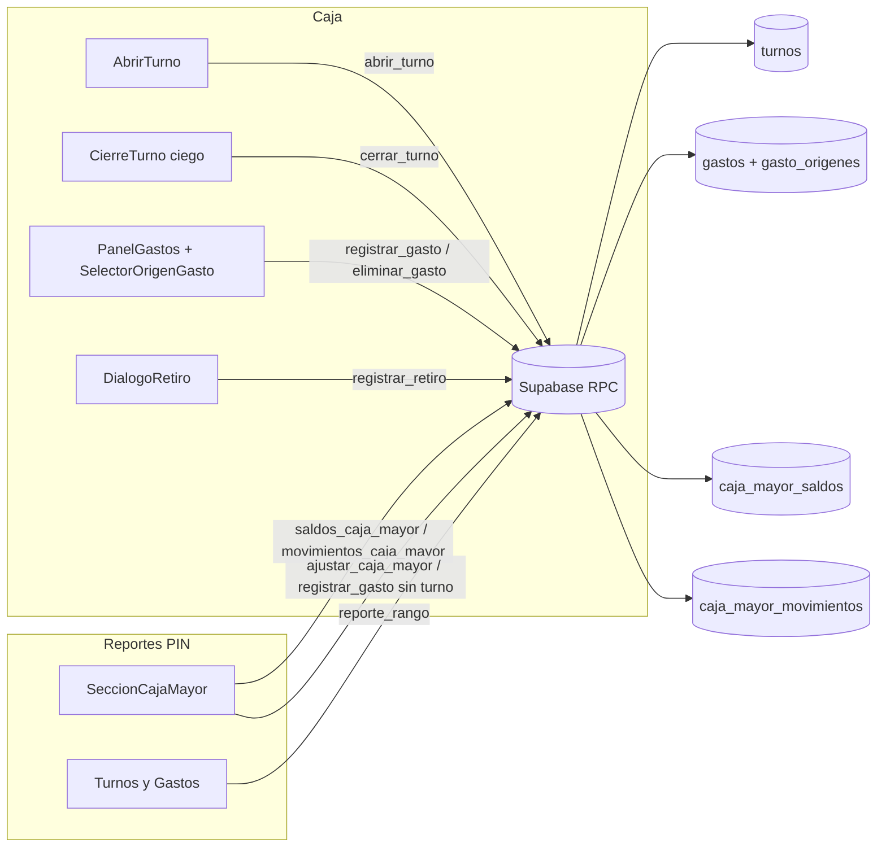

# Design Document: Caja mayor y cierre a ciegas

## Overview

Se agrega la Caja mayor (dinero de los dueños, con saldo por Parte), el cierre a ciegas con base automática, los retiros durante el turno y el origen de cada gasto. Todo el dinero sigue moviéndose solo por RPC `SECURITY DEFINER` en plpgsql, con clave de idempotencia y bloqueos `FOR UPDATE`, como en `supabase/migration-ventas.sql`.

Piezas:

| Capa | Archivo | Cambio |
|---|---|---|
| SQL | `supabase/migration-caja-mayor.sql` (nuevo) | Tablas `caja_mayor_saldos`, `caja_mayor_movimientos`, `gasto_origenes`; columnas nuevas en `turnos`; `gastos.turno_id` nulo; RPC nuevas y reemplazadas |
| API | `src/lib/api/turnos.ts`, `gastos.ts`, `reportes.ts`, `errores.ts`, `cajaMayor.ts` (nuevo) | Firmas nuevas y mapeo snake_case → camelCase |
| Dominio puro | `src/lib/caja/turno.ts`, `src/lib/caja/cajaMayor.ts` (nuevo) | Fórmula del esperado, validación de orígenes, modelo de saldos |
| UI Caja | `CierreTurno`, `ResultadoCierre`, `AbrirTurno`, `PanelGastos`, `SelectorOrigenGasto` (nuevo), `DialogoRetiro` (nuevo), `EncabezadoCaja`, `PuntoVenta` | Cierre a ciegas, apertura sin base, origen de gasto, retiro |
| UI Reportes | `NavegacionSecciones`, `ModuloReportes`, `SeccionCajaMayor` (nuevo), `DialogoAjusteMayor` (nuevo), `DialogoGastoMayor` (nuevo), `src/lib/reportes/agregar.ts`, `tablas.ts` | Pestaña Caja mayor y columnas nuevas en Turnos y Gastos |

## Architecture



Reglas de bloqueo (evitan bloqueos cruzados):

1. Primero la fila de `turnos` (`FOR UPDATE`), si la operación tiene Turno.
2. Después la fila de `gastos`, si aplica.
3. Al final las Partes que se tocan, en orden de `id` (`SELECT … ORDER BY id FOR UPDATE`).

## Components and Interfaces

### 1. Migración `supabase/migration-caja-mayor.sql`

Se ejecuta después de `migration-ventas.sql`. Es idempotente: `IF NOT EXISTS`, `CREATE OR REPLACE`, `DROP … IF EXISTS` antes de crear restricciones, triggers, políticas y funciones con firma vieja.

#### 1.1 Modelo de Partes (decisión)

`caja_mayor_saldos` tiene una fila por Parte:

- **Parte Efectivo:** una sola fila con `metodo_pago_id IS NULL` (índice único parcial). Recibe el efectivo de todos los métodos con `es_efectivo`.
- **Parte por método no efectivo:** `metodo_pago_id` único que referencia `metodos_pago(id)` con `ON DELETE RESTRICT` (los métodos solo se desactivan, nunca se borran desde la app).
- Las filas de métodos no efectivo se crean con un trigger `AFTER INSERT OR UPDATE OF es_efectivo ON metodos_pago` y con un relleno inicial en la migración. `cerrar_turno` además hace `INSERT … ON CONFLICT DO NOTHING` por seguridad.
- Si un método cambia a `es_efectivo = true`, su Parte se conserva con su saldo y nombre.

Todas las referencias a una Parte usan `caja_mayor_saldos.id` (`parte_id`). En los orígenes de gasto, `parte_id = null` significa **Cajón**.

```sql
CREATE TABLE IF NOT EXISTS caja_mayor_saldos (
    id UUID DEFAULT uuid_generate_v4() PRIMARY KEY,
    metodo_pago_id UUID UNIQUE REFERENCES metodos_pago(id) ON DELETE RESTRICT, -- NULL = Efectivo
    saldo BIGINT NOT NULL DEFAULT 0 CONSTRAINT caja_mayor_saldo_no_negativo CHECK (saldo >= 0),
    actualizado_en TIMESTAMPTZ NOT NULL DEFAULT NOW()
);
CREATE UNIQUE INDEX IF NOT EXISTS caja_mayor_una_efectivo
    ON caja_mayor_saldos ((TRUE)) WHERE metodo_pago_id IS NULL;

CREATE TABLE IF NOT EXISTS caja_mayor_movimientos (
    id UUID DEFAULT uuid_generate_v4() PRIMARY KEY,
    clave UUID UNIQUE,                                -- retiro y ajuste
    parte_id UUID NOT NULL REFERENCES caja_mayor_saldos(id) ON DELETE RESTRICT,
    tipo VARCHAR(20) NOT NULL CHECK (tipo IN ('cierre_turno','retiro','gasto','eliminacion_gasto','ajuste')),
    valor BIGINT NOT NULL CHECK (valor <> 0),         -- + entra, − sale
    saldo_despues BIGINT NOT NULL CHECK (saldo_despues >= 0),
    persona VARCHAR(60),
    descripcion VARCHAR(200),
    turno_id UUID REFERENCES turnos(id) ON DELETE RESTRICT,
    gasto_id UUID REFERENCES gastos(id) ON DELETE RESTRICT,
    creado_en TIMESTAMPTZ NOT NULL DEFAULT NOW(),
    CONSTRAINT movimiento_coherente CHECK (
        (tipo = 'cierre_turno' AND turno_id IS NOT NULL AND valor > 0) OR
        (tipo = 'retiro' AND turno_id IS NOT NULL AND clave IS NOT NULL AND valor > 0 AND persona IS NOT NULL) OR
        (tipo = 'gasto' AND gasto_id IS NOT NULL AND valor < 0) OR
        (tipo = 'eliminacion_gasto' AND gasto_id IS NOT NULL AND valor > 0) OR
        (tipo = 'ajuste' AND clave IS NOT NULL AND persona IS NOT NULL
            AND length(trim(descripcion)) BETWEEN 3 AND 200)
    )
);
CREATE INDEX IF NOT EXISTS caja_mayor_mov_creado_en ON caja_mayor_movimientos (creado_en);
CREATE INDEX IF NOT EXISTS caja_mayor_mov_turno ON caja_mayor_movimientos (turno_id) WHERE turno_id IS NOT NULL;

CREATE TABLE IF NOT EXISTS gasto_origenes (
    id UUID DEFAULT uuid_generate_v4() PRIMARY KEY,
    gasto_id UUID NOT NULL REFERENCES gastos(id) ON DELETE RESTRICT,
    parte_id UUID REFERENCES caja_mayor_saldos(id) ON DELETE RESTRICT, -- NULL = Cajón
    valor INTEGER NOT NULL CHECK (valor BETWEEN 1 AND 10000000)
);
CREATE UNIQUE INDEX IF NOT EXISTS gasto_origenes_unica
    ON gasto_origenes (gasto_id, COALESCE(parte_id, '00000000-0000-0000-0000-000000000000'::uuid));
```

#### 1.2 Cambios en tablas existentes

```sql
ALTER TABLE turnos ADD COLUMN IF NOT EXISTS base_siguiente INTEGER;
ALTER TABLE turnos ADD COLUMN IF NOT EXISTS enviado_mayor INTEGER;
ALTER TABLE turnos DROP CONSTRAINT IF EXISTS turnos_base_siguiente_coherente;
ALTER TABLE turnos ADD CONSTRAINT turnos_base_siguiente_coherente CHECK (
    (base_siguiente IS NULL AND enviado_mayor IS NULL)              -- abiertos y cerrados antiguos
    OR (cerrado_en IS NOT NULL
        AND base_siguiente BETWEEN 0 AND efectivo_contado
        AND enviado_mayor = efectivo_contado - base_siguiente)
);

ALTER TABLE gastos ALTER COLUMN turno_id DROP NOT NULL;            -- Gasto_Sin_Turno
```

`proteger_turnos` no cambia: las columnas nuevas solo se llenan en el mismo `UPDATE` que cierra el Turno. `proteger_gastos` se reemplaza: la comprobación de Turno abierto solo aplica si `OLD.turno_id IS NOT NULL`.

#### 1.3 Seguridad e inmutabilidad

- RLS activado en las tres tablas nuevas con una sola política `FOR SELECT TO anon, authenticated USING (TRUE)`.
- Triggers `BEFORE UPDATE OR DELETE` en `caja_mayor_movimientos` y `gasto_origenes` que lanzan `MOVIMIENTO_INMUTABLE`. Trigger `BEFORE DELETE` en `caja_mayor_saldos`.
- Función interna `mover_caja_mayor`: `REVOKE ALL … FROM PUBLIC, anon, authenticated` (Supabase da `EXECUTE` a anon por privilegios por defecto, así que no basta con `PUBLIC`). Las RPC públicas la llaman como dueño `postgres`.
- RPC públicas: `REVOKE ALL FROM PUBLIC` + `GRANT EXECUTE TO anon, authenticated`.
- Las RPC de la pestaña Caja mayor no piden PIN; el PIN se exige en la interfaz, igual que `reporte_rango`.

#### 1.4 Funciones

```sql
-- Interna. Suma (valor > 0) o resta (valor < 0); valor 0 no hace nada y devuelve el saldo.
-- Si el CHECK de saldo falla: RAISE EXCEPTION 'SALDO_INSUFICIENTE: <nombre de la Parte>'.
mover_caja_mayor(p_parte UUID, p_valor BIGINT, p_tipo TEXT, p_persona TEXT, p_descripcion TEXT,
                 p_turno UUID, p_gasto UUID, p_clave UUID) RETURNS BIGINT

nombre_parte(p_parte UUID) RETURNS TEXT          -- 'Efectivo' o metodos_pago.nombre
parte_efectivo() RETURNS UUID                     -- id de la Parte Efectivo
base_proximo_turno() RETURNS INTEGER              -- pública (la muestra AbrirTurno)
efectivo_esperado_turno(p_turno UUID) RETURNS INTEGER   -- reemplazada, misma firma
```

`base_proximo_turno`: `base_siguiente` del último Turno cerrado (`ORDER BY cerrado_en DESC LIMIT 1`). Si es nulo o no hay Turnos cerrados, `configuracion.base_caja_defecto` cuando cumple `^[0-9]{1,8}$`, si no 0.

`efectivo_esperado_turno` (fórmula única, Req 10.1):

```sql
v_base
+ COALESCE((SELECT sum(total) FROM ventas WHERE turno_id = p AND estado = 'registrada' AND es_efectivo), 0)
- COALESCE((SELECT sum(g.valor - COALESCE(o.mayor, 0))
            FROM gastos g
            LEFT JOIN LATERAL (SELECT sum(valor) AS mayor FROM gasto_origenes
                               WHERE gasto_id = g.id AND parte_id IS NOT NULL) o ON TRUE
            WHERE g.turno_id = p AND g.eliminado_en IS NULL), 0)   -- Parte_Cajon; antiguos = valor completo
- COALESCE((SELECT sum(valor) FROM caja_mayor_movimientos WHERE turno_id = p AND tipo = 'retiro'), 0)
```

RPC públicas (firma nueva → se hace `DROP FUNCTION IF EXISTS` de la vieja):

| RPC | Firma | Respuesta |
|---|---|---|
| `abrir_turno` | `(p_clave UUID, p_persona TEXT)` (borra `(UUID,TEXT,INTEGER)`) | Igual que hoy; `base` = `base_proximo_turno()` |
| `cerrar_turno` | `(p_turno UUID, p_clave UUID, p_persona TEXT, p_contado INTEGER, p_base_siguiente INTEGER)` (borra la de 4) | `{resultado:'cerrado', cierre:{cerrado_en, cerrado_por, base_siguiente, enviado_mayor}}` o `{resultado:'ya_cerrado', cerrado_por, cerrado_en}` |
| `resumen_turno` | igual | Agrega `total_retiros`; `efectivo_esperado` con la fórmula nueva |
| `registrar_retiro` | `(p_clave UUID, p_turno UUID, p_valor INTEGER, p_persona TEXT, p_nota TEXT)` | `{id, valor, persona, descripcion, creado_en}` |
| `registrar_gasto` | `(p_clave UUID, p_turno UUID, p_valor INTEGER, p_concepto TEXT, p_categoria UUID, p_persona TEXT, p_origenes jsonb)` (borra la de 6) | Lo de hoy + `origenes:[{parte_id, nombre, valor}]` |
| `eliminar_gasto` | igual `(p_gasto UUID)` | `void`; devuelve el dinero a las Partes |
| `saldos_caja_mayor` | `()` | `[{parte_id, metodo_pago_id, nombre, activo, saldo}]`, Efectivo primero y luego por `metodos_pago.orden` |
| `movimientos_caja_mayor` | `(p_desde DATE, p_hasta DATE)` | `[{id, creado_en, tipo, parte_id, parte_nombre, valor, saldo_despues, persona, descripcion, turno_id, gasto_id, gasto_eliminado}]`, más reciente primero; mismas reglas de rango que `reporte_rango` (`RANGO_INVALIDO`) |
| `ajustar_caja_mayor` | `(p_clave UUID, p_parte UUID, p_valor INTEGER, p_motivo TEXT, p_persona TEXT)` | El movimiento creado |
| `reporte_rango` | igual | Turnos: + `total_retiros`, `base_siguiente`, `enviado_mayor`. Gastos: + `turno_id`, `origenes:[{parte_id, nombre, valor}]` |

Pasos de `cerrar_turno` (una transacción):

1. `SELECT … FROM turnos WHERE id = p_turno FOR UPDATE`. Si ya está cerrado: misma clave → respuesta original (sin esperado ni diferencia), otra clave → `ya_cerrado`.
2. Validar persona, `p_contado` en 0..99.999.999 y `p_base_siguiente` en 0..`p_contado`; si no, `DATOS_INVALIDOS`.
3. `v_esperado := efectivo_esperado_turno(p_turno)`; `UPDATE turnos` con contado, esperado, diferencia, `base_siguiente`, `enviado_mayor = p_contado − p_base_siguiente`.
4. `INSERT … ON CONFLICT DO NOTHING` de las Partes de los métodos no efectivo con ventas en el Turno; bloquear las Partes involucradas en orden de `id`.
5. `mover_caja_mayor(parte_efectivo(), enviado_mayor, 'cierre_turno', …)`.
6. Por cada método con ventas registradas donde `NOT ventas.es_efectivo`: `mover_caja_mayor(parte del método, total, 'cierre_turno', …)`.

Pasos de `registrar_gasto`:

1. Reintento: si `clave` existe, devolver el gasto y sus orígenes.
2. Si `p_turno` no es nulo: bloquear Turno; cerrado o inexistente → `TURNO_CERRADO`.
3. `p_origenes` nulo o `[]` → `[{parte_id: null, valor: p_valor}]` (solo con Turno; sin Turno → `ORIGEN_INVALIDO`).
4. Validar datos del gasto (`DATOS_INVALIDOS`) y orígenes (`ORIGEN_INVALIDO`): cada elemento con `valor` entero 1..10.000.000, `parte_id` nulo o existente, sin fuentes repetidas, suma = `p_valor`, sin Cajón cuando `p_turno` es nulo.
5. Bloquear las Partes en orden de `id`; insertar gasto y orígenes; `mover_caja_mayor(parte, −valor, 'gasto', persona, concepto, turno, gasto, NULL)` por cada Parte.

`eliminar_gasto`: bloquea Turno (si hay), gasto y Partes; si ya estaba eliminado termina; si el Turno está cerrado → `TURNO_CERRADO`; marca `eliminado_en` y llama `mover_caja_mayor(parte, +valor, 'eliminacion_gasto', NULL, 'Gasto eliminado: ' || concepto, …)` por cada origen con Parte.

`registrar_retiro`: reintento por `clave` en `caja_mayor_movimientos`; bloquea Turno (cerrado → `TURNO_CERRADO`); valida valor 1..10.000.000, persona 1..60, nota ≤ 120 (`DATOS_INVALIDOS`); `mover_caja_mayor(parte_efectivo(), p_valor, 'retiro', persona, nota, turno, NULL, clave)`. El servidor no bloquea si el retiro supera el esperado; la advertencia es de la UI (igual que los gastos).

`ajustar_caja_mayor`: reintento por `clave`; valida `p_valor` ≠ 0 y |valor| ≤ 99.999.999, motivo 3..200, persona 1..60; bloquea la Parte; `mover_caja_mayor(p_parte, p_valor, 'ajuste', …)`; saldo negativo → `SALDO_INSUFICIENTE`.

### 2. API del cliente

`src/lib/api/errores.ts`: `CodigoError` y `CODIGOS_SQL` agregan `'SALDO_INSUFICIENTE' | 'ORIGEN_INVALIDO'`. El nombre de la Parte llega después de `': '` en el mensaje; se expone con una función `parteDeError(e: ErrorApp): string | null`.

```ts
// src/lib/api/turnos.ts
export interface Cierre { cerradoEn: string; cerradoPor: string; baseSiguiente: number; enviadoMayor: number }
export async function baseProximoTurno(): Promise<number>
export async function abrirTurno(clave: string, persona: string): Promise<ResultadoApertura>
export async function cerrarTurno(turnoId: string, clave: string, persona: string,
                                  contado: number, baseSiguiente: number): Promise<ResultadoCierre>
// ResumenTurno agrega totalRetiros: number

// src/lib/api/gastos.ts
export interface OrigenGasto { parteId: string | null; valor: number }   // null = Cajón
export interface EntradaGasto { clave: string; turnoId: string | null; valor: number; concepto: string;
                                categoriaId: string; persona: string; origenes: OrigenGasto[] }
// GastoTurno y GastoRegistrado agregan origenes: OrigenGasto[]
// gastosDelTurno agrega gasto_origenes(parte_id, valor) al select

// src/lib/api/cajaMayor.ts (nuevo)
export interface ParteCajaMayor { parteId: string; metodoPagoId: string | null; nombre: string; activo: boolean; saldo: number }
export type TipoMovimientoMayor = 'cierre_turno' | 'retiro' | 'gasto' | 'eliminacion_gasto' | 'ajuste';
export interface MovimientoMayor { id: string; creadoEn: string; tipo: TipoMovimientoMayor; parteId: string;
  parteNombre: string; valor: number; saldoDespues: number; persona: string | null; descripcion: string | null;
  turnoId: string | null; gastoId: string | null; gastoEliminado: boolean }
export async function obtenerSaldos(): Promise<ParteCajaMayor[]>
export async function obtenerMovimientos(rango: Rango): Promise<MovimientoMayor[]>
export async function registrarRetiro(e: { clave: string; turnoId: string; valor: number; persona: string; nota: string | null }): Promise<MovimientoMayor>
export async function ajustarCajaMayor(e: { clave: string; parteId: string; valor: number; motivo: string; persona: string }): Promise<MovimientoMayor>
```

`src/lib/api/reportes.ts`: mapea los campos nuevos de `reporte_rango`.

### 3. Dominio puro

`src/lib/caja/turno.ts` (se actualiza):

```ts
export type GastoTurno = { valor: number; eliminado: boolean; origenes?: { parteId: string | null; valor: number }[] };
export type MovimientosTurno = { base: number; ventas: VentaTurno[]; gastos: GastoTurno[]; retiros: number[] };

/** Valor del gasto que sale del cajón; sin orígenes (gasto antiguo) es el valor completo. */
export function parteCajon(g: GastoTurno): number

/** Base + ventas registradas en efectivo − Parte_Cajon de gastos no eliminados − retiros. */
export function efectivoEsperado(m: MovimientosTurno): number

/** Retiro o Parte_Cajon que supera el esperado pide confirmación (aviso sin cifras). */
export function requiereAdvertencia(valor: number, esperado: number): boolean

export type ErrorCierre = 'BASE_MAYOR_CONTADO';
/** Valida contado ≥ 0 y 0 ≤ base ≤ contado; devuelve enviado = contado − base. */
export function calcularCierre(contado: number, base: number):
  { ok: true; enviado: number } | { ok: false; error: ErrorCierre }
```

`requiereAdvertenciaGasto`, `diferenciaCierre` y `clasificarDiferencia` se conservan si algo más los usa; la Caja deja de usarlos.

`src/lib/caja/cajaMayor.ts` (nuevo):

```ts
export type ErrorOrigen = 'SUMA_DISTINTA' | 'VALOR_INVALIDO' | 'FUENTE_REPETIDA' | 'PARTE_INEXISTENTE' | 'CAJON_SIN_TURNO' | 'VACIO';
export function validarOrigenes(valor: number, origenes: OrigenGasto[], opciones: { conTurno: boolean; partes: Set<string> }):
  { ok: true } | { ok: false; error: ErrorOrigen }

/** Base del siguiente turno: base_siguiente del último cerrado o la de configuración. */
export function baseProximoTurno(ultimaBaseSiguiente: number | null | undefined, baseDefecto: number): number

/** Entradas a la Caja mayor al cerrar; omite valores 0 y ventas anuladas o en efectivo. */
export function entradasCierre(enviadoEfectivo: number, ventas: VentaTurno[]): { metodoPagoId: string | null; valor: number }[]

/** Aplica movimientos en orden; rechaza todo el lote si una Parte queda < 0. Modelo de mover_caja_mayor. */
export function aplicarMovimientos(saldos: Map<string, number>, movs: { parteId: string; valor: number }[]):
  { ok: true; saldos: Map<string, number>; saldosDespues: number[] } | { ok: false; parteId: string }

/** Movimientos de un gasto (−) y de su eliminación (+) a partir de sus orígenes. */
export function movimientosGasto(origenes: OrigenGasto[]): { parteId: string; valor: number }[]
export function movimientosEliminacion(origenes: OrigenGasto[]): { parteId: string; valor: number }[]

/** "Cajón", "Nequi" o "Cajón $ 20.000 + Nequi $ 30.000". */
export function textoOrigen(origenes: OrigenGasto[], nombres: Map<string, string>, formatear: (n: number) => string): string
```

### 4. UI Caja

- **`AbrirTurno`**: quita el campo de base y los montos rápidos. Al montar llama `baseProximoTurno()` y muestra "Base del turno: $ X" (solo lectura). Si la consulta falla muestra "No se pudo consultar la base; se usará la del último cierre" y deja abrir. `abrirTurno(clave, persona)`; la firma de idempotencia es solo la persona. Se quita la prop `baseDefecto`.
- **`CierreTurno`**: quita el resumen, `resumenTurno` y la vista previa de diferencia. Campos: Efectivo contado, "Base para el siguiente turno" (prellenada con `baseDefecto` nueva prop desde `parametros.baseCajaDefecto`) y Persona. Debajo, texto calculado solo con lo que escribió la persona: "Se enviarán $ X a caja mayor". Valida con `validarEnteroEnRango` + `calcularCierre`. La firma de idempotencia incluye contado, base y persona.
- **`ResultadoCierre`**: título "Turno cerrado", "Cerró {persona} a las {hora12}", "Base que quedó: $ X", "Enviado a caja mayor: $ Y". Sin colores de Cuadra/Sobrante/Faltante.
- **`SelectorOrigenGasto`** (nuevo, `src/components/caja/SelectorOrigenGasto.tsx`): props `{ valor: number | null; partes: ParteCajaMayor[]; permitirCajon: boolean; value: OrigenGasto[]; onChange; error }`. Botones (≥44 px) Cajón / Efectivo (caja mayor) / cada Parte no efectivo activa o con saldo / Combinado. Cada Parte muestra su saldo. En Combinado, un campo de valor por fuente y la línea "Falta $ X" o "Sobra $ X" hasta que la suma cuadre.
- **`PanelGastos`**: carga `obtenerSaldos()` al abrir y después de cada gasto o error `SALDO_INSUFICIENTE`. Usa `SelectorOrigenGasto` con `permitirCajon`. La advertencia de efectivo usa `requiereAdvertencia(parteCajon, resumen.efectivoEsperado)` con el texto "El valor que sale del cajón supera lo que debería haber. ¿Registrar de todos modos?", sin cifras. Cada gasto de la lista muestra `textoOrigen`. `SALDO_INSUFICIENTE` → "No alcanza el saldo de {parte} en caja mayor".
- **`DialogoRetiro`** (nuevo, `src/components/caja/DialogoRetiro.tsx`): modal con valor, `SelectorPersona`, nota opcional, Cancelar y "Registrar retiro". Antes de enviar consulta `resumenTurno` y, si `requiereAdvertencia`, pide confirmación sin cifras. Usa `useClaveIdempotente`, `AvisoSinConexion` y maneja `TURNO_CERRADO` con `onTurnoCerrado`. Al terminar muestra un toast "Retiro registrado: $ X".
- **`EncabezadoCaja`**: prop `onRetiro?: () => void`; botón "Retiro a caja mayor" junto a Gastos (solo con Turno).
- **`PuntoVenta`**: vista nueva `'retiro'`, pasa `onRetiro`, pasa `baseDefecto` a `CierreTurno` y deja de pasarlo a `AbrirTurno`.

### 5. UI Reportes

- **`NavegacionSecciones`**: `SeccionModulo` agrega `'caja-mayor'` con etiqueta "Caja mayor", entre Métodos de pago y Configuración.
- **`ModuloReportes`**: `'caja-mayor'` no es una `Seccion` de `tablasDeSeccion`; se muestra con `FiltroRango` y sin `BotonesExportar` (decisión: sin CSV/PDF en esta entrega). Renderiza `<SeccionCajaMayor rango={rango} revisarAcceso={revisarAcceso} />`.
- **`SeccionCajaMayor`** (nuevo): tarjetas de saldo por Parte (oculta Partes inactivas con saldo 0) y total; botones "Ajuste manual" y "Registrar gasto / pago grande"; tabla de movimientos con `TablaReporte` (Fecha y hora con `fechaHora12`, Tipo, Parte, Valor con signo, Saldo después, Persona, Descripción). Las filas de tipo `gasto` sin Turno y no eliminadas tienen botón "Eliminar gasto" con confirmación. Cada carga y acción llama primero `revisarAcceso()`; descarta respuestas viejas con un contador como `ModuloReportes`.
- **`DialogoAjusteMayor`** (nuevo): Parte, signo (Sumar / Quitar), valor, motivo (3..200, obligatorio), persona.
- **`DialogoGastoMayor`** (nuevo): valor, concepto, categoría activa, persona y `SelectorOrigenGasto` con `permitirCajon={false}`; llama `registrarGasto({ turnoId: null, … })`.
- **`agregar.ts`**: `TurnoReporte` y `FilaTurno` agregan `totalRetiros`, `baseSiguiente: number | null`, `enviadoMayor: number | null`. `GastoReporte` agrega `turnoId: string | null` y `origenes: { parteId: string | null; nombre: string; valor: number }[]`; `GastoConCategoria` agrega `origenTexto` (vacío → "Cajón").
- **`tablas.ts`**: Turnos agrega después de "Gastos" las columnas "Retiros", "Base dejada" y "Enviado a caja mayor" (nulas para abiertos y antiguos). Gastos agrega "Origen" antes de "Valor". Pantalla, CSV y PDF salen de `tablasDeSeccion`, así que quedan iguales.

## Data Models

| Entidad | Campos clave | Notas |
|---|---|---|
| `caja_mayor_saldos` | `id`, `metodo_pago_id` (NULL = Efectivo), `saldo ≥ 0` | Una fila Efectivo + una por método no efectivo |
| `caja_mayor_movimientos` | `tipo`, `parte_id`, `valor` (±), `saldo_despues`, `persona`, `descripcion`, `turno_id`, `gasto_id`, `clave` | Inmutable; valor 0 no se guarda |
| `gasto_origenes` | `gasto_id`, `parte_id` (NULL = Cajón), `valor` | Suma = `gastos.valor`; gastos antiguos sin filas = 100 % Cajón |
| `turnos` (+) | `base_siguiente`, `enviado_mayor` | Nulos en abiertos y en cerrados antiguos |
| `gastos` (±) | `turno_id` nulo | Nulo = Gasto_Sin_Turno |

Invariantes:

- `saldo` de cada Parte = suma de `valor` de sus movimientos (si arrancó en 0) y `saldo_despues` del último movimiento.
- `enviado_mayor = efectivo_contado − base_siguiente`, `0 ≤ base_siguiente ≤ efectivo_contado`.
- Para cada gasto nuevo, `Σ gasto_origenes.valor = gastos.valor`.

## Error Handling

| Código | Origen | Mensaje en la UI |
|---|---|---|
| `SALDO_INSUFICIENTE: <Parte>` | `mover_caja_mayor` | "No alcanza el saldo de {Parte} en caja mayor." y recarga saldos |
| `ORIGEN_INVALIDO` | `registrar_gasto` | "Revise de dónde sale el dinero: los valores deben sumar el total." |
| `TURNO_CERRADO` | retiro, gasto, eliminar | Flujo actual `onTurnoCerrado` |
| `DATOS_INVALIDOS` | todas | "Revise los datos e intente de nuevo." |
| `RANGO_INVALIDO` | `movimientos_caja_mayor` | Mismo texto que Reportes |
| `SIN_CONEXION` | cliente | `AvisoSinConexion` con reintento y la misma clave |

La UI valida antes de enviar (`validarOrigenes`, `calcularCierre`), pero manda el servidor.

## Correctness Properties

*A property is a characteristic or behavior that should hold true across all valid executions of a system-essentially, a formal statement about what the system should do. Properties serve as the bridge between human-readable specifications and machine-verifiable correctness guarantees.*

Reflexión: las advertencias de retiro (5.3) y de gasto (6.7) usan la misma función y quedan en una sola propiedad. El rechazo por saldo (3.4), el piso de 0 (3.2) y el encadenamiento de `saldo_despues` (3.3) son el mismo modelo y se juntan. El origen en el panel (6.9) y en Reportes (9.2) usan `textoOrigen` y se juntan. Los Gastos_Sin_Turno (8.7) quedan dentro de la validación de orígenes.

### Property 1: Cierre válido y enviado a caja mayor

*For any* enteros `contado` en 0..99.999.999 y `base`, `calcularCierre(contado, base)` es válido si y solo si `0 ≤ base ≤ contado`, y cuando es válido `enviado = contado − base` y `enviado ≥ 0`.

**Validates: Requirements 1.3, 1.4**

### Property 2: Base del siguiente turno

*For any* `ultimaBaseSiguiente` (entero ≥ 0, `null` o `undefined`) y `baseDefecto` ≥ 0, `baseProximoTurno` devuelve `ultimaBaseSiguiente` cuando es un entero y `baseDefecto` en otro caso.

**Validates: Requirements 2.1, 2.2**

### Property 3: Fórmula del efectivo esperado

*For any* `MovimientosTurno`, `efectivoEsperado` = base + Σ ventas registradas en efectivo − Σ `parteCajon` de gastos no eliminados − Σ retiros. En particular, agregar un retiro de `v` baja el resultado exactamente `v`; agregar un gasto sin Cajón en sus orígenes no lo cambia; un gasto sin orígenes resta su valor completo.

**Validates: Requirements 5.5, 6.6, 10.2**

### Property 4: Advertencia de efectivo

*For any* `valor` y `esperado` enteros, `requiereAdvertencia(valor, esperado)` es verdadero si y solo si `valor > esperado`.

**Validates: Requirements 5.3, 6.7**

### Property 5: Entradas del cierre

*For any* lista de ventas y `enviadoEfectivo` ≥ 0, `entradasCierre` no tiene valores 0, tiene a lo sumo una entrada por método más la de Efectivo (`metodoPagoId = null`), excluye ventas anuladas y en efectivo, y la suma de sus valores es `enviadoEfectivo` + Σ ventas registradas no efectivo.

**Validates: Requirements 4.1, 4.2, 4.3**

### Property 6: Validación de orígenes

*For any* `valor` y lista de orígenes, `validarOrigenes` acepta si y solo si la lista no está vacía, cada valor es un entero ≥ 1, no hay fuentes repetidas, cada `parteId` no nulo está en `partes`, la suma es igual a `valor` y no hay Cajón cuando `conTurno` es falso.

**Validates: Requirements 6.3, 6.4, 8.7**

### Property 7: Saldos nunca negativos y saldo después encadenado

*For any* saldos iniciales ≥ 0 y lote de movimientos, `aplicarMovimientos` rechaza el lote completo (sin cambiar saldos) si alguna Parte quedaría < 0 en algún paso; si lo acepta, todos los saldos finales son ≥ 0, cada `saldosDespues[i]` es el saldo anterior de su Parte más `valor[i]`, y el saldo final de cada Parte es el inicial más la suma de sus valores.

**Validates: Requirements 3.2, 3.3, 3.4**

### Property 8: Eliminar un gasto devuelve los saldos

*For any* saldos y orígenes de gasto que se puedan aplicar, aplicar `movimientosGasto` y luego `movimientosEliminacion` deja los saldos iguales a los iniciales.

**Validates: Requirements 7.1**

### Property 9: Texto de origen

*For any* lista de orígenes con nombres conocidos, `textoOrigen` es "Cajón" para la lista vacía o solo Cajón, es el nombre de la Parte para un solo origen de Parte, y con varios orígenes contiene el nombre y el valor formateado de cada fuente.

**Validates: Requirements 6.9, 9.2**

### Property 10: Tablas de Turnos y Gastos consistentes

*For any* `Reporte`, `tablasDeSeccion` de `'turnos'` y `'gastos'` tiene las mismas columnas en formato pantalla y CSV, cada fila tiene tantas celdas como columnas, y en Turnos abiertos o sin `baseSiguiente` las celdas "Base dejada" y "Enviado a caja mayor" son nulas.

**Validates: Requirements 9.1, 9.3, 9.4**

### Property 11: Orden de movimientos

*For any* lista de `MovimientoMayor`, la tabla de la pestaña Caja mayor contiene los mismos movimientos ordenados por `creadoEn` descendente (a igual fecha por `id`).

**Validates: Requirements 8.3**

## Testing Strategy

- **Propiedades** (fast-check + vitest, ya instalados, mínimo 100 corridas): Properties 1–11 sobre `src/lib/caja/turno.ts`, `src/lib/caja/cajaMayor.ts` y `src/lib/reportes/tablas.ts`. Archivos `src/lib/caja/__tests__/cajaMayor.test.ts`, `turno.test.ts` y `src/lib/reportes/__tests__/tablas.test.ts`. Cada prueba lleva la etiqueta `Feature: caja-mayor, Property N: …`.
- **Ejemplos** (vitest + Testing Library): `CierreTurno` no muestra "Efectivo esperado" ni "Diferencia"; `ResultadoCierre` no muestra Cuadra/Sobrante/Faltante; `AbrirTurno` no tiene campo de base; `traducirError` reconoce `SALDO_INSUFICIENTE: Nequi` y `ORIGEN_INVALIDO`.
- **SQL**: la migración no tiene pruebas automáticas en el repositorio. Se revisa a mano en el SQL Editor (ejecutar dos veces, cierre con y sin ventas no efectivo, gasto combinado, eliminación, saldo insuficiente).
- **Checkpoint**: `npx tsc --noEmit`, `npm run lint`, `npm run build` y `npm test`.
