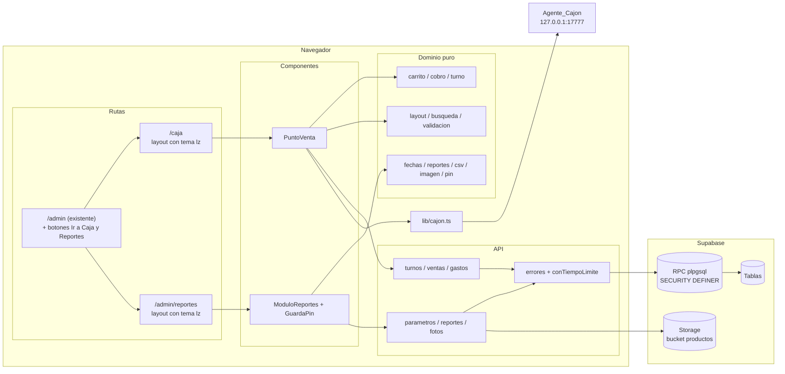
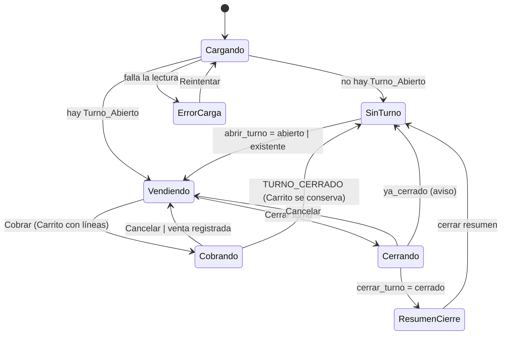
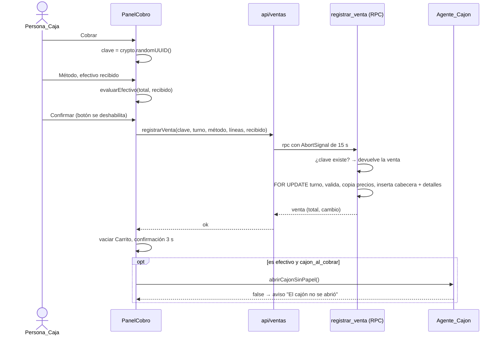
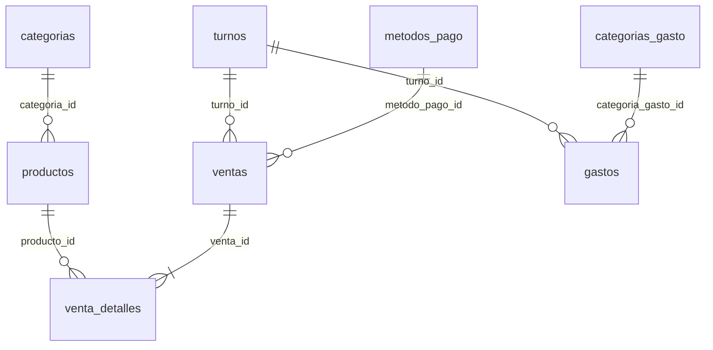

# Design Document

## Overview

Este diseño agrega a la aplicación de inventarios de Panadería LIZPAN (Next.js 14 App Router + Supabase, cliente con llave `anon`, desplegada en Vercel) dos módulos nuevos:

1. **Caja** (`/caja`): punto de venta táctil para abrir turno, armar el Carrito, cobrar, anular ventas del turno, registrar Gastos y cerrar el turno con arqueo.
2. **Reportes y parametrización** (`/admin/reportes`): reportes por secciones con exportación a PDF y CSV, y la configuración que usa la Caja, protegido con un PIN_Admin opcional.

Decisiones abiertas de los requisitos, ya aceptadas con la opción recomendada:

| Decisión | Resultado |
|---|---|
| Entrada a la Caja | Ruta `/caja`, acceso directo de PWA "Caja" y botón "Ir a Caja" en `/admin` |
| Protección de Reportes | PIN_Admin opcional (Requisito 15) |
| Persona_Caja | Lista configurable o nombre libre |
| Anulación | Solo ventas de un Turno_Abierto |
| Categorías de producto | Tabla `categorias` existente y columna `productos.categoria_id`, asignables en el Modulo_Parametrizacion |

### Principios del diseño

- **Sin servidor propio.** La app no tiene server actions ni rutas API; todo corre en el navegador con el cliente `supabase` de `src/lib/supabase.ts`. Por eso **todo movimiento de dinero pasa por funciones RPC de PostgreSQL** (`plpgsql`, `SECURITY DEFINER`), cada una en una sola transacción. Así se cumplen la atomicidad (Req 6.8, 17.9), la regla de un solo Turno_Abierto (Req 2.5), "el primer cierre gana" (Req 3.8) y la idempotencia de los reintentos (Req 17.8), aunque el cliente use la llave pública.
- **Lógica pura separada de React.** Carrito, cálculos de cobro y arqueo, layout, búsqueda, fechas en Bogotá, agregación de reportes, CSV y validaciones viven en módulos TypeScript puros bajo `src/lib/caja/` y `src/lib/reportes/`. Son la base de las pruebas basadas en propiedades.
- **Cero cambios visibles en `/login` y `/`.** No se modifican `src/app/login/page.tsx`, `src/app/page.tsx`, `src/app/layout.tsx`, `src/app/globals.css` ni `AuthProvider`. La paleta y las fuentes de Stitch se cargan solo en los layouts de segmento de `/caja` y `/admin/reportes` (ver "Tema visual").
- **Plan gratuito.** Solo Vercel, Supabase (Postgres, Storage) y el Agente_Cajon local. No hay Realtime, Edge Functions ni servicios externos.

### Hallazgos de la investigación

| Fuente | Hallazgo | Uso en el diseño |
|---|---|---|
| `diseno/stitch/codigo/code.html` y `DESIGN.md` (idéntico a `diseno/paleta/DESIGN (1).md`) | Paleta "Liz Pan Boutique POS": fondos lino (`#F7F5F0`, `#EFECE6`, `#E7E2D8`), verdes salvia (`#244936`, `#2D5A43`, `#3C7356`, `#E9EFEA`, `#D5E3D8`), ámbar (`#D9822B`, `#E8973D`, `#FAF1E6`), carbón (`#1F2421`, `#545B56`), blanco `#FFFFFF`, borde `#E2DDD3`, peligro (`#FDEAE8`, `#C03728`, `#F8C8C3`). Fuentes **Plus Jakarta Sans** (texto) y **Space Grotesk** (cifras, títulos). Sombras `soft`, `card`, `float`. Radios 12–16 px. | Tema `lz-*` en Tailwind y fuentes con `next/font` |
| `diseno/stitch/pantallas/screen.png` | Zonas: encabezado (logo, caja, reloj, operador, salir), barra de búsqueda con atajos, cinta de categorías, cuadrícula de tarjetas con foto y botón "+", ticket a la derecha con líneas `- cantidad +`, total grande y botón "IR A COBRAR". Riel lateral izquierdo de navegación. | Se conservan encabezado, buscador + categorías, cuadrícula y Carrito con total y "Cobrar". Se quitan el riel lateral, "PLU/Balanza", "Recién salido", cliente/puntos, IVA, descuentos y atajos F1–F12 para que la Caja quede simple (Req 16.2 lo permite) |
| `diseno/logo/image.png` | Logo original rojo y amarillo: óvalo, panadero con bandeja de pan, texto "LIZ PAN" y espigas de trigo. | Se dibuja un SVG nuevo con la misma composición (óvalo, texto, espigas, gorro de panadero) usando solo colores de la paleta (Req 16.3) |
| `src/lib/cajon.ts` | `abrirCajonSinPapel()` hace `POST http://127.0.0.1:17777/abrir` con `AbortSignal.timeout(1500)` y devuelve `boolean`. | Se reutiliza sin cambios; su límite de 1,5 s queda dentro de los 3 s del Req 2.9 |
| `supabase/*.sql` | Convenciones: `uuid_generate_v4()`, `TIMESTAMP WITH TIME ZONE DEFAULT TIMEZONE('utc', NOW())`, trigger `update_updated_at_column()`, RLS desactivado en la mayoría de tablas (`fix-rls.sql`), `configuracion(clave UNIQUE, valor TEXT)`, RPC `verificar_password` `SECURITY DEFINER` con `GRANT EXECUTE ... TO anon`. `productos.precio_actual` es `DECIMAL(10,2)`; `categoria_id` está en `schema.sql`. | La migración sigue las mismas convenciones y usa `IF NOT EXISTS` |
| Proyecto de referencia `pos-management-platform` | `registrar_venta` con clave de idempotencia `uuid unique`, bloqueo `FOR UPDATE` del turno para serializar ventas, gastos y cierre, precios copiados de la BD y validación "precio visto = precio vigente" (`PRECIOS_ACTUALIZADOS`); índice único parcial para el turno abierto; reducer puro del carrito; `BILLETES`; rangos Bogotá `[inicio, fin)` con offset `-05:00`; `reducirFoto` con `createImageBitmap(..., { imageOrientation: "from-image" })`. | Patrones adoptados, adaptados a: sin usuarios de Supabase Auth, turno único global, Persona_Caja en texto, métodos de pago configurables y solo WebP |
| Supabase Storage ([docs de control de acceso](https://supabase.com/docs/guides/storage/security/access-control)) | Subir requiere política `INSERT` en `storage.objects`; borrar requiere `SELECT` y `DELETE`. Los buckets públicos sirven archivos por URL pública sin política de lectura. | Políticas `anon` limitadas a `bucket_id = 'productos'` |
| Supabase roles ([timeouts](https://supabase.com/docs/guides/database/postgres/timeouts)) | El rol `anon` tiene `statement_timeout` de 3 s por defecto. | Las RPC de reportes devuelven datos compactos y usan índices por fecha; ver "Riesgos" |
| `jspdf` 4 y `jspdf-autotable` 5 (ya en `package.json`) | `autoTable` pagina sola; jsPDF no dibuja SVG directamente. | El logo SVG se pasa a PNG con un `<canvas>` antes de `addImage` |

## Architecture

### Vista general



### Rutas y archivos

| Archivo | Tipo | Cambio |
|---|---|---|
| `src/app/caja/layout.tsx` | Server component | Nuevo. Carga fuentes con `next/font`, aplica `tema-lz` y metadatos "Caja | LIZPAN" |
| `src/app/caja/page.tsx` | `'use client'` | Nuevo. Renderiza `<PuntoVenta />` |
| `src/app/admin/reportes/layout.tsx` | Server component | Nuevo. Mismas fuentes y tema |
| `src/app/admin/reportes/page.tsx` | `'use client'` | Nuevo. `<GuardaPin><ModuloReportes /></GuardaPin>` |
| `src/app/admin/page.tsx` | Existente | Solo se agregan en el encabezado dos enlaces: "Ir a Caja" (`/caja`) y "Reportes" (`/admin/reportes`). El resto queda igual (Req 11.1) |
| `src/components/productos/ProductoForm.tsx` | Existente | Al editar un producto que no es `materia_prima`, muestra el bloque `<FotoProducto />` (Req 10.1). Crear producto no cambia |
| `src/types/database.ts` | Existente | Se agregan columnas nuevas de `productos` y los tipos de las tablas nuevas |
| `tailwind.config.ts` | Existente | Se agregan colores `lz.*`, fuentes `lz-sans`/`lz-display` y sombras `lz-*` en `theme.extend`. No cambia ninguna clase existente |
| `public/manifest.json` | Existente | Se agrega solo la clave `shortcuts` (Req 1.4) |
| `public/logo-lizpan.svg`, `diseno/logo/logo-lizpan.svg` | Nuevos | Logo SVG (Req 16.3) |
| `supabase/migration-ventas.sql` | Nuevo | Única migración, idempotente (Req 17.2) |
| `supabase/pruebas-ventas.sql` | Nuevo | Pruebas SQL manuales dentro de `BEGIN ... ROLLBACK` |

Sin cambios: `src/app/page.tsx`, `src/app/login/page.tsx`, `src/app/layout.tsx`, `src/app/globals.css`, `src/components/auth/*`, `src/lib/cajon.ts`, `src/lib/supabase.ts`.

**Protección de `/caja` y `/admin/reportes` (Req 1.1, 1.3).** `AuthProvider` ya protege toda ruta que no esté en `PUBLIC_ROUTES = ['/login']`: mientras verifica o redirige muestra solo el spinner y no renderiza `children`. Por eso `/caja` y `/admin/reportes` quedan protegidas sin tocar `AuthProvider`, y abrirlas por URL, marcador, acceso directo o recarga muestra la página directamente si hay sesión.

### Estados de la Caja



Los paneles de Gastos y de Ventas del turno se abren encima de `Vendiendo` y no cambian de estado. Si cualquier RPC responde `TURNO_CERRADO`, la Caja pasa a `SinTurno` con un aviso (Req 6.13, 7.5, 8.8).

### Flujo de cobro



Si la respuesta no llega (15 s o sin conexión), la ventana de cobro queda abierta con "Sin conexión" y "Reintentar". El reintento usa **la misma clave** mientras no cambien el Carrito, el método ni el efectivo recibido. Si la primera llamada sí se guardó, la RPC devuelve esa misma venta y no crea otra (Req 17.8).

### Tema visual y aislamiento de `/login` y `/`

- **Fuentes.** `src/lib/marca/fuentes.ts` define, a nivel de módulo:
  - `Plus_Jakarta_Sans({ subsets: ['latin'], weight: ['400','500','600','700','800'], variable: '--font-lz-sans', display: 'swap', fallback: ['system-ui','Segoe UI','Roboto','Arial','sans-serif'] })`
  - `Space_Grotesk({ subsets: ['latin'], weight: ['600','700'], variable: '--font-lz-display', display: 'swap', fallback: [...] })`

  Solo los layouts de `/caja` y `/admin/reportes` importan este módulo, así que Next.js solo incluye el CSS de estas fuentes en esas rutas. `display: 'swap'` y la lista de respaldo cubren el Req 16.6.
- **Contenedor.** Cada layout envuelve `children` en `<div className={`${sans.variable} ${display.variable} font-lz-sans bg-lz-linen text-lz-charcoal antialiased`}>`. Las variables CSS y las clases se aplican solo dentro de ese `div`.
- **Tailwind.** En `theme.extend` se agrega:

```ts
colors: {
  lz: {
    linen: '#F7F5F0', oat: '#EFECE6', sand: '#E7E2D8',
    'sage-dark': '#244936', sage: '#2D5A43', 'sage-medium': '#3C7356',
    'sage-light': '#E9EFEA', 'sage-tint': '#D5E3D8',
    amber: '#D9822B', 'amber-warm': '#E8973D', 'amber-light': '#FAF1E6',
    charcoal: '#1F2421', 'charcoal-muted': '#545B56',
    surface: '#FFFFFF', border: '#E2DDD3',
    'danger-surface': '#FDEAE8', danger: '#C03728', 'danger-border': '#F8C8C3',
  },
},
fontFamily: {
  'lz-sans': ['var(--font-lz-sans)', 'system-ui', 'Segoe UI', 'Roboto', 'Arial', 'sans-serif'],
  'lz-display': ['var(--font-lz-display)', 'system-ui', 'Segoe UI', 'Roboto', 'Arial', 'sans-serif'],
},
boxShadow: {
  'lz-soft': '0 2px 10px rgba(31, 36, 33, 0.04)',
  'lz-card': '0 3px 14px rgba(31, 36, 33, 0.05)',
  'lz-float': '0 8px 30px rgba(45, 90, 67, 0.12)',
},
```

  El prefijo `lz` evita choques con `bakery-*` y con las clases de Tailwind que usan `/login` y `/`. Los componentes de Caja y Reportes usan solo clases `lz-*` para color (Req 16.1). Una regla de ESLint `no-restricted-syntax` no sirve bien para clases, así que la revisión se hace con una prueba que busca clases de color fuera de `lz-*` en `src/components/caja/**` (ver Testing Strategy).
- **Iconos.** Se usan SVG en línea (no la fuente Material Symbols de Stitch) para no cargar otra fuente externa.
- **Fondo de página.** El `body` sigue con `bg-gray-50` de `globals.css`; la Caja cubre la ventana con un contenedor `fixed inset-0` de alto `window.innerHeight` (Req 9.7), así que no se ve.

### Logo SVG

`public/logo-lizpan.svg` (copia idéntica en `diseno/logo/logo-lizpan.svg`), `viewBox="0 0 320 160"`, sin imágenes rasterizadas:

- Óvalo exterior `#2D5A43` (sage) con borde `#D9822B` (amber) de 6 px y óvalo interior `#F7F5F0` (linen) con trazo fino `#E8973D`.
- Gorro de panadero simplificado arriba del centro en `#FFFFFF` con contorno `#244936`, y una hogaza estilizada en `#D9822B` / `#FAF1E6`.
- Texto `<text>LIZPAN</text>` centrado, `font-family="'Arial Black','Segoe UI Black','Helvetica Neue',Arial,sans-serif"`, `font-weight="900"`, relleno `#2D5A43`, trazo `#244936`. Se usan fuentes del sistema porque un SVG cargado con `` no ve las fuentes web.
- Dos espigas abajo con hojas en `#E8973D` y tallos `#D9822B`.
- `<title>Panadería LIZPAN</title>` para accesibilidad.

`<LogoLizpan alto={40} />` renderiza ``. Con `height` entre 32 y 64 y `width: auto` la proporción no cambia (Req 16.4). Si `onError` se dispara, muestra el texto "Panadería LIZPAN" (Req 16.7).

## Components and Interfaces

### Módulos de dominio puros

Todos sin React ni Supabase, con pruebas en `src/lib/**/__tests__`.

#### `src/lib/caja/carrito.ts`

```ts
export const CANTIDAD_MAX = 999;
export type LineaCarrito = { productoId: string; nombre: string; precio: number; cantidad: number };
export type Carrito = LineaCarrito[];
export type AccionCarrito =
  | { tipo: 'agregar'; producto: { id: string; nombre: string; precio: number } }
  | { tipo: 'sumar'; productoId: string }
  | { tipo: 'restar'; productoId: string }          // con cantidad 1 quita la línea
  | { tipo: 'fijar'; productoId: string; cantidad: number } // 0 quita; inválido no cambia
  | { tipo: 'quitar'; productoId: string }
  | { tipo: 'vaciar' }
  | { tipo: 'reemplazar'; carrito: Carrito };
export type ResultadoCarrito = { carrito: Carrito; aviso?: 'CANTIDAD_MAXIMA' | 'CANTIDAD_INVALIDA' };
export function reducirCarrito(c: Carrito, a: AccionCarrito): ResultadoCarrito;
export const subtotalLinea = (l: LineaCarrito) => l.cantidad * l.precio;
export const totalCarrito = (c: Carrito) => c.reduce((s, l) => s + subtotalLinea(l), 0);
export const articulosCarrito = (c: Carrito) => c.reduce((s, l) => s + l.cantidad, 0);
export function firmaCarrito(c: Carrito): string; // para reutilizar la clave de cobro
export function conciliarCarrito(c: Carrito, vigentes: ProductoCaja[]): { carrito: Carrito; retirados: string[]; conPrecioNuevo: string[] };
export function parsearCantidad(texto: string): { ok: true; valor: number } | { ok: false }; // entero 0..999
```

Reglas: `agregar` de un producto nuevo crea una línea con cantidad 1 y el precio de la tarjeta; si ya existe, equivale a `sumar`. `sumar` con 999 deja 999 y devuelve `aviso: 'CANTIDAD_MAXIMA'`. `fijar` con 0 quita la línea; con un valor fuera de 1..999 o no entero devuelve el mismo carrito y `aviso: 'CANTIDAD_INVALIDA'`. Nunca hay dos líneas con el mismo `productoId` (Req 5.1–5.11).

#### `src/lib/caja/cobro.ts`

```ts
export const BILLETES = [2000, 5000, 10000, 20000, 50000, 100000] as const;
export const RECIBIDO_MAX = 10_000_000;
export function botonesRapidos(total: number): number[]; // [total, ...BILLETES.filter(b => b > total)]
export type EstadoEfectivo =
  | { estado: 'invalido'; motivo: 'VACIO' | 'NO_ENTERO' | 'NEGATIVO' | 'MAXIMO' }
  | { estado: 'falta'; falta: number }
  | { estado: 'completo'; cambio: number };
export function evaluarEfectivo(total: number, textoRecibido: string): EstadoEfectivo;
export function datosPago(total: number, esEfectivo: boolean, recibido: number | null): { recibido: number; cambio: number };
```

Para un método que no es efectivo, `datosPago` devuelve `{ recibido: total, cambio: 0 }` (Req 6.4).

#### `src/lib/caja/turno.ts`

```ts
export type MovimientosTurno = {
  base: number;
  ventas: { total: number; esEfectivo: boolean; estado: 'registrada' | 'anulada'; metodoPagoId: string }[];
  gastos: { valor: number; eliminado: boolean }[];
};
export function efectivoEsperado(m: MovimientosTurno): number; // base + Σ ventas efectivo registradas − Σ gastos no eliminados
export const efectivoDisponible = efectivoEsperado;          // misma fórmula (Req 8.4)
export function requiereAdvertenciaGasto(valor: number, m: MovimientosTurno): boolean; // valor > efectivoDisponible(m)
export function totalesPorMetodo(m: MovimientosTurno): Map<string, number>;
export function diferenciaCierre(contado: number, esperado: number): number;
export function clasificarDiferencia(d: number): 'Cuadra' | 'Sobrante' | 'Faltante';
```

La misma fórmula existe en SQL (`efectivo_esperado_turno`). El servidor es la fuente de verdad en el cierre; la versión TS se usa para mostrar y se prueba contra un modelo.

#### `src/lib/caja/layout.ts`

```ts
export const LIMITES = { anchoMin: 320, anchoMax: 3840, altoMin: 480, altoMax: 2160 };
export const MEDIDAS = { encabezado: 64, barraMovil: 64, padding: 16, gap: 12, tarjetaMin: 120, tarjetaMax: 200, quiebre: 768 };
export type LayoutCaja = {
  modo: 'movil' | 'escritorio';
  altoVentana: number;         // = alto (acotado), alto del contenedor raíz
  columnas: number;
  anchoTarjeta: number;
  anchoCarrito: number;        // escritorio: 30 % del ancho entre 300 y 420
  altoDisponible: number;      // alto − encabezado (− barra en móvil)
  altoCarritoExpandido: number; // floor(0,85 × alto)
};
export function calcularLayout(ancho: number, alto: number): LayoutCaja;
```

Algoritmo (entradas fuera de rango se acotan a `LIMITES`):

1. `modo = ancho < 768 ? 'movil' : 'escritorio'`.
2. `anchoCarrito = escritorio ? clamp(round(0.3 × ancho), 300, 420) : ancho`.
3. `anchoCuadricula = (escritorio ? ancho − anchoCarrito : ancho) − 2 × 16`.
4. `columnas = max(2, ceil((anchoCuadricula + 12) / (200 + 12)))`: el menor número de columnas que deja la tarjeta en 200 px o menos.
5. `anchoTarjeta = (anchoCuadricula − 12 × (columnas − 1)) / columnas`.

Con estas medidas la tarjeta siempre queda entre 120 y 200 px. Con 2 columnas el ancho mínimo de cuadrícula es 288 px (ventana de 320 px), que da 138 px. Con 3 o más columnas, si `n − 1` columnas dejaban tarjetas de más de 200 px, con `n` la tarjeta mide más de `(200 × (n − 1) − 12) / n`, que es al menos 129 px. La propiedad 9 lo verifica para todo el rango.

#### `src/lib/caja/busqueda.ts`

```ts
export function normalizarTexto(s: string): string; // NFD, sin diacríticos (\p{M}), minúsculas, trim
export type ProductoCaja = { id: string; nombre: string; precio: number; categoriaId: string | null; imagenUrl: string | null; orden: number | null };
export function filtrarProductos(ps: ProductoCaja[], texto: string, categoriaId: string | 'todas'): ProductoCaja[];
export function compararProductos(a: ProductoCaja, b: ProductoCaja): number; // orden asc, null al final, luego nombre normalizado con localeCompare('es')
export function esVendible(p: ProductoBD): boolean; // activo && tipo !== 'materia_prima' && visible_caja
```

`normalizarTexto` quita tildes y diéresis (á→a, ü→u) pero también convierte ñ en n, porque NFD separa la virgulilla. Se acepta: buscar "pan" encuentra "Pañuelo" igual que un buscador común, y el requisito pide no distinguir tildes.

#### `src/lib/caja/validacion.ts`

```ts
export function validarNombrePersona(s: string): { ok: true; valor: string } | { ok: false; error: 'VACIO' | 'LARGO' }; // trim, 1..60
export function validarEnteroEnRango(texto: string, min: number, max: number): { ok: true; valor: number } | { ok: false; error: 'VACIO' | 'NO_ENTERO' | 'RANGO' };
export function validarTextoLargo(s: string, min: number, max: number): { ok: true; valor: string } | { ok: false; error: 'CORTO' | 'LARGO' };
export function nombreRepetido(nombre: string, existentes: { id: string; nombre: string }[], idPropio?: string): boolean; // compara con normalizarTexto
export type CambioMetodo = { id: string; activo?: boolean; esEfectivo?: boolean };
export function puedeAplicarCambioMetodo(metodos: { id: string; activo: boolean; esEfectivo: boolean }[], cambio: CambioMetodo): boolean; // ¿queda al menos un método activo de efectivo?
```

`validarEnteroEnRango` acepta solo `^\d+$` (sin signos, puntos ni comas) después de `trim`. "-5" da `NO_ENTERO`; el requisito lo llama "negativo", así que el mensaje de la UI es "Debe ser un número entero mayor o igual a 0".

#### `src/lib/fechas/bogota.ts`

```ts
export const ZONA = 'America/Bogota';
export function diaLocal(isoUtc: string | Date): string;   // 'AAAA-MM-DD' = fecha UTC − 5 h
export function horaLocal(isoUtc: string | Date): string;  // 'HH:mm' 24 h
export function fechaHoraLocal(isoUtc: string | Date): string; // 'AAAA-MM-DD HH:mm'
export type Rango = { desde: string; hasta: string };
export function atajoRango(nombre: 'hoy' | 'ayer' | 'ultimos7' | 'esteMes' | 'mesAnterior', ahora?: Date): Rango;
export function validarRango(desde: string | null, hasta: string | null): { ok: true; rango: Rango } | { ok: false; error: 'FALTA_FECHA' | 'INICIO_POSTERIOR' | 'MAS_DE_366' };
export function limitesUtc(r: Rango): { inicio: string; fin: string }; // [desde 00:00 −05:00, hasta+1 00:00 −05:00)
```

Colombia no tiene horario de verano, así que `diaLocal` usa un desplazamiento fijo de −5 h. Una prueba compara contra `Intl.DateTimeFormat('en-CA', { timeZone: 'America/Bogota' })`. "Últimos 7 días" va de `hoy − 6` a `hoy`. Un rango de 366 días se permite; 367 no.

#### `src/lib/reportes/agregar.ts`

```ts
export type DatosReporte = {
  ventas: VentaReporte[];         // todas las del rango, incluidas anuladas
  productos: ProductoVendido[];   // agregados en SQL, sin anuladas
  gastos: GastoReporte[];         // no eliminados del rango
  turnos: TurnoReporte[];         // abiertos en el rango
  metodos: { id: string; nombre: string; esEfectivo: boolean; activo: boolean }[];
  categoriasGasto: { id: string; nombre: string; activo: boolean }[];
};
export type Reporte = {
  resumen: { totalVendido: number; numeroVentas: number; promedio: number; totalGastos: number; neto: number };
  porDia: { dia: string; total: number; cantidad: number }[];
  ventas: VentaReporte[];        // registradas, más reciente primero
  anuladas: VentaReporte[];      // más reciente primero
  productos: ProductoVendido[];  // valor desc, nombre asc
  turnos: FilaTurno[];
  gastos: GastoReporte[];        // más reciente primero
  gastosPorCategoria: { categoriaId: string; nombre: string; total: number }[];
  porMetodo: { metodoPagoId: string; nombre: string; total: number; cantidad: number }[];
  vacio: boolean;                // sin ventas registradas ni gastos
};
export function construirReporte(d: DatosReporte): Reporte;
```

`promedio = cantidad === 0 ? 0 : Math.round(total / cantidad)`. `vacio` usa todas las ventas del rango (también las anuladas cuentan como movimiento para no esconder la lista de anuladas): `vacio = ventas.length === 0 && gastos.length === 0` (Req 12.10).

#### `src/lib/reportes/tablas.ts`

```ts
export type Seccion = 'resumen' | 'ventas' | 'productos' | 'turnos' | 'gastos' | 'metodos';
export type Celda = string | number | null;
export type Tabla = { titulo: string; columnas: string[]; filas: Celda[][] };
export function tablasDeSeccion(r: Reporte, s: Seccion, formato: 'pantalla' | 'csv'): Tabla[];
export function nombreArchivo(s: Seccion, r: Rango, ext: 'pdf' | 'csv'): string; // reporte-{seccion}-{desde}-{hasta}.{ext}
```

La pantalla, el PDF y el CSV salen de la misma función, así que muestran las mismas filas y columnas (Req 13.2, 13.3, 13.5). En formato `csv`, los montos van como enteros y las fechas como `AAAA-MM-DD HH:mm` (Req 13.4); en `pantalla` y PDF, los montos pasan por `formatCurrency`. En Ventas, el CSV tiene una fila por Venta con columna Estado y, para anuladas, motivo y persona (Req 13.3).

#### `src/lib/reportes/csv.ts`

```ts
export function serializarCsv(columnas: string[], filas: Celda[][]): string; // sin BOM, separador ',', fin de línea '\r\n'
export function parsearCsv(texto: string): string[][];                    // RFC 4180, ignora BOM inicial
export function csvConBom(texto: string): Blob;                            // '\uFEFF' + texto, type 'text/csv;charset=utf-8'
```

Un campo va entre comillas si contiene `,`, `"`, `\r` o `\n`, o si empieza o termina con espacio; las comillas internas se duplican. `null` se escribe como campo vacío. No se antepone `'` a valores que empiezan con `=`, `+`, `-` o `@` porque rompería la ida y vuelta del Req 13.5 y los montos negativos; los datos los escribe la misma familia (ver "Notas de seguridad").

#### `src/lib/imagen/procesarFoto.ts`

```ts
export const FOTO = { ladoMax: 600, pesoMaxOriginal: 25 * 1024 * 1024, pesoMaxFinal: 300 * 1024, calidades: [0.8, 0.7, 0.6, 0.5] };
export const TIPOS = ['image/jpeg', 'image/png', 'image/webp'];
export function dimensionesReducidas(ancho: number, alto: number): { ancho: number; alto: number }; // escala = min(1, 600 / max(w, h)), redondeo, mínimo 1
export type Codificador = (lienzo: HTMLCanvasElement, calidad: number) => Promise<Blob | null>;
export type ErrorFoto = 'FORMATO' | 'DANADO' | 'GRANDE' | 'SIN_WEBP' | 'PESADA';
export async function procesarFoto(archivo: File, deps?: { codificar?: Codificador; decodificar?: typeof createImageBitmap }): Promise<{ ok: true; archivo: File; calidad: number } | { ok: false; error: ErrorFoto }>;
export function elegirCalidad(pesos: (calidad: number) => number | null): { calidad: number } | { error: 'SIN_WEBP' | 'PESADA' }; // núcleo puro del bucle
```

Pasos: valida tipo (`FORMATO`) y tamaño (`GRANDE`); `createImageBitmap(archivo, { imageOrientation: 'from-image' })` corrige EXIF, y si falla da `DANADO`; dibuja en un `canvas` con `dimensionesReducidas`; codifica WebP con 0,8 y, si pesa más de 300 KB, repite con 0,7, 0,6 y 0,5. Si `toBlob` devuelve `null` o un tipo distinto de `image/webp` (Safari antiguo devuelve PNG), da `SIN_WEBP`. Si con 0,5 sigue pesando más de 300 KB, da `PESADA` (Req 10.2–10.5). A diferencia de `reducirFoto` del proyecto de referencia, no cae a JPEG.

#### `src/lib/seguridad/pin.ts`

```ts
export const PIN = { intentos: 5, bloqueoMs: 5 * 60_000, duracionMs: 8 * 3_600_000 };
export type EstadoIntentos = { fallidos: number; bloqueadoHasta: number | null };
export function registrarFallo(e: EstadoIntentos, ahora: number): EstadoIntentos; // al 5.º fallo: bloqueadoHasta = ahora + 5 min
export function registrarExito(): EstadoIntentos;                                    // { fallidos: 0, bloqueadoHasta: null }
export function estaBloqueado(e: EstadoIntentos, ahora: number): { bloqueado: boolean; restanteMs: number; estado: EstadoIntentos }; // al vencer reinicia a 0
export function accesoVigente(verificadoEn: number | null, ahora: number): boolean;  // ahora − verificadoEn < 8 h
export function validarPinNuevo(s: string): boolean;                                 // /^\d{4,8}$/
```

`EstadoIntentos` se guarda en `localStorage['lz_pin_intentos']` (mismo navegador, Req 15.3). La marca de verificación se guarda en `sessionStorage['lz_pin_ok']` como un número de milisegundos, no el PIN (Req 15.2, 15.5). Un error de RPC o un tiempo agotado no llama a `registrarFallo` (Req 15.8).

### Capa de API (`src/lib/api/`)

Sigue el estilo de `productos.ts` (funciones `async` que usan `supabase`), con un ayudante común:

```ts
// src/lib/api/errores.ts
export type CodigoError =
  | 'SIN_CONEXION' | 'TURNO_CERRADO' | 'TURNO_NO_ABIERTO' | 'PRECIOS_ACTUALIZADOS'
  | 'PRODUCTO_NO_DISPONIBLE' | 'METODO_INVALIDO' | 'RECIBIDO_INVALIDO' | 'DATOS_INVALIDOS'
  | 'VENTA_NO_EXISTE' | 'GASTO_NO_EXISTE' | 'PIN_INCORRECTO' | 'PIN_INVALIDO'
  | 'NOMBRE_REPETIDO' | 'SIN_METODO_EFECTIVO' | 'RANGO_INVALIDO' | 'DESCONOCIDO';
export class ErrorApp extends Error { constructor(public codigo: CodigoError, public detalle?: unknown) { super(codigo); } }
export async function llamarRpc<T>(nombre: string, args: object, ms = 15_000): Promise<T>;
```

`llamarRpc`:
1. Si `navigator.onLine === false`, lanza `SIN_CONEXION` sin llamar (Req 17.7).
2. Llama `supabase.rpc(nombre, args).abortSignal(AbortSignal.timeout(ms))`.
3. Si se aborta o hay `TypeError: Failed to fetch`, lanza `SIN_CONEXION`.
4. Si PostgreSQL lanza una excepción cuyo `message` empieza con un código conocido (`TURNO_CERRADO`, etc.), lanza ese `ErrorApp`; si no, `DESCONOCIDO`. Un `23505` (`unique_violation`) en tablas de parámetros se traduce a `NOMBRE_REPETIDO`.

| Módulo | Funciones |
|---|---|
| `turnos.ts` | `obtenerTurnoAbierto()`, `abrirTurno(clave, persona, base)`, `resumenTurno(turnoId)`, `cerrarTurno(turnoId, clave, persona, contado)` |
| `ventas.ts` | `obtenerCatalogoCaja()`, `registrarVenta(entrada)`, `ventasDelTurno(turnoId)`, `anularVenta(ventaId, clave, motivo, persona)`, `detalleVenta(ventaId)` |
| `gastos.ts` | `gastosDelTurno(turnoId)`, `registrarGasto(entrada)`, `eliminarGasto(gastoId)` |
| `parametros.ts` | `obtenerParametrosCaja()` (métodos activos ordenados, categorías de gasto activas, personas activas, base por defecto, opciones de cajón, categorías de producto), CRUD de `metodos_pago`, `categorias_gasto`, `personas_caja`; `guardarConfig(clave, valor)`; `productosConfigurables()`; `actualizarProductoCaja(id, { visible_caja?, orden_caja?, categoria_id? })` |
| `reportes.ts` | `obtenerReporte(rango)` → `DatosReporte`; `detalleVenta` reutilizado |
| `fotos.ts` | `subirFotoProducto(productoId, archivo, pathAnterior)`, `quitarFotoProducto(productoId, pathAnterior)`, `urlFoto(path)` |
| `pin.ts` | `pinConfigurado()`, `verificarPin(pin)` (10 s), `cambiarPin(actual, nuevo \| null)` |

`obtenerCatalogoCaja()` hace una sola consulta: `productos.select('id,nombre,precio_actual,categoria_id,imagen_path,orden_caja').eq('activo', true).neq('tipo_producto','materia_prima').eq('visible_caja', true)`, y devuelve todo o lanza error, nunca una lista parcial (Req 4.10). El precio se convierte con `Math.round(precio_actual)`, igual que en SQL.

`subirFotoProducto`:
1. `path = `${productoId}-${Date.now()}.webp``.
2. `storage.from('productos').upload(path, archivo, { contentType: 'image/webp', cacheControl: '31536000', upsert: false })` dentro de `Promise.race` con 30 s.
3. `productos.update({ imagen_path: path }).eq('id', productoId)`.
4. Si 2 o 3 fallan o se agota el tiempo, intenta `storage.remove([path])` y lanza error; `imagen_path` queda igual (Req 10.8).
5. Si todo sale bien y había `pathAnterior`, intenta `storage.remove([pathAnterior])` e ignora su error (Req 10.7).

Como cada foto tiene una ruta nueva, la caché de un año no muestra fotos viejas.

### Hooks

| Hook | Responsabilidad |
|---|---|
| `useLayoutCaja()` | Calcula `calcularLayout(window.innerWidth, window.innerHeight)` en `useLayoutEffect` antes del primer pintado de la cuadrícula. Escucha `resize` y `orientationchange` y recalcula una sola vez 150 ms después del último evento (≤ 200 ms, Req 9.2). Devuelve `null` en el servidor y en el primer render. Solo cambia el layout; Carrito, búsqueda, filtro y cobro viven en otros estados y no se reinician (Req 9.9, 9.10) |
| `useTurnoCaja()` | Lee el Turno_Abierto al montar y en `visibilitychange`/`focus`; expone `turno`, `resumen`, `ventas`, `gastos` y `refrescar()` |
| `useCatalogoCaja()` | Carga productos y parámetros; `reintentar()` |
| `useBusquedaDiferida(texto, 150)` | Aplica el texto 150 ms después de la última tecla (≤ 300 ms, Req 4.5) |
| `useCajon()` | `abrirSiCorresponde(evento: 'cobro_efectivo' \| 'turno')` lee `cajon_al_cobrar` / `cajon_en_turno`; si está desactivado no llama al agente (Req 14.11); si `abrirCajonSinPapel()` da `false`, muestra un aviso (Req 2.9, 3.10, 6.14) |
| `useClaveIdempotente(firma)` | Devuelve un `crypto.randomUUID()` que cambia solo cuando cambia `firma` |

### Componentes de Caja (`src/components/caja/`)

| Componente | Contenido | Requisitos |
|---|---|---|
| `PuntoVenta` | Máquina de estados de la Caja; contiene `useReducer(reducirCarrito)`; pide confirmación con `Modal` antes de ir a `/admin` si el Carrito tiene líneas | 1.6–1.8, 2.1 |
| `EncabezadoCaja` | Logo, Persona_Caja y hora de apertura, reloj, botones "Ventas", "Gastos", "Cerrar turno", "Administración" | 1.6, 3.1, 16.2, 16.4 |
| `AbrirTurno` | `SelectorPersona`, campo Base_Caja precargado, errores por campo | 2.2–2.10 |
| `SelectorPersona` | Botones con las Persona_Caja activas y un campo "Otro nombre" | 2.2, 3.2, 7.2, 8.1 |
| `BarraBusqueda` | Buscador (`maxLength=50`) y cinta de categorías ("Todas" primero) | 4.5, 4.6 |
| `CuadriculaProductos` / `TarjetaProducto` | Cuadrícula con `gridTemplateColumns: repeat(columnas, 1fr)`; tarjeta con foto 4:3, nombre en 2 líneas (`line-clamp-2`), precio con `formatCurrency`; toda la tarjeta es el botón (≥ 44 px) | 4.1–4.4, 9.6, 9.8 |
| `ImagenProducto` | `` con la URL pública; si no hay `imagen_path` o `onError`, muestra la inicial en mayúscula sobre `bg-lz-sage-light` | 4.4, 10.11 |
| `EstadoVacioCaja` | Dos variantes: sin coincidencias (botón "Limpiar búsqueda") y sin productos vendibles | 4.8, 4.9 |
| `PanelCarrito` | Escritorio: panel derecho de `anchoCarrito`. Móvil: barra fija de 64 px con total y artículos; al tocarla se expande hasta `altoCarritoExpandido` con botón "Contraer". Líneas con `-`, campo de cantidad, `+`, eliminar; "Vaciar" con confirmación; total y "Cobrar" | 5.*, 6.1, 9.3–9.5, 9.10 |
| `PanelCobro` | Total, botones de Metodo_Pago activos en su orden, campo de efectivo, `botonesRapidos`, cambio o faltante, confirmar con indicador de progreso, "Cancelar" | 6.2–6.9, 6.12, 6.13 |
| `ConfirmacionVenta` | Total y cambio; se cierra a los 3 s o al tocar | 6.15 |
| `ListaVentasTurno` / `DialogoAnulacion` | Lista del turno (más reciente primero) con hora, total, método y estado; anulación con motivo y Persona_Caja | 7.* |
| `PanelGastos` | Formulario (valor, concepto, categoría, persona), advertencia de efectivo disponible, lista y total, eliminar con confirmación | 8.* |
| `CierreTurno` / `ResultadoCierre` | Resumen del turno, efectivo contado, persona; resultado con "Cuadra/Sobrante/Faltante" | 3.* |
| `AvisoSinConexion` | Mensaje "Sin conexión" con "Reintentar", dentro del panel que falló | 17.7 |

Distribución (Req 9.3–9.7):

```
Escritorio (ancho ≥ 768)                       Móvil (ancho < 768)
┌───────────────────────────────┬──────────┐   ┌──────────────────────┐
│ Encabezado (64 px)                        │   │ Encabezado (64 px)   │
├───────────────────────────────┬──────────┤   ├──────────────────────┤
│ Buscador + categorías          │ Carrito  │   │ Buscador + categorías│
│ ┌────┐┌────┐┌────┐┌────┐       │ (30 %,   │   │ ┌────┐┌────┐         │
│ │    ││    ││    ││    │ scroll│ 300–420) │   │ │    ││    │  scroll │
│ └────┘└────┘└────┘└────┘       │ líneas   │   │ └────┘└────┘         │
│                                │ (scroll) │   ├──────────────────────┤
│                                │ Total    │   │ Barra Carrito ≥56 px │
│                                │ [Cobrar] │   │ $ total · n art.     │
└───────────────────────────────┴──────────┘   └──────────────────────┘
```

El contenedor raíz usa `style={{ height: layout.altoVentana }}` y `overflow: hidden`; solo la cuadrícula y la lista de líneas tienen `overflow-y: auto` (Req 9.7).

### Componentes de Reportes (`src/components/reportes/`)

| Componente | Contenido | Requisitos |
|---|---|---|
| `GuardaPin` | Si `pin_admin_configurado()` es verdadero y `accesoVigente` es falso, muestra solo el campo de PIN; con bloqueo, el tiempo restante; antes de cada consulta vuelve a revisar `accesoVigente` | 15.1–15.3, 15.6–15.8 |
| `ModuloReportes` | Encabezado con logo y "Volver a Administración"; `NavegacionSecciones` (siete pestañas, una visible, la activa resaltada); `FiltroRango` compartido entre secciones; carga `obtenerReporte(rango)` y guarda el último reporte válido | 11.2–11.7, 12.11–12.13 |
| `FiltroRango` | Fechas `desde`/`hasta` y atajos; con error muestra el mensaje y no consulta | 11.4, 11.7, 12.12 |
| `SeccionResumen`, `SeccionVentas`, `SeccionProductos`, `SeccionTurnos`, `SeccionGastos`, `SeccionMetodos` | Renderizan `tablasDeSeccion(reporte, seccion, 'pantalla')`; Ventas permite seleccionar una venta y carga `detalleVenta` | 12.1–12.7 |
| `EstadoVacioReporte` | "Sin movimientos en este rango" | 12.10 |
| `BotonesExportar` | "Descargar PDF" y "Descargar CSV"; deshabilitados con estado vacío | 13.1, 13.6, 13.7 |
| `SeccionConfiguracion` | Subpaneles: `ConfigMetodosPago`, `ConfigCategoriasGasto`, `ConfigPersonas`, `ConfigBaseCaja`, `ConfigProductosCaja` (visible, orden, categoría, foto), `ConfigCajon`, `ConfigPin` | 14.*, 15.4, 15.9 |
| `FotoProducto` | Vista previa, subir/reemplazar/quitar con confirmación, progreso y botones deshabilitados; usado en `ConfigProductosCaja` y en `ProductoForm` | 10.1–10.10 |

Para evitar cifras de otro rango (Req 12.13), cada consulta lleva un número de petición; al llegar la respuesta se descarta si ya no es la última. Si falla, se muestra el error con "Reintentar" en lugar de las cifras.

### Exportación

- **CSV:** `csvConBom(serializarCsv(...))` → `URL.createObjectURL` → `<a download>`. Si algo lanza antes de crear el `Blob`, no se descarga nada (Req 13.7).
- **PDF:** `jsPDF({ orientation: 'landscape', format: 'letter' })`. El logo se rasteriza una vez: se carga `/logo-lizpan.svg` en un `Image`, se dibuja en un `canvas` de 320×160 y se usa `toDataURL('image/png')`. Si eso falla, el PDF lleva el texto "Panadería LIZPAN". Luego van el nombre de sección, el rango, "Generado: AAAA-MM-DD HH:mm" en Bogotá y una `autoTable` por cada `Tabla`, que pagina sola. El documento se arma completo en memoria y solo al final se llama `doc.save(nombreArchivo(...))`.

## Data Models

### Migración `supabase/migration-ventas.sql`

Se ejecuta a mano en el SQL Editor. Todas las sentencias son repetibles: `CREATE TABLE IF NOT EXISTS`, `ADD COLUMN IF NOT EXISTS`, `CREATE INDEX IF NOT EXISTS`, `CREATE OR REPLACE FUNCTION`, `DROP TRIGGER IF EXISTS` + `CREATE TRIGGER`, `DROP POLICY IF EXISTS` + `CREATE POLICY`, datos iniciales con `INSERT ... SELECT ... WHERE NOT EXISTS` o `ON CONFLICT DO NOTHING` (Req 17.2). No borra ni renombra nada y no toca filas existentes de `productos`, `inventarios`, `inventario_detalles`, `inventario_facturas` ni `configuracion` (Req 17.3). Las columnas nuevas de `productos` tienen valores por defecto, así que las filas existentes quedan visibles con orden 0 y sin foto.



#### Extensiones y utilidades

```sql
CREATE EXTENSION IF NOT EXISTS pgcrypto WITH SCHEMA extensions;  -- crypt() y gen_salt('bf') para el PIN

-- Clave de unicidad de nombres: sin espacios extremos, minúsculas y sin tildes (la ñ se conserva)
CREATE OR REPLACE FUNCTION normalizar_nombre(p TEXT) RETURNS TEXT
LANGUAGE sql IMMUTABLE AS $$
  SELECT lower(translate(trim(p), 'ÁÉÍÓÚÜáéíóúü', 'AEIOUUaeiouu'))
$$;
```

#### Columnas nuevas en `productos`

| Columna | Tipo | Regla |
|---|---|---|
| `categoria_id` | `UUID REFERENCES categorias(id) ON DELETE SET NULL` | `ADD COLUMN IF NOT EXISTS` por si la base no viene de `schema.sql` |
| `imagen_path` | `TEXT NULL` | Ruta en el bucket, `{productoId}-{ms}.webp` |
| `visible_caja` | `BOOLEAN NOT NULL DEFAULT TRUE` | |
| `orden_caja` | `INTEGER NOT NULL DEFAULT 0 CHECK (orden_caja BETWEEN 0 AND 9999)` | |

Nota de coherencia: el Req 14.6 dice que un producto sin configuración tiene orden 0, y el Req 4.7 habla de "productos sin orden configurado" que van al final. Con `DEFAULT 0` y `NOT NULL` todos los productos tienen orden, así que ese caso no ocurre en la base. `compararProductos` igual pone `null` al final por si llega un dato incompleto. Si el negocio prefiere que un producto nuevo vaya al final, hay que volver a los requisitos y cambiar el 14.6.

#### Tablas de parámetros

RLS desactivado, igual que `productos` y `configuracion` (`fix-rls.sql`). El cliente las edita directamente.

```sql
CREATE TABLE IF NOT EXISTS metodos_pago (
  id UUID DEFAULT uuid_generate_v4() PRIMARY KEY,
  nombre VARCHAR(40) NOT NULL CHECK (length(trim(nombre)) BETWEEN 1 AND 40),
  es_efectivo BOOLEAN NOT NULL DEFAULT FALSE,
  activo BOOLEAN NOT NULL DEFAULT TRUE,
  orden INTEGER NOT NULL DEFAULT 0 CHECK (orden BETWEEN 0 AND 999),
  created_at TIMESTAMPTZ DEFAULT TIMEZONE('utc', NOW()),
  updated_at TIMESTAMPTZ DEFAULT TIMEZONE('utc', NOW())
);
CREATE UNIQUE INDEX IF NOT EXISTS metodos_pago_nombre_unico ON metodos_pago (normalizar_nombre(nombre));

CREATE TABLE IF NOT EXISTS categorias_gasto (
  id UUID DEFAULT uuid_generate_v4() PRIMARY KEY,
  nombre VARCHAR(40) NOT NULL CHECK (length(trim(nombre)) BETWEEN 1 AND 40),
  activo BOOLEAN NOT NULL DEFAULT TRUE,
  created_at ..., updated_at ...
);
CREATE UNIQUE INDEX IF NOT EXISTS categorias_gasto_nombre_unico ON categorias_gasto (normalizar_nombre(nombre));

CREATE TABLE IF NOT EXISTS personas_caja (
  id UUID DEFAULT uuid_generate_v4() PRIMARY KEY,
  nombre VARCHAR(60) NOT NULL CHECK (length(trim(nombre)) BETWEEN 1 AND 60),
  activo BOOLEAN NOT NULL DEFAULT TRUE,
  created_at ..., updated_at ...
);
CREATE UNIQUE INDEX IF NOT EXISTS personas_caja_nombre_unico ON personas_caja (normalizar_nombre(nombre));
```

Trigger `AFTER UPDATE OR DELETE ON metodos_pago FOR EACH ROW`: si después del cambio no queda ninguna fila con `activo AND es_efectivo`, lanza `SIN_METODO_EFECTIVO` y la transacción se revierte (Req 14.2). La UI hace la misma revisión antes de guardar para mostrar el mensaje sin ir al servidor. La UI no ofrece borrar métodos, categorías ni personas, solo desactivarlos (Req 14.8).

Datos iniciales (solo si no existe un nombre equivalente):

| Tabla | Filas |
|---|---|
| `metodos_pago` | Efectivo (efectivo, orden 0), Transferencia (orden 1), Nequi (orden 2) |
| `categorias_gasto` | Insumos, Servicios, Transporte, Otros |
| `configuracion` | `base_caja_defecto = '0'`, `cajon_al_cobrar = 'true'`, `cajon_en_turno = 'true'` con `ON CONFLICT (clave) DO NOTHING`. `admin_pin_hash` no se crea: su ausencia significa "sin PIN" |

#### Tablas de movimientos

RLS **activado** con solo una política `SELECT` para `anon` y `authenticated`. No hay políticas de escritura, así que solo las RPC `SECURITY DEFINER` pueden escribir. Esto impide que un error del cliente deje una venta sin detalles o cambie una venta cerrada.

```sql
CREATE TABLE IF NOT EXISTS turnos (
  id UUID DEFAULT uuid_generate_v4() PRIMARY KEY,
  clave_apertura UUID NOT NULL UNIQUE,
  abierto_por VARCHAR(60) NOT NULL CHECK (length(trim(abierto_por)) BETWEEN 1 AND 60),
  base INTEGER NOT NULL CHECK (base BETWEEN 0 AND 99999999),
  abierto_en TIMESTAMPTZ NOT NULL DEFAULT NOW(),
  cerrado_en TIMESTAMPTZ,
  cerrado_por VARCHAR(60),
  clave_cierre UUID UNIQUE,
  efectivo_contado INTEGER CHECK (efectivo_contado BETWEEN 0 AND 99999999),
  efectivo_esperado INTEGER CHECK (efectivo_esperado BETWEEN -99999999 AND 99999999),
  diferencia INTEGER CHECK (diferencia BETWEEN -99999999 AND 99999999),
  CONSTRAINT turnos_cierre_coherente CHECK (
    (cerrado_en IS NULL AND cerrado_por IS NULL AND clave_cierre IS NULL
      AND efectivo_contado IS NULL AND efectivo_esperado IS NULL AND diferencia IS NULL)
    OR
    (cerrado_en IS NOT NULL AND length(trim(cerrado_por)) BETWEEN 1 AND 60 AND clave_cierre IS NOT NULL
      AND efectivo_contado IS NOT NULL AND efectivo_esperado IS NOT NULL
      AND diferencia = efectivo_contado - efectivo_esperado)
  )
);
-- Un único Turno_Abierto en toda la panadería (Req 2.5)
CREATE UNIQUE INDEX IF NOT EXISTS turnos_un_abierto ON turnos ((TRUE)) WHERE cerrado_en IS NULL;
CREATE INDEX IF NOT EXISTS turnos_abierto_en ON turnos (abierto_en DESC);

CREATE TABLE IF NOT EXISTS ventas (
  id UUID DEFAULT uuid_generate_v4() PRIMARY KEY,
  clave UUID NOT NULL UNIQUE,                      -- idempotencia (Req 17.8)
  turno_id UUID NOT NULL REFERENCES turnos(id) ON DELETE RESTRICT,
  creado_en TIMESTAMPTZ NOT NULL DEFAULT NOW(),
  total INTEGER NOT NULL CHECK (total BETWEEN 0 AND 99999999),
  metodo_pago_id UUID NOT NULL REFERENCES metodos_pago(id) ON DELETE RESTRICT,
  es_efectivo BOOLEAN NOT NULL,                    -- copia del método al vender
  efectivo_recibido INTEGER NOT NULL CHECK (efectivo_recibido BETWEEN 0 AND 99999999),
  cambio INTEGER NOT NULL CHECK (cambio >= 0),
  estado VARCHAR(10) NOT NULL DEFAULT 'registrada' CHECK (estado IN ('registrada', 'anulada')),
  anulada_en TIMESTAMPTZ,
  anulada_por VARCHAR(60),
  motivo_anulacion VARCHAR(200),
  clave_anulacion UUID UNIQUE,
  CONSTRAINT ventas_pago_coherente CHECK (
    efectivo_recibido >= total AND cambio = efectivo_recibido - total
    AND (es_efectivo OR (efectivo_recibido = total AND cambio = 0))
  ),
  CONSTRAINT ventas_anulacion_coherente CHECK (
    (estado = 'registrada' AND anulada_en IS NULL AND anulada_por IS NULL AND motivo_anulacion IS NULL AND clave_anulacion IS NULL)
    OR (estado = 'anulada' AND anulada_en IS NOT NULL AND length(trim(anulada_por)) BETWEEN 1 AND 60
        AND length(trim(motivo_anulacion)) BETWEEN 3 AND 200 AND clave_anulacion IS NOT NULL)
  )
);
CREATE INDEX IF NOT EXISTS ventas_turno ON ventas (turno_id);
CREATE INDEX IF NOT EXISTS ventas_creado_en ON ventas (creado_en);

CREATE TABLE IF NOT EXISTS venta_detalles (
  id UUID DEFAULT uuid_generate_v4() PRIMARY KEY,
  venta_id UUID NOT NULL REFERENCES ventas(id) ON DELETE RESTRICT,
  producto_id UUID NOT NULL REFERENCES productos(id) ON DELETE RESTRICT,
  nombre_producto VARCHAR(255) NOT NULL,           -- copia del nombre al vender
  cantidad INTEGER NOT NULL CHECK (cantidad BETWEEN 1 AND 999),
  precio_unitario INTEGER NOT NULL CHECK (precio_unitario BETWEEN 0 AND 99999999),
  subtotal INTEGER GENERATED ALWAYS AS (cantidad * precio_unitario) STORED,
  UNIQUE (venta_id, producto_id)
);
CREATE INDEX IF NOT EXISTS venta_detalles_producto ON venta_detalles (producto_id);

CREATE TABLE IF NOT EXISTS gastos (
  id UUID DEFAULT uuid_generate_v4() PRIMARY KEY,
  clave UUID NOT NULL UNIQUE,
  turno_id UUID NOT NULL REFERENCES turnos(id) ON DELETE RESTRICT,
  valor INTEGER NOT NULL CHECK (valor BETWEEN 1 AND 10000000),
  concepto VARCHAR(120) NOT NULL CHECK (length(trim(concepto)) BETWEEN 1 AND 120),
  categoria_gasto_id UUID NOT NULL REFERENCES categorias_gasto(id) ON DELETE RESTRICT,
  registrado_por VARCHAR(60) NOT NULL CHECK (length(trim(registrado_por)) BETWEEN 1 AND 60),
  creado_en TIMESTAMPTZ NOT NULL DEFAULT NOW(),
  eliminado_en TIMESTAMPTZ
);
CREATE INDEX IF NOT EXISTS gastos_turno ON gastos (turno_id);
CREATE INDEX IF NOT EXISTS gastos_creado_en ON gastos (creado_en);
```

Decisiones:

- **Montos enteros.** Todos los montos nuevos son `INTEGER` de COP (Req 17.4). `productos.precio_actual` sigue siendo `DECIMAL(10,2)`; al vender se copia `round(precio_actual)::int`.
- **Precio de venta de productos de tipo `produccion`.** Se vende a `precio_actual`. El descuento de producción solo aplica al valor del inventario, como hoy.
- **`es_efectivo` copiado en la venta.** Si después se cambia la marca de efectivo de un método, el Efectivo_Esperado de turnos pasados no cambia.
- **Gastos eliminados.** Se marcan con `eliminado_en` y se excluyen de todas las sumas, listas y reportes. Para la Persona_Caja el Gasto desaparece (Req 8.5), pero queda la traza.
- **Persona_Caja como texto.** Se guarda el nombre, no un id, porque se permite nombre libre. Desactivar una persona no cambia registros (Req 14.8).
- **Fechas.** `TIMESTAMPTZ` con `NOW()` del servidor, almacenado en UTC (Req 17.5). El Dia_Local en SQL es `(creado_en AT TIME ZONE 'America/Bogota')::date`.

Triggers de inmutabilidad (`BEFORE UPDATE OR DELETE`):

| Tabla | Regla |
|---|---|
| `turnos` | No se borra. Un turno cerrado no cambia (`TURNO_CERRADO`) |
| `ventas` | No se borra. La única actualización permitida es `registrada → anulada` que llena los cuatro campos de anulación, sin cambiar otras columnas, y con el turno abierto |
| `venta_detalles` | No se actualiza ni se borra |
| `gastos` | No se borra. La única actualización permitida es llenar `eliminado_en` una vez, con el turno abierto |

#### Storage

```sql
INSERT INTO storage.buckets (id, name, public, file_size_limit, allowed_mime_types)
VALUES ('productos', 'productos', TRUE, 307200, ARRAY['image/webp'])
ON CONFLICT (id) DO NOTHING;

DROP POLICY IF EXISTS "productos_fotos_leer" ON storage.objects;
CREATE POLICY "productos_fotos_leer" ON storage.objects FOR SELECT TO anon, authenticated USING (bucket_id = 'productos');
DROP POLICY IF EXISTS "productos_fotos_subir" ON storage.objects;
CREATE POLICY "productos_fotos_subir" ON storage.objects FOR INSERT TO anon, authenticated WITH CHECK (bucket_id = 'productos');
DROP POLICY IF EXISTS "productos_fotos_borrar" ON storage.objects;
CREATE POLICY "productos_fotos_borrar" ON storage.objects FOR DELETE TO anon, authenticated USING (bucket_id = 'productos');
```

El bucket rechaza en el servidor archivos de más de 300 KB o que no sean WebP. Con 300 KB como máximo (en la práctica 40–80 KB), 500 productos ocupan menos de 150 MB del 1 GB del plan gratuito.

#### Seguridad de `configuracion`

Hoy `configuracion` tiene RLS desactivado, así que cualquiera con la llave `anon` puede leer `app_password_hash` y también podría leer `admin_pin_hash`. La migración activa RLS en `configuracion` con políticas `FOR ALL TO anon, authenticated USING (clave NOT LIKE '%\_hash') WITH CHECK (clave NOT LIKE '%\_hash')`:

- `getConfiguraciones()` y `updateConfiguracion()` de `/admin` siguen funcionando con `porcentaje_descuento_produccion` y las claves nuevas.
- `verificar_password` es `SECURITY DEFINER` y su dueño (`postgres`) no está sujeto a RLS, así que el login no cambia.
- Ninguna fila ni columna cambia (Req 17.3); solo deja de ser visible para el cliente las filas `*_hash`.

### Funciones RPC

Todas `LANGUAGE plpgsql SECURITY DEFINER SET search_path = public, extensions`, con `REVOKE ALL ... FROM PUBLIC` y `GRANT EXECUTE ... TO anon, authenticated`. Los errores de negocio se lanzan con `RAISE EXCEPTION 'CODIGO'` y el cliente los traduce. Los conflictos que necesitan datos para el aviso se devuelven como `jsonb` con `resultado`.

Toda operación sobre un turno toma `SELECT ... FROM turnos WHERE id = p_turno FOR UPDATE`. Así ventas, anulaciones, gastos y cierre del mismo turno se ejecutan en serie aunque vengan de varios dispositivos, y el cierre ve todo lo confirmado antes (Req 3.3).

```sql
-- Interna: base + ventas registradas en efectivo − gastos no eliminados
efectivo_esperado_turno(p_turno UUID) RETURNS INTEGER

turno_abierto() RETURNS jsonb
-- null o { id, abierto_por, abierto_en, base }

abrir_turno(p_clave UUID, p_persona TEXT, p_base INTEGER) RETURNS jsonb
-- 1. Valida persona (trim 1..60) y base (0..99.999.999) → DATOS_INVALIDOS
-- 2. Si existe un turno con clave_apertura = p_clave → { resultado: 'abierto', turno }   (reintento)
-- 3. Si existe un Turno_Abierto → { resultado: 'existente', turno }
-- 4. INSERT; si choca con turnos_un_abierto (unique_violation) → { resultado: 'existente', turno }
-- 5. { resultado: 'abierto', turno }

resumen_turno(p_turno UUID) RETURNS jsonb
-- { turno, base, por_metodo: [{ metodo_pago_id, nombre, es_efectivo, total, cantidad }],
--   total_ventas, total_gastos, efectivo_esperado }   (sin anuladas ni gastos eliminados)

cerrar_turno(p_turno UUID, p_clave UUID, p_persona TEXT, p_contado INTEGER) RETURNS jsonb
-- FOR UPDATE del turno
-- Si ya está cerrado y clave_cierre = p_clave → { resultado: 'cerrado', cierre }      (reintento)
-- Si ya está cerrado → { resultado: 'ya_cerrado', cerrado_por, cerrado_en }          (primer cierre gana)
-- Valida persona y contado (0..99.999.999) → DATOS_INVALIDOS
-- esperado := efectivo_esperado_turno(p_turno); UPDATE con cierre, esperado y diferencia
-- { resultado: 'cerrado', cierre: { contado, esperado, diferencia, cerrado_en, cerrado_por } }

registrar_venta(p_clave UUID, p_turno UUID, p_metodo UUID, p_lineas jsonb, p_recibido INTEGER) RETURNS jsonb
-- p_lineas = [{ producto_id, cantidad, precio }]  ("precio" = el que mostró la tarjeta)
-- 1. Si existe una venta con clave = p_clave → devolverla                            (Req 17.8)
-- 2. FOR UPDATE del turno; si no existe o está cerrado → TURNO_CERRADO
-- 3. Método activo → si no, METODO_INVALIDO
-- 4. 1..200 líneas, cantidad 1..999, productos sin repetir → DATOS_INVALIDOS
-- 5. Cada producto activo y no materia_prima → si no, PRODUCTO_NO_DISPONIBLE
-- 6. round(precio_actual) = precio de la línea → si no, PRECIOS_ACTUALIZADOS
-- 7. total = Σ cantidad × round(precio_actual); total ≤ 99.999.999
-- 8. Efectivo: p_recibido entre total y 10.000.000 → si no, RECIBIDO_INVALIDO; cambio = recibido − total
--    Otro método: recibido = total, cambio = 0
-- 9. INSERT cabecera (estado 'registrada', es_efectivo copiado) y detalles (nombre y precio copiados)
-- 10. { venta_id, total, efectivo_recibido, cambio, es_efectivo, creado_en }

anular_venta(p_venta UUID, p_clave UUID, p_motivo TEXT, p_persona TEXT) RETURNS jsonb
-- Venta inexistente → VENTA_NO_EXISTE; FOR UPDATE del turno; turno cerrado → TURNO_CERRADO
-- Si estado = 'anulada': clave_anulacion = p_clave → { resultado: 'anulada', venta }  (reintento)
--                        si no → { resultado: 'ya_anulada', anulada_por, anulada_en, motivo }
-- Valida motivo (trim 3..200) y persona (trim 1..60) → DATOS_INVALIDOS
-- UPDATE estado, anulada_en = NOW(), anulada_por, motivo, clave_anulacion

registrar_gasto(p_clave UUID, p_turno UUID, p_valor INTEGER, p_concepto TEXT, p_categoria UUID, p_persona TEXT) RETURNS jsonb
-- Reintento por clave → devuelve el gasto; FOR UPDATE del turno; cerrado → TURNO_CERRADO
-- Valida valor (1..10.000.000), concepto (trim 1..120), categoría activa, persona → DATOS_INVALIDOS
-- No bloquea si supera el efectivo disponible: la advertencia y la confirmación son de la UI (Req 8.4)

eliminar_gasto(p_gasto UUID) RETURNS void
-- Inexistente → GASTO_NO_EXISTE; FOR UPDATE del turno; cerrado → TURNO_CERRADO
-- Si ya tiene eliminado_en, no hace nada (reintento)

pin_admin_configurado() RETURNS BOOLEAN
verificar_pin_admin(p_pin TEXT) RETURNS BOOLEAN
-- crypt(p_pin, hash) = hash; sin PIN configurado → TRUE
cambiar_pin_admin(p_actual TEXT, p_nuevo TEXT) RETURNS void
-- Si hay PIN y p_actual no coincide → PIN_INCORRECTO
-- p_nuevo NULL → borra la fila admin_pin_hash; si no, exige '^\d{4,8}$' → PIN_INVALIDO
-- Guarda crypt(p_nuevo, gen_salt('bf', 8)) con INSERT ... ON CONFLICT (clave) DO UPDATE

reporte_rango(p_desde DATE, p_hasta DATE) RETURNS jsonb
-- p_desde/p_hasta nulos, p_desde > p_hasta o más de 366 días → RANGO_INVALIDO
-- inicio := p_desde::timestamp AT TIME ZONE 'America/Bogota'; fin := (p_hasta + 1)::timestamp AT TIME ZONE 'America/Bogota'
-- { ventas:    [{ id, creado_en, total, metodo_pago_id, efectivo_recibido, cambio, estado, anulada_en, anulada_por, motivo_anulacion, turno_id }]  creado_en ∈ [inicio, fin)
--   productos: [{ producto_id, nombre, cantidad, valor }]  de detalles de ventas registradas del rango, agrupado por producto
--   gastos:    [{ id, creado_en, valor, concepto, categoria_gasto_id, registrado_por }]  no eliminados, creado_en ∈ [inicio, fin)
--   turnos:    [{ id, abierto_por, abierto_en, cerrado_por, cerrado_en, base, efectivo_contado, efectivo_esperado, diferencia,
--                 por_metodo: [{ metodo_pago_id, total }], total_gastos }]  abierto_en ∈ [inicio, fin); para abiertos, efectivo_esperado calculado al momento
--   metodos, categorias_gasto: todos, incluidos inactivos }

detalle_venta(p_venta UUID) RETURNS jsonb
-- { venta, detalles: [{ nombre_producto, cantidad, precio_unitario, subtotal }] }
```

El rango usa `[inicio, fin)`, que equivale a "desde 00:00:00 del día inicial hasta 23:59:59 del día final" (Req 12.8), sin perder registros con fracciones de segundo.

### Tipos TypeScript nuevos (`src/types/database.ts`)

Se agregan `Turno`, `Venta`, `VentaDetalle`, `Gasto`, `MetodoPago`, `CategoriaGasto`, `PersonaCaja` y las columnas `categoria_id`, `imagen_path`, `visible_caja`, `orden_caja` en `productos.Row` (opcionales en `Insert`/`Update`). `createProducto` no cambia: las columnas nuevas toman sus valores por defecto.

### Estado en el navegador

| Clave | Almacenamiento | Contenido |
|---|---|---|
| `lz_pin_intentos` | `localStorage` | `{ fallidos, bloqueadoHasta }` |
| `lz_pin_ok` | `sessionStorage` | milisegundos de la última verificación |

El Carrito vive solo en memoria. No hay cola de registros pendientes (Req 17.6).

## Correctness Properties

*A property is a characteristic or behavior that should hold true across all valid executions of a system-essentially, a formal statement about what the system should do. Properties serve as the bridge between human-readable specifications and machine-verifiable correctness guarantees.*

Las propiedades se prueban sobre los módulos puros (`src/lib/caja`, `src/lib/fechas`, `src/lib/reportes`, `src/lib/imagen`, `src/lib/seguridad`). Lo que depende de la base de datos (atomicidad, un solo turno abierto, primer cierre gana, idempotencia por clave, inmutabilidad) se prueba con `supabase/pruebas-ventas.sql` (ver Testing Strategy), no con PBT.

Reflexión aplicada: los criterios de validación de nombre, concepto, motivo, base, contado, valor de gasto y valores de configuración usan las mismas dos funciones, así que quedan en las Propiedades 1 y 2. Los criterios del Carrito 5.1–5.6, 5.8, 5.10 y 5.11 se unen en un modelo (Propiedad 6). Las exclusiones de ventas anuladas y gastos eliminados del Efectivo_Esperado (3.4, 7.4, 8.5) quedan en un solo modelo (Propiedad 10). Los reportes se cubren con una propiedad de equivalencia con un modelo y otra de sumas consistentes. 12.8 y 17.5 son el mismo cálculo (Propiedad 18).

### Property 1: Validación de textos con longitud

*For any* cadena `s` y límites `1 ≤ min ≤ max`, `validarTextoLargo(s, min, max)` (y `validarNombrePersona(s)` con 1..60) es válida si y solo si `s.trim().length` está entre `min` y `max`, y en ese caso devuelve exactamente `s.trim()`.

**Validates: Requirements 2.2, 2.7, 3.2, 3.9, 7.2, 7.6, 8.1, 8.3, 14.9**

### Property 2: Validación de enteros en rango

*For any* cadena `t` y rango `[min, max]`, `validarEnteroEnRango(t, min, max)` es válida si y solo si `t.trim()` coincide con `^\d+$` y su valor numérico está en `[min, max]`; en ese caso el valor devuelto es `Number(t.trim())`. En particular, para todo entero `n` en el rango, `validarEnteroEnRango(String(n))` devuelve `n`, y para todo texto con signo, punto, coma o vacío devuelve error.

**Validates: Requirements 2.6, 3.9, 5.10, 6.7, 8.3, 14.5, 14.9**

### Property 3: Nombres repetidos sin distinguir mayúsculas ni tildes

*For any* nombre `n` y lista de nombres existentes, `nombreRepetido(n, existentes, idPropio)` es verdadero si y solo si existe un elemento con id distinto de `idPropio` cuyo `normalizarTexto` es igual a `normalizarTexto(n)`. En particular, cambiar mayúsculas, quitar o poner tildes o agregar espacios extremos a un nombre existente siempre se detecta como repetido.

**Validates: Requirements 14.1, 14.3, 14.4, 14.9**

### Property 4: Solo productos vendibles en la Caja

*For any* lista de productos con valores aleatorios de `activo`, `tipo_producto` y `visible_caja`, el catálogo de Caja contiene exactamente los productos con `activo = true`, `tipo_producto ≠ 'materia_prima'` y `visible_caja = true`.

**Validates: Requirements 4.1, 4.2**

### Property 5: Búsqueda y filtro de categoría

*For any* lista de productos, texto de búsqueda `q` (hasta 50 caracteres) y categoría `c` (una categoría o `'todas'`), `filtrarProductos` devuelve exactamente los productos que cumplen las dos condiciones: `normalizarTexto(nombre)` contiene `normalizarTexto(q)` (siempre verdadero si `q.trim()` es vacío) y, si `c ≠ 'todas'`, `categoriaId = c`. Además, el resultado no cambia si a `q` se le cambian mayúsculas o se le agregan o quitan tildes.

**Validates: Requirements 4.5, 4.6**

### Property 6: Orden del catálogo

*For any* lista de productos, ordenar con `compararProductos` produce una permutación de la lista en la que, para cada par consecutivo `(a, b)`: si los dos tienen orden, `a.orden ≤ b.orden`; un producto sin orden nunca va antes que uno con orden; y si tienen el mismo orden (o ninguno), `normalizarTexto(a.nombre)` va antes o igual que `normalizarTexto(b.nombre)` según `localeCompare('es')`.

**Validates: Requirements 4.7**

### Property 7: Carrito equivalente a un modelo

*For any* secuencia de acciones del Carrito (`agregar`, `sumar`, `restar`, `fijar` con valores válidos e inválidos, `quitar`, `vaciar`) sobre productos aleatorios, el resultado de `reducirCarrito` es igual al de un modelo de referencia basado en un `Map<productoId, cantidad>` con estas reglas: agregar crea con 1 o suma 1; sumar topa en 999; restar en 1 quita; fijar 0 quita, fijar 1..999 asigna y otro valor no cambia nada; quitar elimina; vaciar deja vacío. Después de cada acción, el Carrito no tiene dos líneas con el mismo producto, toda cantidad está entre 1 y 999 y cada línea conserva el precio con que se agregó.

**Validates: Requirements 5.1, 5.2, 5.3, 5.4, 5.5, 5.6, 5.8, 5.10, 5.11**

### Property 8: Total del Carrito

*For any* Carrito, cada subtotal es `cantidad × precio`, `totalCarrito` es la suma de los subtotales y `articulosCarrito` es la suma de las cantidades.

**Validates: Requirements 5.7, 6.11**

### Property 9: Botones de valor rápido

*For any* total entero entre 0 y 99.999.999, `botonesRapidos(total)` empieza con `total`, sigue con exactamente los billetes de `[2000, 5000, 10000, 20000, 50000, 100000]` mayores que `total` en orden ascendente, y no tiene otros valores.

**Validates: Requirements 6.3**

### Property 10: Efectivo recibido, cambio y faltante

*For any* total entero `T ≥ 0` y texto `r`: si `r` no es un entero válido entre 0 y 10.000.000, `evaluarEfectivo(T, r)` es `invalido`; si es un entero `R ≥ T`, es `completo` con `cambio = R − T`; si es un entero `R < T`, es `falta` con `falta = T − R`. Además, para todo método que no es efectivo, `datosPago(T, false, x)` es `{ recibido: T, cambio: 0 }` sin importar `x`.

**Validates: Requirements 6.4, 6.5, 6.6, 6.7, 6.11**

### Property 11: Efectivo_Esperado y totales por método

*For any* turno con base aleatoria, ventas aleatorias (método efectivo o no, estado registrada o anulada) y gastos aleatorios (eliminados o no), `efectivoEsperado` es igual a `base + Σ total de ventas registradas en efectivo − Σ valor de gastos no eliminados`, y `totalesPorMetodo` agrupa solo ventas registradas. En consecuencia, anular una venta en efectivo baja el Efectivo_Esperado exactamente en su total, anular una venta que no es en efectivo no lo cambia, y eliminar un gasto lo sube exactamente en su valor.

**Validates: Requirements 3.2, 3.4, 7.4, 8.5, 8.6**

### Property 12: Diferencia y etiqueta del cierre

*For any* efectivo contado `C ≥ 0` y Efectivo_Esperado `E`, `diferenciaCierre(C, E) = C − E`, y `clasificarDiferencia` devuelve "Cuadra" si es 0, "Sobrante" si es mayor que 0 y "Faltante" si es menor que 0; el valor mostrado es `|C − E|`.

**Validates: Requirements 3.4, 3.5**

### Property 13: Advertencia de gasto mayor al efectivo disponible

*For any* turno y valor de Gasto válido `V`, la UI pide confirmación si y solo si `V > efectivoDisponible(turno)`.

**Validates: Requirements 8.4**

### Property 14: Layout dentro de los límites

*For any* ancho entero entre 320 y 3840 y alto entero entre 480 y 2160, `calcularLayout` devuelve: `modo = 'movil'` si y solo si ancho < 768; `columnas ≥ 2`; `120 ≤ anchoTarjeta ≤ 200`; `columnas × anchoTarjeta + 12 × (columnas − 1)` igual al ancho de la cuadrícula; en escritorio `anchoCarrito = clamp(round(0,3 × ancho), 300, 420)`; `altoCarritoExpandido ≤ 0,85 × alto`; `altoVentana = alto` y `altoDisponible > 0`.

**Validates: Requirements 9.1, 9.3, 9.4, 9.5, 9.6**

### Property 15: Reducción de fotos sin recorte ni ampliación

*For any* dimensiones enteras `w, h ≥ 1` (hasta 20.000), `dimensionesReducidas(w, h)` cumple: `max(ancho, alto) ≤ 600`; si `max(w, h) ≤ 600`, el resultado es `(w, h)`; si no, el lado más largo es 600 y la proporción `ancho / alto` difiere de `w / h` en a lo sumo lo que causa el redondeo de un píxel.

**Validates: Requirements 10.2**

### Property 16: Validación del archivo de foto

*For any* tipo MIME y tamaño en bytes, la validación inicial de `procesarFoto` acepta el archivo si y solo si el tipo está en `image/jpeg`, `image/png`, `image/webp` y el tamaño es ≤ 25 MB; si el tipo no está, el error es `FORMATO`; si el tipo está pero pesa más, el error es `GRANDE`.

**Validates: Requirements 10.3**

### Property 17: Elección de calidad WebP

*For any* función de peso que asigna a cada calidad un número de bytes o `null` (navegador sin WebP), `elegirCalidad` prueba las calidades en el orden 0,8, 0,7, 0,6, 0,5 y devuelve la primera cuyo peso es ≤ 300 KB; si la codificación con 0,8 da `null`, devuelve `SIN_WEBP`; si ninguna sirve, devuelve `PESADA`. Nunca prueba una calidad menor a 0,5.

**Validates: Requirements 10.4, 10.5**

### Property 18: Día local de Bogotá

*For any* instante entre 2000 y 2100, `diaLocal(instante)` es igual a la fecha que da `Intl.DateTimeFormat('en-CA', { timeZone: 'America/Bogota' })`, y para todo rango válido `r` el instante está dentro de `limitesUtc(r)` (`inicio ≤ t < fin`) si y solo si `r.desde ≤ diaLocal(t) ≤ r.hasta`.

**Validates: Requirements 12.8, 17.5**

### Property 19: Atajos de rango

*For any* instante `ahora`, con `hoy = diaLocal(ahora)`: "Hoy" es `[hoy, hoy]`; "Ayer" es `[hoy − 1, hoy − 1]`; "Últimos 7 días" es `[hoy − 6, hoy]`; "Este mes" empieza el día 01 del mes de `hoy` y termina en `hoy`; "Mes anterior" empieza el día 01 del mes anterior y termina el día anterior al 01 del mes de `hoy`. Todos son rangos válidos según `validarRango`.

**Validates: Requirements 11.4**

### Property 20: Validación del rango de fechas

*For any* par de valores `(desde, hasta)` que pueden ser nulos o fechas `AAAA-MM-DD`, `validarRango` es válido si y solo si los dos existen, `desde ≤ hasta` y el número de días inclusivos es ≤ 366; en otro caso devuelve `FALTA_FECHA`, `INICIO_POSTERIOR` o `MAS_DE_366` según la primera regla que falla.

**Validates: Requirements 11.7, 12.12**

### Property 21: Reporte equivalente a un modelo

*For any* `DatosReporte` generado (ventas registradas y anuladas con métodos activos e inactivos, gastos con categorías activas e inactivas, turnos abiertos y cerrados), `construirReporte` coincide con un modelo simple: el resumen tiene total, cantidad, promedio redondeado (0 sin ventas), gastos y neto = total − gastos; `porDia` tiene una fila por cada Dia_Local con al menos una venta registrada; `ventas` y `anuladas` separan por estado y van de la más reciente a la más antigua; `productos` va por valor descendente y luego nombre ascendente; `gastosPorCategoria` y `porMetodo` incluyen toda categoría o método con al menos un registro, aunque esté inactivo; cada fila de turno abierto tiene estado "Abierto" y vacíos el cierre, la hora de cierre, el contado y la diferencia; y `vacio` es verdadero si y solo si no hay ventas ni gastos.

**Validates: Requirements 12.1, 12.2, 12.3, 12.4, 12.5, 12.6, 12.7, 12.10**

### Property 22: Sumas consistentes del reporte

*For any* `DatosReporte` cuyos productos agregados vienen de los detalles de las ventas registradas, la suma de `porDia.total`, la suma de `productos.valor` y la suma de `porMetodo.total` son iguales a `resumen.totalVendido`, y la suma de `gastosPorCategoria.total` es igual a `resumen.totalGastos`.

**Validates: Requirements 12.9, 7.4**

### Property 23: CSV con la misma tabla que la pantalla

*For any* reporte y sección exportable, `tablasDeSeccion(r, s, 'csv')` tiene las mismas columnas y el mismo número y orden de filas que `tablasDeSeccion(r, s, 'pantalla')`; en el CSV toda celda de monto es un entero sin símbolo ni separador de miles (`^-?\d+$`) y toda celda de fecha y hora cumple `^\d{4}-\d{2}-\d{2} \d{2}:\d{2}$`; en Ventas hay una fila por venta, incluidas las anuladas, y en Resumen una fila por indicador.

**Validates: Requirements 13.2, 13.3, 13.4**

### Property 24: Ida y vuelta del CSV

*For any* lista de columnas y filas de celdas (textos con comas, comillas dobles, saltos de línea `\n` y `\r\n`, tildes, ñ, emojis y espacios extremos; enteros; `null`), `parsearCsv(serializarCsv(columnas, filas))` devuelve `[columnas, ...filas]` con cada celda convertida a texto (`null` como `''`). Lo mismo vale si el texto se lee con el BOM inicial.

**Validates: Requirements 13.5**

### Property 25: Siempre queda un método de pago en efectivo activo

*For any* lista de Metodo_Pago que tiene al menos uno activo marcado como efectivo y cualquier cambio (desactivar, quitar la marca de efectivo, activar, marcar como efectivo) sobre uno de ellos, `puedeAplicarCambioMetodo` lo permite si y solo si después del cambio sigue existiendo al menos un método activo marcado como efectivo; si lo rechaza, la lista queda igual.

**Validates: Requirements 14.2**

### Property 26: Intentos de PIN y bloqueo

*For any* secuencia de eventos (fallo, éxito, avance del reloj) aplicada a `EstadoIntentos`, el estado coincide con un modelo: cada éxito deja 0 fallos; el 5.º fallo seguido fija `bloqueadoHasta = momento del fallo + 5 min`; mientras `ahora < bloqueadoHasta` no se aceptan intentos; al llegar a `bloqueadoHasta` el conteo vuelve a 0; y los intentos restantes mostrados son siempre `5 − fallidos`.

**Validates: Requirements 15.3, 15.7**

### Property 27: Vigencia del acceso con PIN

*For any* instante de verificación `v` y momento `ahora ≥ v`, `accesoVigente(v, ahora)` es verdadero si y solo si `ahora − v < 8 h`; con `v = null` siempre es falso.

**Validates: Requirements 15.2**

### Property 28: Formato del PIN nuevo

*For any* cadena `s`, `validarPinNuevo(s)` es verdadero si y solo si `s` tiene solo dígitos del 0 al 9 y su longitud está entre 4 y 8.

**Validates: Requirements 15.4, 15.9**

### Property 29: Firma del Carrito para reintentos

*For any* Carrito, `firmaCarrito` no cambia al reordenar las líneas y cambia si cambia la cantidad, el precio o el producto de alguna línea. Por eso la clave de cobro se reutiliza en un reintento con el mismo Carrito, método y efectivo, y se genera una nueva si alguno cambia.

**Validates: Requirements 17.8**

## Error Handling

### Errores de RPC y su efecto en la UI

| Código | Origen | Mensaje | Efecto |
|---|---|---|---|
| `SIN_CONEXION` | `llamarRpc` (sin red o 15 s; 10 s para el PIN; 30 s para fotos) | "Sin conexión. Revisa el internet e intenta de nuevo." | Conserva todos los datos en pantalla y muestra "Reintentar" con la misma clave (Req 6.12, 17.7) |
| `TURNO_CERRADO` | ventas, anulaciones, gastos | "El turno ya fue cerrado." | Va a la pantalla de apertura; el Carrito se conserva (Req 6.13, 7.5, 8.8) |
| `resultado: 'existente'` | `abrir_turno` | "Ya hay un turno abierto por {persona} desde las {HH:mm}." | Muestra la pantalla de ventas de ese turno (Req 2.5) |
| `resultado: 'ya_cerrado'` | `cerrar_turno` | "Este turno ya lo cerró {persona} a las {HH:mm}." | Va a la pantalla de apertura (Req 3.8) |
| `resultado: 'ya_anulada'` | `anular_venta` | "Esta venta ya fue anulada por {persona}." | Refresca la lista (Req 7.7) |
| `PRECIOS_ACTUALIZADOS` | `registrar_venta` | "Cambió el precio de algunos productos. Revisa el total." | Recarga el catálogo, aplica `conciliarCarrito` y deja la ventana de cobro abierta con el total nuevo |
| `PRODUCTO_NO_DISPONIBLE` | `registrar_venta` | "Un producto ya no está a la venta." | Recarga el catálogo y quita del Carrito los productos retirados |
| `METODO_INVALIDO` | `registrar_venta` | "Ese método de pago ya no está activo." | Recarga los métodos |
| `RECIBIDO_INVALIDO`, `DATOS_INVALIDOS` | varias | Mensaje junto al campo | No debería pasar porque la UI valida antes; si pasa, se conservan los datos |
| `NOMBRE_REPETIDO` | parámetros (índice único) | "Ya existe un nombre igual." | Conserva el valor anterior guardado y el escrito en pantalla (Req 14.9) |
| `SIN_METODO_EFECTIVO` | trigger de `metodos_pago` | "Debe existir al menos un método de pago en efectivo activo." | Conserva el estado anterior (Req 14.2) |
| `PIN_INCORRECTO`, `PIN_INVALIDO` | `cambiar_pin_admin` | Causa del error | El PIN guardado no cambia (Req 15.9) |
| `RANGO_INVALIDO` | `reporte_rango` | Mensaje junto al filtro | No debería pasar porque la UI valida antes |
| `DESCONOCIDO` | cualquiera | "No se pudo guardar. Intenta de nuevo." | Igual que `SIN_CONEXION` |

### Cajón

`abrirCajonSinPapel()` nunca lanza: devuelve `false` si el agente no está, tarda más de 1,5 s o responde con error. Se llama **después** de que la RPC confirmó el registro, así que un fallo del cajón solo muestra el aviso "El cajón no se abrió" y no deshace nada (Req 2.9, 3.10, 6.14).

### Carga de datos

- **Catálogo (Req 4.10):** si falla, la cuadrícula muestra el error con "Reintentar"; el Carrito no cambia.
- **Reportes (Req 12.13):** si falla, se muestran el error y "Reintentar" en lugar de las cifras; las respuestas viejas se descartan por número de petición.
- **Exportación (Req 13.7):** el archivo se arma completo en memoria; cualquier excepción antes de `save()` o del clic de descarga muestra "No se pudo generar el archivo" y no descarga nada.

### Fotos

| Caso | Resultado |
|---|---|
| `FORMATO`, `DANADO`, `GRANDE` | "Formato no admitido (usa JPG, PNG o WebP)", "El archivo está dañado" o "La foto pesa más de 25 MB"; no se sube nada |
| `SIN_WEBP` | "Tu navegador no puede convertir fotos. Usa Chrome, Edge o Firefox actualizados." |
| `PESADA` | "La imagen es demasiado pesada aun reducida." |
| Falla la subida, tarda más de 30 s o falla `update` | "No se pudo guardar la foto"; se intenta borrar el archivo nuevo; `imagen_path` no cambia (Req 10.8) |
| Falla el borrado del archivo anterior | Se ignora; queda un archivo huérfano en el bucket |

### Concurrencia entre dispositivos

- **Dos aperturas al tiempo:** el índice `turnos_un_abierto` deja pasar solo una; la otra recibe `existente`.
- **Dos cierres al tiempo:** `FOR UPDATE` serializa; el segundo ve `cerrado_en` y recibe `ya_cerrado`.
- **Venta mientras otro cierra:** si el cierre toma el bloqueo primero, la venta recibe `TURNO_CERRADO`; si la venta va primero, el cierre la incluye en el Efectivo_Esperado.

### Riesgos conocidos

- **Tiempo límite del rol `anon` (3 s).** `reporte_rango` filtra por índices de fecha y devuelve filas compactas. Con unas 300 ventas diarias, 31 días son unas 9.000 ventas, dentro del límite. Rangos de 366 días pueden acercarse al límite. Si pasa, la UI muestra el error con "Reintentar" y se recomienda un rango más corto. La mejora posible, fuera de este alcance, es mover los agregados de días largos a SQL.
- **Archivos huérfanos en Storage** cuando falla el borrado; ocupan poco por el límite de 300 KB.

### Notas de seguridad

- La app usa una sola contraseña compartida y la llave `anon`, que está en el navegador. Cualquiera que tenga la llave puede llamar las RPC. Las RPC protegen la **integridad** de los datos (validaciones, atomicidad, inmutabilidad, un solo turno), no la **confidencialidad**: las tablas de movimientos se pueden leer con la llave.
- **El PIN_Admin es una barrera de interfaz, no seguridad real.** Evita que quien atiende la Caja entre a Reportes por descuido. El bloqueo de intentos vive en `localStorage` y se puede borrar. El hash usa bcrypt (`gen_salt('bf', 8)`) y la política de `configuracion` oculta las filas `*_hash` al cliente; aun así, con 4 a 8 dígitos, un ataque dedicado contra la RPC es posible. Si se necesita seguridad real, el camino es Supabase Auth con roles y RLS por rol.
- Las políticas de Storage permiten a `anon` subir y borrar en el bucket `productos`; el bucket solo acepta WebP de hasta 300 KB.
- No se guarda el PIN en texto claro en la base ni en el navegador (Req 15.5). No se registran datos sensibles en la consola.
- CSV: no se neutralizan fórmulas (`=`, `+`, `-`, `@`) para conservar la ida y vuelta exacta (Req 13.5) y los montos negativos. Los textos los escribe el personal de la panadería; el riesgo de inyección de fórmulas en Excel es bajo y se acepta.

## Testing Strategy

### Herramientas

El proyecto no tiene pruebas hoy. Se agregan como `devDependencies`:

| Paquete | Uso |
|---|---|
| `vitest` | Ejecutor de pruebas (`"test": "vitest --run"`) |
| `fast-check` | Pruebas basadas en propiedades |
| `jsdom` | Entorno DOM para pruebas de componentes y hooks |
| `@testing-library/react` | Pruebas de ejemplo de componentes |

`vitest.config.ts` define el alias `@` → `src` y `environment: 'node'` por defecto; las pruebas de componentes usan `// @vitest-environment jsdom`.

### Pruebas basadas en propiedades

- Una prueba con `fast-check` por cada propiedad de la sección Correctness Properties, con `{ numRuns: 100 }` como mínimo.
- Cada prueba lleva un comentario con el formato:
  `// Feature: caja-ventas-reportes, Property 7: Carrito equivalente a un modelo`
- Ubicación: `src/lib/**/__tests__/*.property.test.ts`.
- Generadores clave:
  - Productos con nombres que incluyen tildes, ñ, mayúsculas y espacios; precios 0..99.999.999; `orden` con `null` en algunos casos.
  - Acciones del Carrito con cantidades cerca de los bordes (0, 1, 998, 999, 1000, negativos, texto).
  - Instantes alrededor de las 00:00 y 05:00 UTC y de fin de mes.
  - Celdas CSV con `fc.string({ unit: 'grapheme' })` más casos fijos de `,`, `"`, `\n`, `\r\n`.
  - `DatosReporte` coherentes: los productos agregados se derivan de detalles generados por venta, igual que en SQL.

### Pruebas unitarias de ejemplo

Pocas y enfocadas en lo que no cubren las propiedades:

- `diaLocal('…T04:30:00Z')` da el día anterior (ejemplo literal del Req 17.5).
- `llamarRpc`: con `navigator.onLine = false` lanza `SIN_CONEXION` sin llamar; con temporizadores falsos, a los 15 s aborta.
- `useLayoutCaja`: una serie de eventos `resize` produce un solo recálculo antes de 200 ms.
- `useCajon`: las cuatro combinaciones de opción y evento (Req 14.11).
- `PanelCobro`: un doble clic en confirmar llama a `registrarVenta` una sola vez (Req 6.9).
- `ConfirmacionVenta`: se cierra a los 3 s.
- `GuardaPin`: un error de RPC no cuenta como intento fallido (Req 15.8).
- `subirFotoProducto` con Storage simulado: falla de `update` borra el archivo nuevo; falla del borrado del anterior no muestra error.
- PDF: con 200 filas, el documento tiene más de una página y su texto incluye el nombre de la sección y el rango.

### Pruebas estáticas (smoke)

- `src/app/page.tsx` y `src/app/login/page.tsx` no aparecen en el diff de la rama (revisión en el PR).
- `public/manifest.json` tiene el `shortcut` "Caja" → `/caja` y el resto de claves igual a la versión anterior.
- `public/logo-lizpan.svg`: contiene `LIZPAN`, no contiene `<image`, y todos los valores de `fill` y `stroke` están en la paleta.
- Las clases de color de `src/components/caja/**` y `src/components/reportes/**` usan solo el prefijo `lz-` (con excepciones explícitas como `bg-transparent`).

### Pruebas de base de datos

`supabase/pruebas-ventas.sql` se ejecuta en el SQL Editor dentro de `BEGIN; ... ROLLBACK;`, con bloques `DO $$ ... ASSERT ... $$`:

| Caso | Requisitos |
|---|---|
| Ejecutar la migración dos veces y comparar conteos de tablas, funciones, políticas y datos iniciales | 17.2 |
| Conteos y sumas de `productos`, `inventarios`, `inventario_detalles`, `inventario_facturas` y `configuracion` iguales antes y después | 17.3 |
| Segunda apertura con otro dispositivo devuelve `existente` | 2.4, 2.5 |
| `registrar_venta` con la misma clave dos veces deja una sola venta | 6.8, 17.8 |
| Venta con un producto inexistente no deja cabecera | 6.8, 17.9 |
| Cambiar `precio_actual` después de vender no cambia el detalle | 6.10 |
| Total de la cabecera = Σ subtotales; cambio = recibido − total | 6.11 |
| Venta con turno cerrado da `TURNO_CERRADO` | 6.13 |
| Inventarios sin cambios después de vender | 6.16 |
| Anulación cambia solo los campos de anulación; segunda anulación da `ya_anulada`; anulación con turno cerrado falla | 7.2, 7.3, 7.5, 7.7 |
| `UPDATE` directo de una venta o un detalle falla por el trigger | 7.3 |
| Cierre: Efectivo_Esperado = fórmula; segundo cierre da `ya_cerrado` | 3.3, 3.4, 3.8 |
| Gasto con turno cerrado falla; eliminar dos veces no falla | 8.2, 8.5, 8.8 |
| Desactivar el único método de efectivo falla con `SIN_METODO_EFECTIVO` | 14.2 |
| Desactivar un método, categoría o persona no cambia ventas, gastos ni turnos | 14.8 |
| `verificar_pin_admin` con PIN correcto e incorrecto; la fila `admin_pin_hash` no es visible para `anon` | 15.5 |
| `reporte_rango` incluye una venta de las 04:59:59 UTC del día D+1 en el día D y excluye la de las 05:00:00 | 12.8, 17.5 |

### Pruebas manuales

- Caja en pantallas de 360×640 (celular), 768×1024 (tablet), 1366×768 y 1920×1080, con rotación: columnas, barra inferior, panel lateral, sin barra de desplazamiento de página (Req 9).
- `/login` y `/` antes y después del despliegue: mismas capturas (Req 1.2, 16.5).
- Reporte de 31 días con datos de prueba: menos de 5 s (Req 12.11).
- Agente_Cajon apagado: la venta, la apertura y el cierre se guardan y se muestra el aviso.
- Instalar la PWA y abrir el acceso directo "Caja" (Req 1.4).

### Por qué no todo es PBT

La UI (distribución, fuentes, logo), la integración con Supabase y Storage, el Agente_Cajon y los temporizadores no tienen una relación entrada-salida que valga la pena repetir 100 veces. Se cubren con ejemplos, pruebas SQL y revisión manual. La PBT se concentra en la lógica pura, donde están las reglas de dinero, layout, fechas, reportes y CSV.
