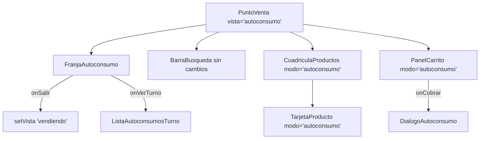

# Design Document: Modo autoconsumo distinto de la venta

## Overview

Ajuste solo de UI sobre la Vista_Autoconsumo de `PuntoVenta`. No hay cambios de base de datos, de API ni de la lógica del Carrito. La venta por producto queda igual porque todo lo nuevo depende de una prop opcional `modo` cuyo valor por defecto es `'venta'`.

| Capa | Archivos | Cambio |
|---|---|---|
| UI | `TarjetaProducto.tsx`, `CuadriculaProductos.tsx` | Prop `modo`: tarjeta ámbar sin precio |
| UI | `PanelCarrito.tsx` | Prop `modo`: panel y barra móvil ámbar, sin precios por línea, referencia pequeña "no se cobra" |
| UI | `FranjaAutoconsumo.tsx` (nuevo) | Franja "MODO AUTOCONSUMO · No es una venta" con dos botones |
| UI | `PuntoVenta.tsx` | Usa la franja, pasa `modo="autoconsumo"` y pinta la Zona_Productos en ámbar |

`/login`, `DialogoAutoconsumo`, `ListaAutoconsumosTurno`, `ResultadoCierre` y `src/lib/caja/*` no se tocan. La spec `recibo-cierre-turno` también modifica `PuntoVenta.tsx`; las tareas de esta spec se ejecutan después y solo cambian el bloque de autoconsumo (franja, `zonaProductos`, `section` y `panelDerecho`).

## Architecture



## Components and Interfaces

### Tipo compartido

```ts
// src/components/caja/TarjetaProducto.tsx
/** Lista a la que suma la cuadrícula: Pedido_Productos o Seleccion_Autoconsumo. */
export type ModoLista = 'venta' | 'autoconsumo';
```

### `TarjetaProducto`

```ts
interface TarjetaProductoProps {
  producto: ProductoCaja;
  cantidad?: number;
  onAgregar: (producto: ProductoCaja) => void;
  /** Por defecto 'venta' (sin cambios). */
  modo?: ModoLista;
}
```

| | `'venta'` (actual) | `'autoconsumo'` |
|---|---|---|
| Tarjeta | `border-lz-border bg-lz-surface`, hover `border-lz-sage-tint`, active `bg-lz-sage-light` | `border-2 border-lz-amber bg-lz-surface`, hover `border-lz-amber-warm`, active `bg-lz-amber-light`, foco `ring-lz-amber` |
| Fila inferior | precio `text-lz-sage-dark` + "+" `bg-lz-sage` | sin precio; "+" `bg-lz-amber text-lz-charcoal` alineado a la derecha |
| Insignia de cantidad | `bg-lz-amber text-lz-surface` | `bg-lz-charcoal text-lz-surface` (se distingue del borde ámbar) |
| `aria-label` | `Agregar {nombre}, {precio}[. En el carrito: N]` | `Agregar {nombre} al autoconsumo[. Seleccionados: N]` |

Nombre y foto (`ImagenProducto`) iguales en ambos modos.

### `CuadriculaProductos`

Agrega `modo?: ModoLista` y lo pasa a cada `TarjetaProducto`. El fondo lo pone `PuntoVenta`, así también cubre los estados de carga, vacío y error.

### `FranjaAutoconsumo` (nuevo)

```tsx
interface FranjaAutoconsumoProps {
  onSalir: () => void;
  onVerTurno: () => void;
}
```

- Contenedor: `flex flex-wrap items-center gap-2 rounded-2xl border-2 border-lz-amber-warm bg-lz-amber px-3 py-2`.
- Texto con `role="status"`: "MODO AUTOCONSUMO · No es una venta" en `font-lz-display text-lg font-extrabold text-lz-charcoal` (18 px, negrita). Texto oscuro porque el blanco sobre `lz-amber` no llega a 3:1.
- "Autoconsumos del turno": `min-h-[44px] min-w-[44px] rounded-xl border border-lz-charcoal/20 bg-lz-amber-light px-4 text-sm font-semibold text-lz-charcoal`.
- "Salir de autoconsumo": `min-h-[44px] min-w-[44px] rounded-xl bg-lz-charcoal px-4 text-sm font-bold text-lz-surface`.

### `PanelCarrito`

```ts
interface PanelCarritoProps {
  // ... props actuales sin cambios
  /** Por defecto 'venta' (sin cambios). */
  modo?: ModoLista;
}
```

Con `modo='autoconsumo'` los valores por defecto cambian a `titulo = 'Autoconsumo'` y `textoAccion = 'Registrar consumo'`; las props explícitas siguen mandando. Un objeto `TONO[modo]` reúne las clases:

| Parte | `'venta'` (actual) | `'autoconsumo'` |
|---|---|---|
| Contenedor escritorio / hoja móvil | `border-lz-border bg-lz-surface` | `border-lz-amber bg-lz-surface` |
| Encabezado y pie | `bg-lz-oat border-lz-border` | `bg-lz-amber-light border-lz-amber` |
| Línea | nombre + "$X c/u" + subtotal | solo nombre; sin "c/u" ni subtotal |
| Caja del pie | "Total" + artículos + total grande | "Artículos" + número grande `text-lz-charcoal`; debajo `text-xs text-lz-charcoal-muted` "Valor de referencia: $X · no se cobra" |
| Botón de acción | `bg-lz-sage-dark border-lz-sage-medium text-lz-surface` | `bg-lz-amber border-lz-amber-warm text-lz-charcoal hover:bg-lz-amber-warm` |
| Barra móvil contraída | `bg-lz-surface border-lz-border`, total grande + artículos, "Ver pedido" verde | `bg-lz-amber-light border-t-4 border-lz-amber`, "Autoconsumo" grande + artículos, "Ver autoconsumo" `text-lz-charcoal`; sin pesos |
| `aria-label` barra móvil | `Ver pedido: N artículos, total $X` | `Ver autoconsumo: N artículos` |
| Hover de "Contraer" y del botón de la barra | `hover:bg-lz-sage-light` | `hover:bg-lz-amber-light` / `hover:bg-lz-surface` |

Los controles de cantidad (−, campo, +, eliminar), "Vaciar" y su confirmación no cambian (≥ 44 px). La prop `nota` sigue funcionando, pero `PuntoVenta` deja de pasarla en autoconsumo porque la referencia ya va en el pie.

### `PuntoVenta`

- Reemplaza la franja actual ("Autoconsumo: toque los productos consumidos") por `<FranjaAutoconsumo onSalir={volverAVender} onVerTurno={abrirListaAutoconsumos} />`. `volverAVender` ya existe y la Seleccion_Autoconsumo vive en `PuntoVenta`, así que se conserva.
- `CuadriculaProductos` recibe `modo={enAutoconsumo ? 'autoconsumo' : 'venta'}`.
- La `section` de la izquierda agrega `bg-lz-amber-light` cuando `enAutoconsumo`.
- `PanelCarrito key="autoconsumo"` recibe `modo="autoconsumo"`, `textoVacio="Toca los productos consumidos."` y deja de recibir `titulo`, `textoAccion` y `nota`.

## Data Models

Sin cambios. `Carrito`, `LineaCarrito`, `totalCarrito` y `articulosCarrito` se usan como hoy; el Valor_Referencia es `totalCarrito(seleccion)`.

## Error Handling

Sin errores nuevos. Avisos de cantidad, `TURNO_CERRADO` y productos cambiados siguen igual. El botón "Registrar consumo" queda deshabilitado con la Seleccion_Autoconsumo vacía (comportamiento actual de `disabled={vacio}`).

## Correctness Properties

*A property is a characteristic or behavior that should hold true across all valid executions of a system-essentially, a formal statement about what the system should do. Properties serve as the bridge between human-readable specifications and machine-verifiable correctness guarantees.*

### Property 1: La tarjeta muestra precio solo en venta

*For any* producto (nombre no vacío, precio entero ≥ 0) y cantidad entre 0 y 999, la `TarjetaProducto` con `modo='autoconsumo'` no contiene `formatCurrency(precio)` en su texto visible ni en su `aria-label` y sí contiene el nombre; con `modo='venta'` o sin `modo` contiene `formatCurrency(precio)` y su `aria-label` es el actual.

**Validates: Requirements 2.3, 2.5**

### Property 2: Las líneas del Panel_Autoconsumo no tienen precios

*For any* Carrito no vacío (1 a 10 líneas, precios y cantidades válidas) en Modo_Escritorio, el `PanelCarrito` con `modo='autoconsumo'` no muestra ningún precio en sus líneas (`li`), muestra la cantidad de artículos y el texto "Valor de referencia: {formatCurrency(totalCarrito)} · no se cobra"; con `modo='venta'` cada línea muestra "{formatCurrency(precio)} c/u" y su subtotal, y el pie muestra el total.

**Validates: Requirements 3.2, 3.3, 5.1**

### Property 3: La barra móvil de autoconsumo no muestra pesos

*For any* Carrito (0 a 10 líneas) en Modo_Movil contraído, el `PanelCarrito` con `modo='autoconsumo'` muestra "Autoconsumo" y la cantidad de artículos, y ni su texto ni sus nombres accesibles contienen `formatCurrency(totalCarrito)`.

**Validates: Requirements 4.1**

## Testing Strategy

- **Propiedades** (fast-check, mínimo 100 corridas, `// @vitest-environment jsdom`, `@testing-library/react`, `cleanup` entre corridas): Properties 1 a 3. Etiqueta: `Feature: modo-autoconsumo, Property N: …`.
- **Ejemplos**: `FranjaAutoconsumo` muestra el texto y los dos botones, y llama `onSalir` / `onVerTurno`; `PanelCarrito` en autoconsumo muestra "Registrar consumo", deshabilitado con el Carrito vacío, y llama `onCobrar` con líneas; tocar la barra móvil llama `onExpandir(true)`.
- **Sin prueba automática**: colores exactos y uso de solo Clase_Lz (Req 5.2); se revisan en el código.
- Verificación final: `npx tsc --noEmit`, `npx next lint`, `npm run build`, `npm run test`.
