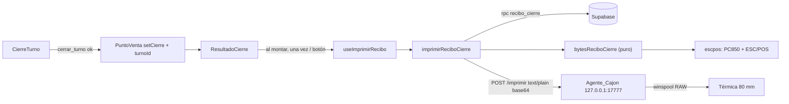

# Design Document: Recibo de cierre de turno (impresora térmica 80 mm)

## Overview

Al cerrar un turno se imprime un Recibo_Cierre en la térmica de 80 mm por el Agente_Cajon, y la Pantalla_Resultado permite reimprimirlo.

| Capa | Archivo | Cambio |
|---|---|---|
| SQL | `supabase/migration-recibo-cierre.sql` (nuevo) | RPC `recibo_cierre(p_turno UUID)` solo para turnos cerrados |
| API | `src/lib/api/recibo.ts` (nuevo), `src/lib/api/errores.ts` | `datosReciboCierre(turnoId)`; código `TURNO_NO_CERRADO` |
| Dominio puro | `src/lib/recibo/config.ts`, `texto.ts`, `escpos.ts`, `reciboCierre.ts` (nuevos) | Encabezado, formato de líneas, PC850, armado de bytes |
| Cliente del agente | `src/lib/cajon.ts` | `imprimirEnAgente(bytes)` con base64 en `text/plain` |
| Orquestación | `src/lib/recibo/imprimir.ts` (nuevo), `src/hooks/caja/useImprimirRecibo.ts` (nuevo) | Pedir datos → bytes → agente; estado de la impresión |
| UI | `ResultadoCierre.tsx`, `PuntoVenta.tsx` | Impresión automática una vez y botón "Imprimir recibo" |
| Agente | `herramientas/cajon/agente-cajon.ps1`, `LEEME.md` | Ruta `POST /imprimir` con lectura de cuerpo; documentación |
| Opcional | `src/components/reportes/SeccionTurnos.tsx` | Botón por turno cerrado |

**Decisión principal:** los bytes ESC/POS se arman en el cliente con un módulo puro (testeable con Vitest y fast-check). El agente solo valida el tamaño y el base64 y reenvía los bytes. Así el agente no conoce el formato del recibo y no hay que reinstalarlo para cambiar el diseño del recibo.

## Architecture



## Components and Interfaces

### 1. RPC `recibo_cierre` (`supabase/migration-recibo-cierre.sql`)

Encabezado con instrucciones: ejecutar después de `migration-ventas.sql`, `migration-caja-mayor.sql` y `migration-barra-acciones.sql`; idempotente; no borra ni cambia datos. Solo `CREATE OR REPLACE FUNCTION` y permisos.

```sql
-- recibo_cierre: datos del Recibo_Cierre de un Turno cerrado.
-- Turno inexistente → TURNO_NO_ABIERTO; Turno abierto → TURNO_NO_CERRADO
CREATE OR REPLACE FUNCTION recibo_cierre(p_turno UUID)
RETURNS jsonb LANGUAGE plpgsql STABLE SECURITY DEFINER
SET search_path = public, extensions AS $$ ... $$;

REVOKE ALL ON FUNCTION recibo_cierre(UUID) FROM PUBLIC;
GRANT EXECUTE ON FUNCTION recibo_cierre(UUID) TO anon, authenticated;
```

Forma de la respuesta:

```text
{ turno: { id, abierto_por, abierto_en, cerrado_por, cerrado_en, base,
           efectivo_esperado, efectivo_contado, diferencia, base_siguiente, enviado_mayor },
  ventas: { total, cantidad, efectivo, valor_total, anuladas_total, anuladas_cantidad,
            por_metodo: [{ nombre, es_efectivo, total, cantidad }] },
  gastos: { lista: [{ creado_en, categoria, concepto, valor, cajon, mayor }],
            total, cajon, mayor },
  retiros: { lista: [{ creado_en, valor }], total },
  productos: [{ nombre, cantidad, valor }],
  autoconsumo: { productos: [{ nombre, cantidad, valor }], total } }
```

Reglas de cálculo (reutilizan las de las migraciones anteriores):

- `turno.*`: columnas guardadas por `cerrar_turno` (`efectivo_esperado`, `efectivo_contado`, `diferencia`, `base_siguiente`, `enviado_mayor`). No se recalcula el esperado: el recibo muestra lo que quedó al cerrar. `base_siguiente` y `enviado_mayor` pueden ser nulos en turnos antiguos; el cliente los muestra como "—".
- `ventas.por_metodo`: mismo `GROUP BY metodo_pago_id, nombre, orden, es_efectivo` de `resumen_turno`, ordenado por `orden, nombre`. `ventas.efectivo` = suma de registradas con `es_efectivo` (igual que en `efectivo_esperado_turno`). `valor_total` = registradas con `tipo = 'valor'`.
- `gastos.lista`: gastos no eliminados del turno, `JOIN categorias_gasto` para el nombre, `mayor = COALESCE(sum(gasto_origenes.valor) WHERE parte_id IS NOT NULL, 0)`, `cajon = valor − mayor` (misma Parte_Cajon de `efectivo_esperado_turno`), ordenados por `creado_en, id`.
- `retiros`: `caja_mayor_movimientos` con `tipo = 'retiro'` del turno, ordenados por `creado_en`.
- `productos`: mismo agrupado de `reporte_rango` por `producto_id` (los nulos forman la fila de Venta_Por_Valor con nombre "Venta por valor"), filtrado por `turno_id` y `estado = 'registrada'`, ordenado por `valor DESC, nombre`.
- `autoconsumo.productos`: `autoconsumo_detalles` de autoconsumos no anulados del turno, agrupados por `producto_id` con `sum(cantidad)` y `sum(subtotal)`.

La RPC expone esperado y diferencia con la anon key, igual que hoy `reporte_rango`. No abre información nueva.

### 2. API (`src/lib/api/recibo.ts`)

```ts
export interface DatosRecibo {
  turno: {
    id: string; abiertoPor: string; abiertoEn: string; cerradoPor: string; cerradoEn: string;
    base: number; efectivoEsperado: number; efectivoContado: number; diferencia: number;
    baseSiguiente: number | null; enviadoMayor: number | null;
  };
  ventas: {
    total: number; cantidad: number; efectivo: number; valorTotal: number;
    anuladasTotal: number; anuladasCantidad: number;
    porMetodo: { nombre: string; esEfectivo: boolean; total: number; cantidad: number }[];
  };
  gastos: {
    lista: { creadoEn: string; categoria: string; concepto: string; valor: number; cajon: number; mayor: number }[];
    total: number; cajon: number; mayor: number;
  };
  retiros: { lista: { creadoEn: string; valor: number }[]; total: number };
  productos: { nombre: string; cantidad: number; valor: number }[];
  autoconsumo: { productos: { nombre: string; cantidad: number; valor: number }[]; total: number };
}

/** RPC recibo_cierre con llamarRpc; convierte snake_case y números (Number(...)). */
export function datosReciboCierre(turnoId: string): Promise<DatosRecibo>;
```

`errores.ts`: agregar `'TURNO_NO_CERRADO'` a `CodigoError` y a `CODIGOS_SQL`.

### 3. Dominio puro (`src/lib/recibo/`)

**`config.ts`** (textos fáciles de cambiar):

```ts
export const ENCABEZADO_RECIBO = {
  nombre: 'PANADERIA LIZPAN',
  linea2: 'Barrio Los Alcázares',
  titulo: 'Cierre de turno',
};
export const COLUMNAS = 48;           // fuente A en 80 mm
export const COLUMNAS_DOBLE = 24;     // doble ancho
export const MAX_BYTES_RECIBO = 49_152; // base64 = 65.536 = límite del agente
export const PAGINA_CODIGOS = 2;      // ESC t 2 = PC850
```

**`texto.ts`** (formato de líneas):

```ts
export type Estilo = 'normal' | 'negrita' | 'alto' | 'grande'; // grande = doble ancho y alto + negrita
export type Alineacion = 'izquierda' | 'centro';
export interface LineaRecibo { texto: string; estilo: Estilo; alineacion: Alineacion }

export function anchoDe(estilo: Estilo): number;            // 24 si 'grande', si no 48
/** "$ 12.345", "-$ 5.000"; separador de miles '.', sin NBSP ni decimales. */
export function dineroRecibo(n: number): string;
/** "+$ 2.000" | "-$ 2.000" | "$ 0". */
export function textoDiferencia(n: number): string;
/** Izquierda recortada con "..." para que izquierda + ' ' + derecha quepa en `ancho`; derecha completa. */
export function fila(izquierda: string, derecha: string, ancho?: number): string;
/** Recorta a `ancho` (centrado lo hace la impresora con ESC a 1). */
export function recortar(texto: string, ancho: number): string;
export function separador(caracter?: '-' | '='): string;    // 48 caracteres
```

**`escpos.ts`** (bytes):

```ts
/** Byte PC850 de un carácter; fuera de la tabla: letra sin tilde (NFD) o '?' (0x3F). */
export function codificarPC850(texto: string): Uint8Array;
/** Inverso para pruebas: bytes 0x20-0xFF → texto. */
export function decodificarPC850(bytes: Uint8Array): string;

export const CMD = {
  iniciar: [0x1b, 0x40],               // ESC @
  pagina: (n: number) => [0x1b, 0x74, n], // ESC t n
  alinear: (a: Alineacion) => [0x1b, 0x61, a === 'centro' ? 1 : 0],
  estilo: (e: Estilo) => [0x1b, 0x21, { normal: 0x00, negrita: 0x08, alto: 0x18, grande: 0x38 }[e]],
  avanzar: (n: number) => [0x1b, 0x64, n], // ESC d n
  cortar: [0x1d, 0x56, 0x42, 0x00],     // GS V 66 0
};

/** ESC @, ESC t 2, por línea: [ESC a][ESC !] texto LF [ESC ! 0 si tuvo estilo]; ESC d 4; GS V 66 0. */
export function armarBytes(lineas: LineaRecibo[]): Uint8Array;
```

La tabla PC850 cubre al menos `á é í ó ú Á É Í Ó Ú ñ Ñ ü Ü ¿ ¡ °`. El carácter `…` no existe en PC850, por eso `fila`, `recortar` y la línea de recorte usan `...` en ASCII. El texto se normaliza a NFC antes de codificar.

**`reciboCierre.ts`**:

```ts
/** Lineas_Recibo en orden: encabezado, datos del turno, VENTAS, GASTOS/PEDIDOS, DINERO, PRODUCTOS, AUTOCONSUMO (si hay). */
export function lineasReciboCierre(datos: DatosRecibo, ahora: Date, limites?: { gastos: number; productos: number }): LineaRecibo[];
/** lineasReciboCierre + armarBytes; si supera MAX_BYTES_RECIBO baja los límites a la mitad hasta caber. */
export function bytesReciboCierre(datos: DatosRecibo, ahora: Date): Uint8Array;
```

Esquema del recibo (48 columnas):

```text
        PANADERIA LIZPAN          (grande, centro)
      Barrio Los Alcázares        (centro)
        Cierre de turno           (negrita, centro)
================================================
Fecha: 2025-01-15
Abrió: Ana                             6:02 am
Cerró: Ana                             2:10 pm
Impreso:                    2025-01-15 2:11 pm
------------------------------------------------
VENTAS                            (alto)
Ventas registradas (42)               $ 512.000
  Efectivo (30)                       $ 380.000
  Nequi (12)                          $ 132.000
Ventas por valor                       $ 45.000
Anuladas (2)                            $ 8.000
------------------------------------------------
GASTOS/PEDIDOS                    (alto)
Harina                                 $ 60.000
Gas (Caja mayor)                       $ 40.000
Total gastos                          $ 100.000
  Del cajón                            $ 60.000
  De caja mayor                        $ 40.000
------------------------------------------------
DINERO                            (alto)
Base inicial / Ventas en efectivo / Gastos del cajón /
Retiros / Efectivo esperado / Efectivo contado /
Diferencia (+/-) / Base dejada / Enviado a caja mayor
------------------------------------------------
PRODUCTOS                         (alto)
12 Pan francés                         $ 24.000
 3 Venta por valor                     $ 45.000
Total                                 $ 512.000
------------------------------------------------
AUTOCONSUMO (si hay)  Valor de referencia, no es dinero
```

- Apertura: `hora12(abiertoEn)` si `diaLocal(abiertoEn) === diaLocal(cerradoEn)`, si no `fechaHora12(abiertoEn)`.
- Fila de gasto: concepto (si está vacío, la categoría); sufijo " (Caja mayor)" si `cajon === 0`.
- Diferencia en negrita con `textoDiferencia`.
- Sección vacía: "Sin movimientos".
- Recorte: si una lista supera su límite, se muestran las primeras N y la línea "... y K más".

### 4. Cliente del agente (`src/lib/cajon.ts`)

```ts
export type ResultadoImpresion =
  | { ok: true }
  | { ok: false; motivo: 'sin_agente' }
  | { ok: false; motivo: 'error'; mensaje: string };

/** aBase64(bytes) con btoa sobre bloques de 8 KB (evita el límite de argumentos). Pura. */
export function aBase64(bytes: Uint8Array): string;

/**
 * POST /imprimir con body string → Content-Type text/plain;charset=UTF-8 (petición simple,
 * sin preflight, como /abrir). Timeout 5000 ms. Excepción o sin respuesta → sin_agente;
 * respuesta con ok:false → error con d.error.
 */
export async function imprimirEnAgente(bytes: Uint8Array): Promise<ResultadoImpresion>;
```

`abrirCajonSinPapel` no cambia.

### 5. Orquestación

`src/lib/recibo/imprimir.ts`:

```ts
export type ResultadoRecibo = ResultadoImpresion | { ok: false; motivo: 'sin_datos' };
export async function imprimirReciboCierre(turnoId: string, ahora = new Date()): Promise<ResultadoRecibo>;
/** Texto para la Pantalla_Resultado o el toast (Req 5.5-5.8). Pura. */
export function mensajeImpresion(r: ResultadoRecibo): string;
```

`src/hooks/caja/useImprimirRecibo.ts`:

```ts
export function useImprimirRecibo(turnoId: string, automatico: boolean): {
  estado: 'inactivo' | 'imprimiendo' | 'listo' | 'fallo';
  mensaje: string | null;
  imprimir: () => void; // ignora toques mientras imprime (ref enProceso)
};
```

La impresión automática usa una ref `yaImpreso` para correr una sola vez aunque React 18 monte dos veces en modo estricto.

### 6. UI

- `PuntoVenta`: guarda `{ cierre, turnoId }` (el `turno.id` que se cerró) y pasa `turnoId` a `ResultadoCierre`. `ya_cerrado` no cambia (no imprime).
- `ResultadoCierre` recibe `turnoId`; usa `useImprimirRecibo(turnoId, true)`. Debajo de los datos: `p role="status"` con "Imprimiendo recibo…", "Recibo impreso" (`text-lz-sage-dark`) o el mensaje de fallo (`text-lz-danger`). Botón secundario "Imprimir recibo" `min-h-[56px]` con borde `border-lz-border`, deshabilitado mientras imprime, encima de "Continuar". "Continuar" sigue con foco inicial.
- Opcional, `SeccionTurnos`: columna de acción en turnos cerrados con botón "Imprimir recibo" (`min-h-[44px]`) que llama `imprimirReciboCierre` y muestra `mensajeImpresion` con `showToast`. Requiere que la tabla de turnos tenga el `id`; si `TablaReporte` no lo permite, se pinta una lista de botones aparte bajo la tabla con la fecha y quién cerró.

### 7. Agente: `POST /imprimir`

Cambios en `agente-cajon.ps1`:

1. `ImpresoraRaw.Enviar(impresora, datos, documento)`; la sobrecarga de dos parámetros usa "Abrir cajon".
2. Lectura: se conserva el bucle de encabezados (8 KB). Se calcula `$fin = $texto.IndexOf("\r\n\r\n")` y los encabezados se parsean solo con `$texto.Substring(0, $fin)` para que el cuerpo no se confunda con encabezados.
3. Las validaciones de Host y origen siguen antes de cualquier ruta.
4. Nueva función `LeerCuerpo($flujo, $buf, $total, $fin, $largo)`: copia los bytes que ya llegaron después de `$fin + 4` y lee el resto hasta `$largo` con el `ReceiveTimeout` de 2000 ms; devuelve `$null` si llega incompleto o hay timeout.
5. Ruta:

```powershell
if ($metodo -eq 'POST' -and $ruta -eq '/imprimir') {
  $cl = [string]$cabeceras['content-length']
  if ($cl -notmatch '^\d{1,7}$') { Responder ... '411 Length Required' '{"ok":false,"error":"Falta Content-Length"}'; return }
  $largo = [int]$cl
  if ($largo -gt 65536) { Responder ... '413 Payload Too Large' '{"ok":false,"error":"Recibo muy grande"}'; return }
  $cuerpo = LeerCuerpo ...
  try { $datos = [Convert]::FromBase64String([Text.Encoding]::ASCII.GetString($cuerpo).Trim()) } catch { $datos = $null }
  if (-not $datos -or $datos.Length -eq 0) { Responder ... '400 Bad Request' '{"ok":false,"error":"Recibo inválido"}'; return }
  $imp = ImpresoraActual
  $fallo = if ($imp) { [ImpresoraRaw]::Enviar($imp, $datos, 'Recibo cierre') } else { 'No hay impresora predeterminada' }
  # 500 con error y Anotar, o 200 {"ok":true} y Anotar "Recibo impreso ($imp, N bytes) desde $origen"
}
```

6. Se actualizan los comentarios de seguridad: "Lo único que puede hacer es abrir el cajón, imprimir lo que mande la app de un origen permitido o decir si está vivo".

**Reinstalar/actualizar el agente:** `instalar.ps1` ya detiene el agente en ejecución, copia `agente-cajon.ps1` a `%LOCALAPPDATA%\POS-Cajon`, conserva los orígenes anteriores y lo reinicia. Para actualizar basta con copiar la carpeta `herramientas/cajon` nueva al equipo y ejecutar `instalar.cmd`. `LEEME.md` agrega la sección "Imprimir el recibo de cierre" y "Actualizar el agente", y en "Para desarrolladores" documenta `POST /imprimir` (cuerpo base64 en `text/plain`, máx. 65.536, respuestas 400/411/413/500). La versión nueva es compatible con el POS que comparte el agente.

## Data Models

Sin tablas ni columnas nuevas. Solo la función `recibo_cierre`. `DatosRecibo` (sección 2) y `LineaRecibo` (sección 3) son tipos del cliente.

## Correctness Properties

*A property is a characteristic or behavior that should hold true across all valid executions of a system-essentially, a formal statement about what the system should do. Properties serve as the bridge between human-readable specifications and machine-verifiable correctness guarantees.*

### Property 1: Formato de dinero y diferencia

*For any* entero `n` entre −99.999.999 y 99.999.999, `dineroRecibo(n)` cumple el patrón `^-?\$ \d{1,3}(\.\d{3})*$`, quitar `$`, espacios y puntos devuelve `n`, y `textoDiferencia(n)` empieza con "+" si `n > 0`, con "-" si `n < 0` y es "$ 0" si `n = 0`.

**Validates: Requirements 2.7, 2.11**

### Property 2: Ancho de línea

*For any* Datos_Recibo con nombres, conceptos y personas arbitrarios (incluidos textos muy largos, tildes y emojis), cada Linea_Recibo de `lineasReciboCierre` tiene longitud ≤ `anchoDe(estilo)`, y para cada fila de dinero el texto termina con el `dineroRecibo` completo del valor.

**Validates: Requirements 2.12**

### Property 3: Contenido y cifras del recibo

*For any* Datos_Recibo dentro de los límites de recorte, las tres primeras Lineas_Recibo son el encabezado de `ENCABEZADO_RECIBO` centrado con los estilos `grande`, `normal` y `negrita`; las secciones aparecen en el orden VENTAS, GASTOS/PEDIDOS, DINERO, PRODUCTOS y AUTOCONSUMO (esta última solo si hay autoconsumos); cada sección tiene una fila por elemento de su lista o "Sin movimientos" si está vacía; y los totales de ventas, gastos, Gasto_Cajon, Gasto_Mayor, retiros, esperado, contado y productos aparecen con `dineroRecibo` de su valor.

**Validates: Requirements 2.1, 2.4, 2.5, 2.6, 2.8, 2.9, 2.10**

### Property 4: Fechas y horas del turno

*For any* par apertura ≤ cierre y hora de impresión, la línea "Fecha" contiene `diaLocal(cierre)`, la línea "Cerró" contiene `hora12(cierre)`, y la línea "Abrió" contiene `fechaHora12(apertura)` si `diaLocal(apertura) ≠ diaLocal(cierre)` y `hora12(apertura)` si no.

**Validates: Requirements 2.2, 2.3**

### Property 5: Codificación PC850

*For any* texto formado por caracteres de la tabla PC850, `decodificarPC850(codificarPC850(t)) = t`; *for any* texto arbitrario, `codificarPC850` produce un byte por carácter (tras NFC) y ningún byte menor que 0x20.

**Validates: Requirements 3.2**

### Property 6: Estructura de los bytes

*For any* lista de Lineas_Recibo, `armarBytes` empieza con `1B 40 1B 74 02`, termina con `1B 64 04 1D 56 42 00`, y cada línea con estilo distinto de `normal` va seguida de `1B 21 00` después de su salto de línea.

**Validates: Requirements 3.1, 3.3, 3.4**

### Property 7: Tamaño máximo y recorte

*For any* Datos_Recibo, incluidas listas de gastos y productos de hasta 5.000 elementos, `bytesReciboCierre` produce como máximo 49.152 bytes, y cuando una lista se recorta su sección termina con "... y K más" donde K es el número de elementos omitidos.

**Validates: Requirements 3.5, 3.6**

### Property 8: Base64 del cuerpo

*For any* arreglo de bytes de hasta 49.152 elementos, `aBase64(bytes)` es igual a `Buffer.from(bytes).toString('base64')` y su longitud es ≤ 65.536.

**Validates: Requirements 4.1**

## Error Handling

| Caso | Respuesta |
|---|---|
| `recibo_cierre` con turno inexistente | `TURNO_NO_ABIERTO` → `sin_datos` |
| `recibo_cierre` con turno abierto | `TURNO_NO_CERRADO` → `sin_datos` |
| Sin conexión al leer datos | `sin_datos`: "No se pudieron leer los datos del recibo. El turno sí quedó cerrado." |
| Agente no instalado, apagado o timeout 5 s | `sin_agente`: "No se pudo imprimir: el agente de la impresora no responde. El turno sí quedó cerrado." |
| Agente 400/411/413/500 | `error`: "No se pudo imprimir: {error}. El turno sí quedó cerrado." |
| Recibo más grande que el límite | Recorte en el cliente antes de enviar (Property 7) |
| Doble toque en "Imprimir recibo" | Ignorado mientras `imprimiendo` |
| Modo estricto monta dos veces | Ref `yaImpreso`: una sola impresión automática |

En todos los casos el turno ya está cerrado y la Pantalla_Resultado conserva sus datos.

## Testing Strategy

- **Propiedades** (Vitest + fast-check, mínimo 100 corridas, etiqueta `Feature: recibo-cierre-turno, Property N: ...`):
  - Property 1 en `src/lib/recibo/texto.test.ts`.
  - Properties 2, 3, 4 y 7 en `src/lib/recibo/reciboCierre.test.ts`.
  - Properties 5 y 6 en `src/lib/recibo/escpos.test.ts`.
  - Property 8 en `src/lib/cajon.test.ts`.
- **Ejemplos:**
  - `src/lib/recibo/imprimir.test.ts` con `datosReciboCierre` y `fetch` simulados: éxito, `sin_datos`, `sin_agente`, `error` y sus mensajes.
  - `src/components/caja/ResultadoCierre.test.tsx` (`// @vitest-environment jsdom`): imprime una vez al montar, "Imprimir recibo" reimprime, botón deshabilitado mientras imprime.
- **SQL:** se valida en PGlite instalado temporalmente en `%TEMP%` (como en specs anteriores): cargar las migraciones previas y la nueva dos veces; turno abierto → `TURNO_NO_CERRADO`; turno inexistente → `TURNO_NO_ABIERTO`; turno cerrado con ventas por producto y por valor, una anulada, gastos de cajón, mixtos y de caja mayor, un retiro y un autoconsumo → cifras esperadas y `efectivo_esperado` igual al guardado.
- **Agente:** prueba manual con `Invoke-WebRequest` (origen y Host válidos): `/estado` y `/abrir` igual que antes; `/imprimir` con base64 válido imprime; sin `Content-Length` → 411; 70.000 bytes → 413; texto no base64 → 400.
- **Verificación final:** `npx tsc --noEmit`, `npx next lint`, `npm run build`, `npm run test`.
